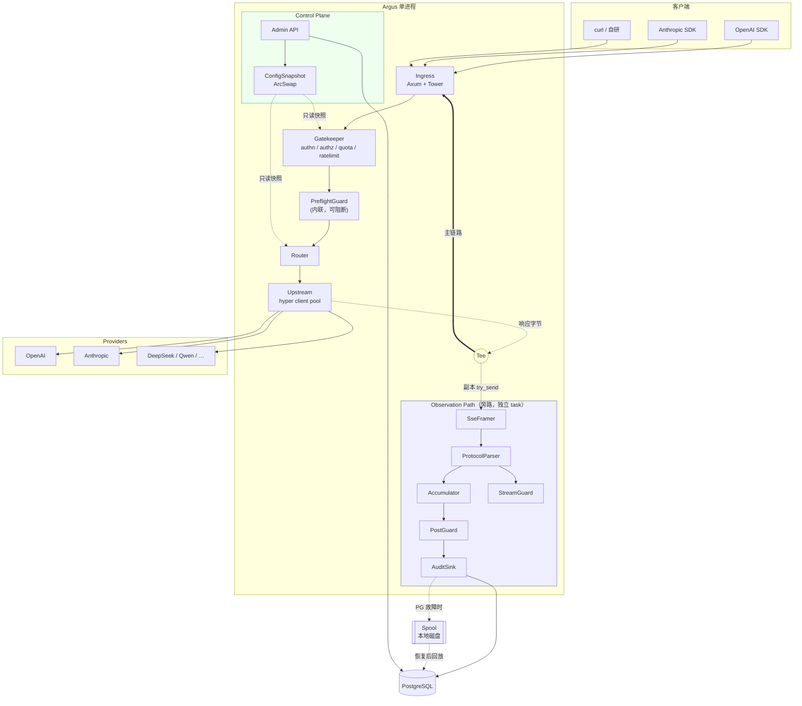

# 00 · Argus 总览

> 状态：Draft v1 · 最后更新 2026-08-19
> 本文是全套设计文档的入口。所有其他文档中的术语以本文第 6 节《术语表》为准。

---

## 1. Problem

现状下，一个组织同时使用多家 AI API 时会遇到四类问题：

1. **访问入口分散**：OpenAI、Anthropic、DeepSeek、Bedrock、Vertex 各有 host、鉴权方式、配额与计费。客户端代码里散落着 base_url 和 key。
2. **没有统一的可观测性**：谁在什么时候用了哪个模型、烧了多少 token、调用了什么工具、产生了什么输出——这些信息分散在各家 dashboard，且颗粒度不足（没有 prompt 内容、没有 tool call 追踪）。
3. **没有安全边界**：AI API 的输入输出是自然语言与工具调用。prompt injection、凭据泄漏、危险 shell 命令、tool abuse 都发生在 HTTP body 里，传统 WAF 与 API 网关完全看不见。
4. **既有网关抹平了协议差异**：市面上多数 AI 网关把一切请求转成"统一格式"再转出去。这会丢失 provider 独有能力（Anthropic 的 `thinking`、OpenAI Responses 的 `output_item`、各家的实验性字段），并在 provider 更新 API 时立刻失效。

Argus 要解决的是前三个问题，同时**明确拒绝**第四种做法。

---

## 2. What Argus Is

Argus 是一个 **AI API 聚合与安全网关**。

它的一句话定位：

> **统一 Provider 管理与访问入口，但完整保留各 AI API 协议自身的语义与能力差异。**

客户端通过同一个 host 访问不同协议的 endpoint：

```text
https://argus.example.com/v1/chat/completions   → OpenAI Chat Completions 协议
https://argus.example.com/v1/responses          → OpenAI Responses 协议
https://argus.example.com/v1/messages           → Anthropic Messages 协议
```

Argus 根据 **endpoint（决定协议）+ 请求中的 model（决定路由）+ 配置（决定 provider）**，把请求透明转发到对应供应商，同时旁路完成观测、审计与安全分析。

第一阶段的产品形态可以概括为：

> **Transparent Proxy + Protocol-aware Observation**

---

## 3. Goals

| # | 目标 | 可验收标准 |
|---|------|-----------|
| G1 | 透明代理正确性 | 官方 SDK（Python/TS）直连 provider 与经由 Argus，行为与产出逐字节等价（除受控注入的 header） |
| G2 | 协议前向兼容 | provider 新增未知字段/未知 SSE event 时，Argus 不报错、不丢弃、原样透传 |
| G3 | 低额外延迟 | proxy-added TTFT p95 ≤ 5 ms（复用连接，不含上游 RTT）；见 `docs/11-observability.md` SLO |
| G4 | 观测不影响代理 | 观测链路（parser / accumulator / DB / 安全）任意组件故障或阻塞时，代理主链路吞吐与延迟不受影响 |
| G5 | 依赖最小 | `Argus 二进制 + PostgreSQL` 即可完整运行；Redis / OTel / 对象存储均为可选增强 |
| G6 | 可在小机器运行 | 4C8G 上稳定承载 10,000 并发 SSE 连接 |
| G7 | 有意义的安全能力 | 覆盖 request-time / stream-time / post-response 三个时机，且策略可选 fail-open 或 fail-close |
| G8 | 无信息不可逆丢失 | 任何被观测的交互都可还原出 raw request、raw response event 序列与结构化结果 |

---

## 4. Non-goals（第一阶段明确不做）

| # | 不做的事 | 原因 |
|---|---------|------|
| N1 | 跨协议转换（Anthropic client → OpenAI provider） | 语义不等价，转换必然有损；等有明确需求时作为独立 compatibility layer 增量引入，见 `docs/04-protocols.md` §7 |
| N2 | 统一的"通用 AI 请求格式" | 与 N1 同源。Observation IR 只用于观测，**不用于重建上游请求** |
| N3 | 语义缓存 / 响应缓存 | 正确性风险高，且与安全审计目标冲突；不在 MVP |
| N4 | 自建向量库、RAG、Agent 编排 | 不是网关的职责 |
| N5 | 微服务拆分、Kafka / NATS / Service Mesh / Event Sourcing / CQRS | 见 `docs/01-architecture.md` §8，第一版是 Modular Monolith |
| N6 | 训练数据导出、模型微调管线 | 超出范围 |
| N7 | 多区域 active-active、跨机房一致性 | 第一阶段单区域多实例即可 |
| N8 | 计费出账（invoice/发票） | 只做 usage 与 cost 计量，不做出账 |
| N9 | Gemini / Bedrock 原生协议 | 架构预留（`Protocol` 枚举已含位），实现排在 OpenAI + Anthropic 之后 |

---

## 5. Constraints

**技术栈**：Rust（edition 2024，MSRV 1.90）、Tokio、Hyper 1.x、Axum 0.8、Tower、Serde、sqlx + PostgreSQL 15+。

**部署形态**：单静态二进制；Docker 单容器；K8s/K3s Deployment；家用 NAS / 小 VM。

**目标硬件基线**：4C8G。所有默认配置必须在此规格下安全运行。

**不可默认依赖**：Redis、Kafka、Elasticsearch、ClickHouse、任何 JVM 组件。均可作为可选增强，缺席时系统必须以降级模式正常工作。

**性能取向**：低内存、大量 SSE 长连接、稳定延迟、低 TTFT 增量、低拷贝、低 allocation。

---

## 6. 术语表（全套文档统一）

以下名称在所有文档中**唯一且固定**。不得用同义词替代。

### 6.1 平面与进程

| 术语 | 含义 |
|------|------|
| **Data Plane** | 处理实际 AI 流量的路径：ingress → auth → route → upstream → 转发 |
| **Control Plane** | 管理面：Provider/模型/用户/Key/策略的 CRUD、统计查询、Dashboard API |
| **Observation Path** | 旁路观测路径，从 Tee 出发，含 Parser、Accumulator、Security、Sink |

### 6.2 Data Plane 组件

> 「归属」列给出 **MVP 的 5-crate 结构**（见 `14-rust-project-structure.md` §5）中的位置。`::` 表示 crate 内的模块，不是独立 crate。

| 术语 | 含义 | 归属 |
|------|------|-----------|
| **Ingress** | Axum HTTP 入口层，含 TLS 终止对接、路由表、请求体准入 | `argus-proxy::ingress` |
| **Gatekeeper** | 认证 + 授权 + 配额 + 限流的组合层（Tower Layer 栈） | `argus-proxy::auth` + `::quota` |
| **Router** | 由 `(Protocol, logical_model, 策略)` 产出 `RouteDecision` 的选路器 | `argus-proxy::router` |
| **Upstream** | 面向 provider 的 HTTP 客户端与连接池，负责 header 变换与发起请求 | `argus-proxy::upstream` |
| **Tee** | 挂在 request/response body 上的分流器（`TeeBody`），把字节副本旁路送出 | `argus-proxy::tee` |
| **PreflightGuard** | 请求时安全检查，**内联**，可阻断 | `argus-proxy::security` |

### 6.3 Observation Path 组件

| 术语 | 含义 | 归属 |
|------|------|-----------|
| **Observer** | Observation Path 的宿主 task，一个 interaction 一个 | `argus-proxy::observer` |
| **SseFramer** | 字节流 → SSE frame 的切分器（不理解语义） | `argus-protocol::framer` |
| **ProtocolParser** | SSE frame / JSON body → `ObservedEvent` 的协议解析器 | `argus-protocol::parser` |
| **Accumulator** | `ObservedEvent` 序列 → `ObservedInteraction` 的累积器 | `argus-protocol::accumulator` |
| **ToolGate** | 扣留 `tool_use` block 至其结束、检查后放行或丢弃的闸门 | `argus-proxy::gate` + `::security` |
| **StreamGuard** | 流式安全检查，默认旁路；驱动 ToolGate 的判定 | `argus-proxy::security` |
| **PostGuard** | 响应结束后的安全检查，**永远旁路**，不可阻断 | `argus-proxy::security` |
| **AuditSink** | 批量落库器，把 `ObservedInteraction` 写入 PostgreSQL | `argus-storage::sink` |
| **Spool** | 本地磁盘 append-only 缓冲，PostgreSQL 不可用时的降级目的地 | `argus-storage::spool` |

### 6.4 核心数据类型

| 类型 | 含义 | 定义处 |
|------|------|--------|
| `Protocol` | 线上协议：`OpenAiChat` / `OpenAiResponses` / `AnthropicMessages` / `GeminiGenerateContent`(预留) | `argus-core` |
| `ProviderKind` | 供应商类型：`OpenAi` / `Anthropic` / `AzureOpenAi` / `Bedrock` / `Vertex` / `OpenAiCompatible` / … | `argus-core` |
| `RouteDecision` | 选路结果：endpoint、credential、provider model、超时、重试策略 | `argus-core` |
| `ObservedEvent` | 观测事件（Observation IR 的元素） | `argus-protocol` |
| `ObservedInteraction` | 一次完整交互的观测结果 | `argus-protocol` |
| `ObservedInteraction` | 一次完整交互的观测结果 | `argus-protocol` |
| `InteractionSink` | Data Plane → 存储的解耦 trait（`try_submit`，非阻塞） | `argus-protocol` |
| `SecurityVerdict` | 安全判定，含 `SecurityAction` | `argus-proxy::security` |
| `SecurityAction` | `Allow` / `Flag` / `Warn` / `Block` / `RequireReview` | `argus-proxy::security` |
| `TraceContext` | `{ trace_id, request_id, conversation_id }` | `argus-core` |

### 6.5 明确的命名禁令

为避免文档漂移，以下同义词**禁止使用**：

- ❌ Analyzer / Inspector / Monitor / Interceptor → 一律用 **Observer**
- ❌ Adapter / Translator / Converter（在协议语境下）→ 一律用 **ProtocolParser**
- ❌ Backend / Upstream Provider / Vendor → 一律用 **Provider**
- ❌ Collector / Writer / Persister → 一律用 **AuditSink**

---

## 7. 系统全景



**三条必须记住的边**：

1. `TEE ==> Ingress` 是**主链路**，同步、不可阻塞、不做任何解析。
2. `TEE -.-> SseFramer` 是**旁路**，用 `try_send`（非阻塞），满了就丢。
3. `AuditSink → PostgreSQL` 失败时走 `Spool`，**绝不回压主链路**。

---

## 8. 请求生命周期（一句话版）

```text
① 收到请求，从 URL path 确定 Protocol
② Gatekeeper：验 API Key（内存 cache）→ 授权 → 配额 → 限流
③ 读取并 buffer 请求体（有上限），PreflightGuard 检查（可阻断）
④ Router：logical model → provider model + endpoint + credential
⑤ Upstream：改写 header，发起上游请求；请求体已在内存，直接复用
⑥ 收到上游 response header：
     - 非 2xx 且未向 client 写出 → 允许 fallback/retry（S2）
     - 2xx → 立刻把 header 写给 client（TTFT 在此刻确定）
⑦ Body 转发：TeeBody 逐 frame 透传给 client，同时 try_send 副本给 Observer
⑧ 流结束/中断 → Accumulator 收尾 → PostGuard → AuditSink 批量落库
```

完整时序见 `docs/02-data-plane.md` §4。

---

## 9. 核心优先级

当设计出现冲突时，按此顺序取舍：

```text
Correctness > Compatibility > Reliability > Observability > Security > Performance > Feature Count
```

注意 **Security 排在 Observability 之后**：这不是说安全不重要，而是说**安全能力的失效不得损害网关可用性**。一个因为安全模块阻塞而挂掉的网关，其净安全价值是负的。详见 `docs/ADR/ADR-006-fail-open-security.md`。

---

## 10. 文档地图

| 文档 | 回答什么 |
|------|---------|
| `01-architecture.md` | 模块划分、依赖方向、进程模型、配置分发 |
| `02-data-plane.md` | 代理主链路的每一步、Tee 机制、取消传播 |
| `03-control-plane.md` | 管理面 API、配置快照、与 Data Plane 的隔离 |
| `04-protocols.md` | 三种协议的线上格式、header 处理、endpoint 映射 |
| `05-streaming.md` | SSE 边转发边解析、背压、slow client/observer、零拷贝 |
| `06-observation-model.md` | Observation IR 定义、跨协议映射表、Accumulator 算法 |
| `07-provider-routing.md` | Provider 配置模型、fallback、熔断、retry 状态机 |
| `08-security.md` | 规则引擎、三个检测时机、工具调用闸门、已输出后的处置 |
| `09-auth.md` | User/Workspace/API Key/RBAC/Quota 模型 |
| `10-storage.md` | PostgreSQL Schema、批量写入、分区、脱敏、清理 |
| `11-observability.md` | metrics/log/trace、OTel 可选化、性能 SLO |
| `12-reliability.md` | 优雅停机、熔断、隔板、限流、资源模型与容量估算 |
| `13-deployment.md` | 单机 / Docker / K8s、配置文件、升级 |
| `14-rust-project-structure.md` | MVP 与长期 crate 结构、依赖清单 |
| `15-testing-strategy.md` | Golden test、chunk 边界 fuzz、SDK 作为 oracle |
| `16-mvp-roadmap.md` | 分期范围、任务拆解、风险 |
| `ADR/*` | 关键决策的完整论证与备选方案 |
