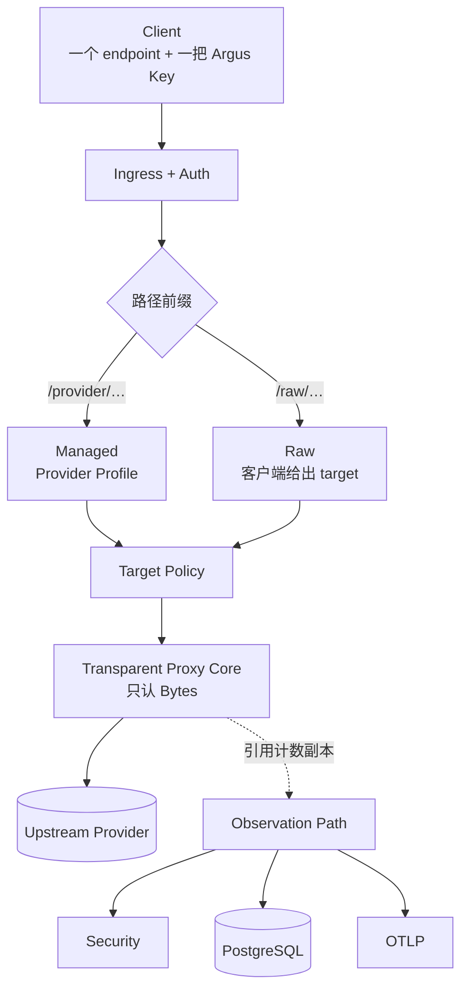

# 00 · 总览

> 状态：Draft v2 · 最后更新 2026-08-20
> 本文是全套文档的入口。**§6 术语表是所有文档的唯一命名依据。**

---

## 1. Problem

一个团队接入多个 AI 供应商时，实际发生的是：

```text
每个供应商一个 base_url        每个供应商一把 key
每个供应商一套认证 header      每个客户端各自配置一遍
key 散落在各处环境变量里        没人知道谁调了什么
出了事查不到                    安全策略无处安放
```

已有的"AI 网关"多数选择再造一层统一协议来解决它。代价是：网关必须理解每一个
供应商的每一个字段，供应商一改，网关就滞后；用户用不了新参数，只能等发版。

Argus 的判断是：**要统一的是供应商管理，不是 API 语义。**

---

## 2. 定位

> **AI Provider Gateway + Protocol-Aware Transparent Proxy + Security Observer**

```text
统一管理大量 AI Provider          透明代理未知或尚未纳管的 AI API
统一管理 Base URL                 观察请求与响应
统一管理 Credential               观察 Streaming 与 Tool Call
统一入口访问不同 Provider          执行 AI 安全检测
减少客户端配置复杂度               提供审计与标准化 Telemetry
```

## 3. Non-goals（明确不做）

```text
OpenAI SDK Wrapper        模型 Marketplace
Anthropic SDK Wrapper     自动模型选择器
统一万能 AI 协议           强制协议转换层
```

具体地：

- **不做 model → provider 的自动选路**（`02-routing-model.md` §4）
- **不维护模型目录**，provider 上新模型不需要 Argus 改动
- **不改写 request body**，包括 `model` 字段
- **不在 Proxy Core 里使用任何 provider SDK**

---

## 4. 一句话架构

```text
客户端在 URL 里说明要去哪，Argus 原样转发字节，
同时把字节的引用计数副本交给旁路做观测与安全，
旁路出任何问题都不影响转发。
```



---

## 5. 两种访问模式

| | Managed Provider Mode | Raw Transparent Proxy Mode |
|---|---|---|
| URL | `/provider/{profileName}/{path}` | `/raw/{targetUrl}` |
| 上游地址来自 | Provider Profile 的 `base_url` | 客户端 |
| 凭据 | Argus 注入 | 通常客户端透传 |
| 定位 | **主路径**，SDK 兼容性以它为准 | **Escape hatch**，高级模式 |
| 默认 | 开启 | 关闭（API Key 上的显式权限） |
| 详见 | `03-managed-provider-mode.md` | `04-raw-proxy-mode.md` |

两者解析后产出同一个 `ResolvedTarget`，之后走**完全相同**的代理核心。

---

## 6. 术语表（全套文档统一）

以下名称在所有文档中**唯一且固定**。不得用同义词替代。

### 6.1 平面

| 术语 | 含义 |
|------|------|
| **Data Plane** | 处理实际 AI 流量的路径：认证 → 解析 target → Target Policy → 转发 |
| **Control Plane** | 管理面：Provider Profile / Credential / Policy / User / Key 的 CRUD、审计查询、Dashboard |
| **Observation Path** | 旁路观测路径，从 Tee 出发，含 Framer、Observer、Accumulator、Security、AuditSink |

### 6.2 路由与目标

| 术语 | 含义 | 归属 |
|------|------|------|
| **Provider Profile** | 一个具名的上游接入点：base_url + credential + policy + observer。**路由的单位** | `argus-core::provider` |
| **Provider Type** | 供应商类别（`openai` / `anthropic` / …）。**仅用于 UI 模板与默认值，Data Plane 不得据此分支** | `argus-core::provider` |
| **Target Resolver** | 从 URL 解析出上游地址的组件（Managed 与 Raw 各一个实现） | `argus-proxy::ingress` |
| **ResolvedTarget** | 解析结果：完整 URI + 凭据模式 + observer 选择 + 超时 + 策略 | `argus-core::target` |
| **Target Policy** | 决定「这个上游地址允许不允许连」的策略（SSRF 边界） | `argus-proxy::target` |

### 6.3 代理与观测组件

| 术语 | 含义 | 归属 |
|------|------|------|
| **Ingress** | Axum HTTP 入口层：路由表、认证、请求体准入 | `argus-proxy::ingress` |
| **Gatekeeper** | 认证 + 授权 + 配额 + 限流的组合层 | `argus-proxy::auth` + `::quota` |
| **Upstream** | 面向供应商的 hyper 客户端与连接池 | `argus-proxy::upstream` |
| **Tee** | 挂在 body 上的分流器（`TeeBody`），把字节副本旁路送出 | `argus-proxy::tee` |
| **Observer** | Observation Path 的宿主 task，一个 interaction 一个 | `argus-proxy::observer` |
| **Framer** | 字节流 → 逻辑帧的切分器，**不理解语义**（`SseFramer` / 将来的 `EventStreamFramer`） | `argus-protocol::framer` |
| **ObserverKind** | 观测器种类：`OpenAiChat` / `OpenAiResponses` / `AnthropicMessages` / `GeminiGenerateContent` / `GenericSse` / `GenericJson` | `argus-core::observe` |
| **ProtocolObserver** | 逻辑帧 → `ObservedEvent` 的协议解析器 | `argus-protocol::observer` |
| **Accumulator** | `ObservedEvent` 序列 → `ObservedInteraction` 的累积器 | `argus-protocol::accumulator` |
| **AuditSink** | 批量落库器 | `argus-storage::sink` |
| **Spool** | 本地磁盘 append-only 缓冲，PostgreSQL 不可用时的降级目的地 | `argus-storage::spool` |
| **ToolGate** | 扣留 `tool_use` block 至其结束、检查后放行或丢弃的闸门 | `argus-proxy::gate` + `::security` |
| **PreflightGuard** | 请求时安全检查，**内联**，可阻断 | `argus-proxy::security` |
| **StreamGuard** | 流式安全检查，默认旁路；驱动 ToolGate 的判定 | `argus-proxy::security` |
| **PostGuard** | 响应结束后的安全检查，**永远旁路**，不可阻断 | `argus-proxy::security` |

### 6.4 核心数据类型

| 类型 | 含义 | 定义处 |
|------|------|--------|
| `ResolvedTarget` | 解析后的上游目标（见 6.2） | `argus-core` |
| `TargetOrigin` | `Managed{profile}` / `Raw`。审计要能区分 | `argus-core` |
| `CredentialMode` | `Injected` / `Passthrough` / `None` | `argus-core` |
| `ObserverKind` | 观测器种类（见 6.3） | `argus-core` |
| `TraceContext` | `{ request_id, trace_id, conversation_id, conversation_link }` | `argus-core` |
| `TeeChunk` | `{ data: Bytes, gap_before: u64 }` | `argus-core` |
| `ObservedEvent` | 观测事件（Observation IR 的元素） | `argus-protocol` |
| `ObservedInteraction` | 一次完整交互的观测结果 | `argus-protocol` |
| `InteractionSink` | Data Plane → 存储的解耦 trait（`try_submit`，非阻塞） | `argus-protocol` |
| `SecurityVerdict` | 安全判定，含 `SecurityAction` | `argus-proxy::security` |
| `ProxyError` | Data Plane 错误，可映射到 status / 可重试性 / 阶段 | `argus-core` |

> `::` 表示 crate 内的模块，不是独立 crate。crate 划分见 `19-rust-project-structure.md` §5。

### 6.5 明确的命名禁令

以下同义词**禁止使用**：

- ❌ Analyzer / Inspector / Monitor / Interceptor → 一律用 **Observer**
- ❌ Adapter / Translator / Converter（协议语境下）→ 一律用 **ProtocolObserver**
- ❌ Backend / Vendor → 一律用 **Provider**
- ❌ Collector / Writer / Persister → 一律用 **AuditSink**
- ❌ Protocol（作为路由键）→ 路由用 **Provider Profile**，观测用 **ObserverKind**

---

## 7. 优先级

冲突时按此顺序取舍：

```text
Correctness > Transparency > Compatibility > Reliability > Security
           > Provider Management > Observation > Observability
           > Performance > Feature Count
```

Transparency 排在 Security 前面不是说安全不重要，而是说：**一个会悄悄改坏用户
请求的网关，先是个正确性问题，然后才轮到别的。** 安全阻断是显式的、被配置的
行为，不是"顺手清洗一下"。

---

## 8. 文档地图

| 文档 | 讲什么 |
|---|---|
| `01-architecture.md` | 分层、模块、任务拓扑、失败隔离 |
| `02-routing-model.md` | **provider 由 URL 决定、model 不透明** —— 全局最重要的决策 |
| `03-managed-provider-mode.md` | URL 拼接、query、编码、凭据注入 |
| `04-raw-proxy-mode.md` | 完整 target URL 的表示与恢复、前置组件风险 |
| `05-transparent-proxy.md` | 透明性契约、header 策略 |
| `06-data-plane.md` | 请求阶段机 P0–P11、重试、取消、错误渲染 |
| `07-control-plane.md` | 管理面 API、与 Data Plane 的隔离 |
| `08-provider-profiles.md` | Profile 数据模型、凭据绑定、重试与熔断 |
| `09-observers.md` | Observer 选择、三种协议的线上要点与坑 |
| `10-streaming.md` | 分帧、背压、降级、内存模型 |
| `11-observation-model.md` | Observation IR、跨协议映射、Accumulator |
| `12-security.md` | 规则引擎、四个检查时机、ToolGate |
| `13-ssrf-protection.md` | Target Policy、DNS rebinding、redirect |
| `14-auth-and-credentials.md` | Argus Key、RBAC、配额、两种凭据模式 |
| `15-storage.md` | PostgreSQL schema、批量落库、Spool |
| `16-opentelemetry.md` | Observation → OTLP 映射、什么不该进 trace |
| `17-reliability.md` | 资源模型、隔板、优雅停机 |
| `18-deployment.md` | 单二进制 / Docker / K8s / NAS、前置组件约束 |
| `19-rust-project-structure.md` | crate 划分、lint、命令入口 |
| `20-testing-strategy.md` | golden test、切分不变性、SDK 作 oracle |
| `21-performance.md` | SLO 目标、基准方法（**实测数据待回填**） |
| `22-mvp-roadmap.md` | 里程碑、风险、第一批任务 |

ADR 见 `docs/ADR/`。
