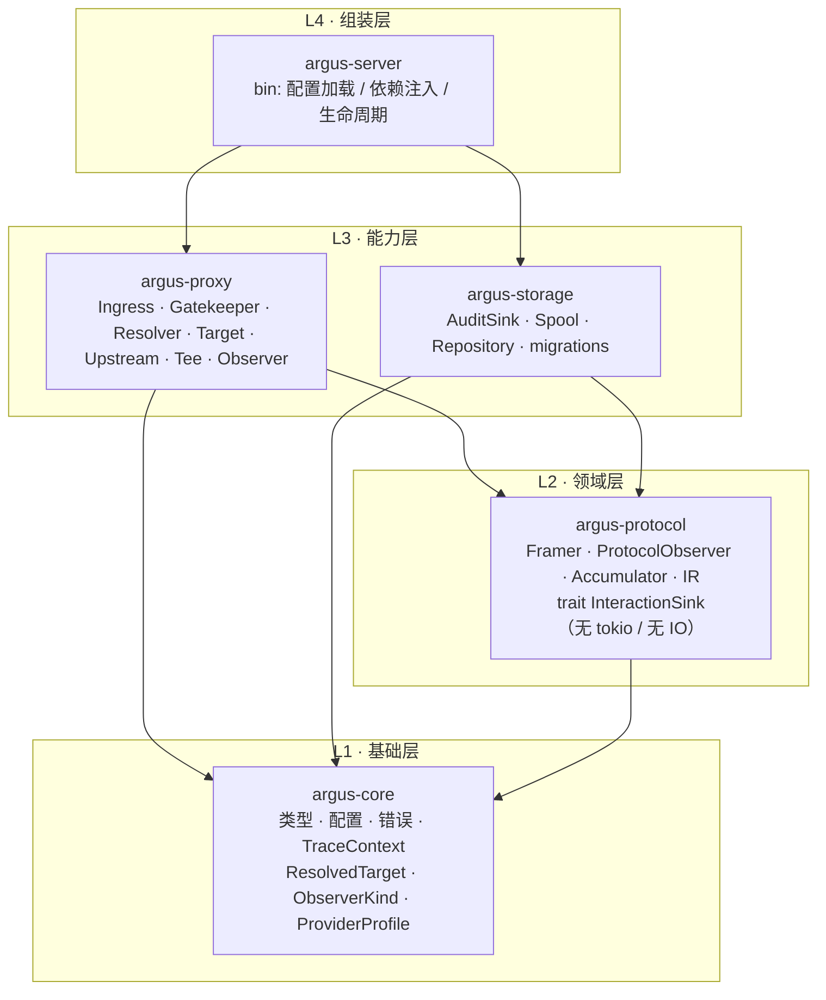
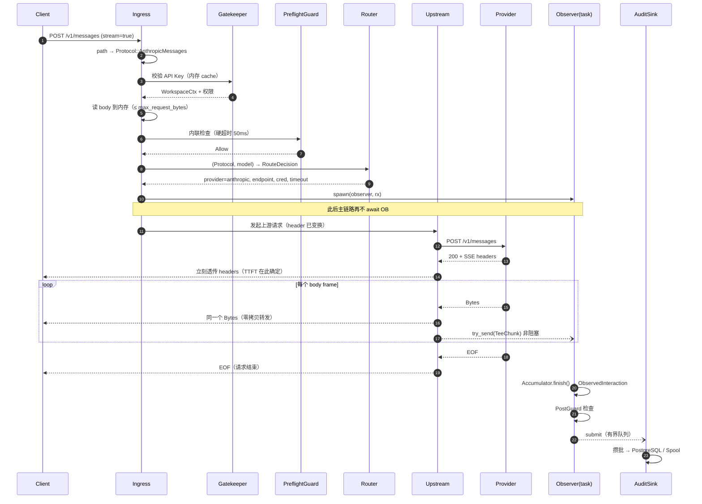

# 01 · 总体架构

> 状态：Draft v2 · 最后更新 2026-08-20
> 前置阅读：`00-overview.md`（尤其是术语表）

---

## 1. Problem

需要一个架构，使下列四组彼此拉扯的要求同时成立：

- **透明**：不改写 body，不丢字段，不做协议转换。
- **可观测**：能拿到完整的 prompt、输出、工具调用、usage。
- **不互相拖累**：观测、安全、落库任一环节故障或变慢，代理主链路必须无感。
- **轻量**：单二进制 + PostgreSQL 就能跑，4C8G 能扛 10k SSE。

这四条中，"透明 + 可观测"是天然对立的（要观测就要解析，要解析就有可能出错并影响转发），"可观测 + 不互相拖累"要求解析必须异步且可丢弃，"轻量"排除了把观测扔给外部消息队列的做法。

架构的核心任务就是**在进程内部划出一条不可跨越的边界**，让主链路与观测链路只通过一个方向、非阻塞、可丢弃的通道相连。

---

## 2. Goals

- G-A1 主链路上不存在任何 `.await` 于观测/存储/安全组件的调用点（PreflightGuard 除外，且其有硬超时）。
- G-A2 模块依赖是有向无环图，且 Data Plane 不依赖 Control Plane 的运行时可用性。
- G-A3 配置读取是 O(1) 内存访问，不产生数据库查询。
- G-A4 单进程可完整运行；水平扩展时实例之间无需直接通信。
- G-A5 crate 数量足以隔离测试与编译，但不引入无用的抽象层。

## 3. Non-goals

- 不做微服务化。Control Plane 与 Data Plane 是**同一进程内的两组模块**，可通过配置只启用其一（见 §7.3），但不强制拆进程。
- 不引入插件系统 / WASM 扩展（MVP 阶段）。
- 不做多租户物理隔离（同进程逻辑隔离即可）。

## 4. Constraints

- Rust 无 GC，所有跨 task 共享数据必须显式 `Arc`；这反而使"配置快照"方案非常自然。
- Tokio 是 work-stealing 多线程运行时；主链路与观测 task 会被调度到同一组线程上，因此**观测 task 消耗 CPU 会间接影响主链路**。这是必须承认的耦合，缓解手段见 §6.4。
- Hyper 1.x 的 `Body` trait 是 poll-based，这让 Tee 可以实现为一个零成本的 Body 包装器（见 `06-data-plane.md` §5）。

---

## 5. 模块划分与依赖方向

### 5.1 分层图



**依赖规则（CI 强制检查，见 `20-testing-strategy.md` §9）**：

1. 箭头只能向下。`argus-core` 不依赖任何内部 crate。
2. `argus-protocol` **禁止**依赖 `tokio`、`sqlx`、`hyper`。它是纯计算库：输入 `&[u8]`，输出 `ObservedEvent`。这保证它可以用普通单元测试以微秒级速度迭代，且天然不会阻塞任何东西。
3. `argus-proxy` **禁止**依赖 `argus-storage` 的具体类型。它通过 `argus-protocol` 中定义的 `trait InteractionSink` 与存储解耦，由 `argus-server` 注入实现。这样 Data Plane 在编译期就不可能直接调用数据库。
   （该 trait 放在 `argus-protocol` 而非 `argus-core`，因为它的签名引用 `ObservedInteraction`；放进 core 会造成 `core ↔ protocol` 的循环依赖。详见 `15-storage.md` §4.1。）

> 规则 3 是"Data Plane 不被数据库阻塞"的**编译期保证**，比代码评审可靠。

### 5.2 模块职责表

| 模块 | 职责 | 明确不负责 |
|------|------|-----------|
| Ingress | HTTP 监听、路由表、**按原始字节**切分 path、请求体准入（size limit）、错误响应格式化 | 认证、解析 target |
| Gatekeeper | API Key 校验、workspace 解析、RBAC、**profile 白名单 / `allow_raw_proxy`**、配额、限流 | 内容检查 |
| PreflightGuard | 请求内容的规则检查，产出 `SecurityVerdict` | 流式内容、响应内容 |
| Resolver | URL → `ResolvedTarget`（Managed 与 Raw 两个实现）；熔断状态查询 | 发起 HTTP、判断 target 是否安全 |
| Target Policy | 判定上游地址是否允许连接：scheme / IP / 端口 / DNS rebinding | 解析 URL |
| Upstream | 连接池、header 变换、发起请求、超时、retry 状态机 | 解析 body |
| Tee | 逐 frame 复制 `Bytes` 到旁路 channel | 理解字节含义 |
| Observer | 驱动 Framer→ProtocolObserver→Accumulator，触发 StreamGuard/PostGuard，提交给 Sink | 影响主链路 |
| Framer | 字节 → 逻辑帧（`SseFramer`；将来 `EventStreamFramer`） | 理解 JSON |
| ProtocolObserver | 逻辑帧 → `ObservedEvent`，由 `ObserverKind` 选择 | 累积状态 |
| Accumulator | event 序列 → `ObservedInteraction` | 解析字节 |
| StreamGuard | 流中安全检查；`gate_tools` 模式下的扣留决策 | 请求时检查 |
| PostGuard | 完整交互的安全检查（含可选 LLM detector） | 阻断已发出的流 |
| AuditSink | 批量、异步、有界地把 interaction 落到 PG 或 Spool | 决定内容 |
| Control Plane API | 配置 CRUD、查询、Dashboard 后端 | 参与转发路径 |
| ConfigSnapshot | 内存中的不可变配置视图，`ArcSwap` 原子替换 | 持久化 |

---

## 6. 进程内并发模型

### 6.1 Task 拓扑

每个进来的请求产生：

| Task | 数量 | 生命周期 | 说明 |
|------|------|---------|------|
| **connection task** | 每 TCP 连接 1 个 | 连接期间 | hyper 管理 |
| **request task** | 每请求 1 个 | 请求期间 | 主链路，由 Axum 驱动 |
| **observer task** | 每被观测的 interaction 1 个 | 可超出请求生命周期 | `tokio::spawn`，与 request task **无 join 关系** |

**关键**：request task 结束时**不 await** observer task。observer 拿着自己需要的一切（`Arc<RouteDecision>`、`TraceContext`、channel receiver），独立跑完。这是"Observer 不阻塞 Proxy"在 task 层面的体现。

反过来，observer task 需要在进程停机时被优雅收敛——见 `17-reliability.md` §3。

### 6.2 唯一的跨界通道

```rust
// argus-core
pub struct TeeChunk {
    /// 从上游读到的原始字节切片，Bytes::clone 只是 refcount++
    pub data: Bytes,
    /// 在这个 chunk 之前，因为背压被丢弃的字节数（0 表示无丢失）
    pub gap_before: u64,
}

pub struct TeeHandle {
    tx: mpsc::Sender<TeeChunk>,      // bounded
    byte_budget: u64,                // 在途字节上限，额外的字节维度保护
    in_flight: Arc<AtomicU64>,
    pending_gap: u64,                // 累积待上报的丢弃量
}
```

主链路对这个 channel **只做 `try_send`，永不 `send().await`**。这条规则没有例外。

`gap_before` 的存在是为了让 ProtocolObserver 知道"这里断了 N 字节"，从而进入 resync 状态而不是解析出错误结果。详见 `10-streaming.md` §6。

### 6.3 背压方向

```text
slow client  →  TCP 窗口关闭  →  主链路 poll_frame 变慢  →  自动不再从上游读
                                                          （背压正确传播到 provider）

slow observer → channel 满 → try_send 失败 → 丢弃并累加 gap → 主链路速度不变
```

两个方向都不会导致无界内存增长。这是整个架构最重要的一条不变式。

### 6.4 CPU 干扰的缓解

observer task 与 request task 共享 tokio worker 线程池，因此观测的 CPU 开销会稀释主链路吞吐。缓解措施，按优先级：

1. **让解析本身足够便宜**：SseFramer 与 ProtocolObserver 走"扫描 + 借用"而非"反序列化到 Value"（见 `10-streaming.md` §7）。
2. **昂贵的东西不在 observer task 里做**：LLM detector、正则大规模匹配、压缩、序列化，全部下沉到 `AuditSink` 的批处理 worker（固定小数量的常驻 task）或 `tokio::task::spawn_blocking` 池。
3. **可选的运行时隔离**：配置 `runtime.split=true` 时，创建第二个 Tokio Runtime（少量线程）专跑 observer 与 sink。默认关闭——因为它引入跨 runtime 的复杂度，只有在实测确认干扰显著时才启用。见 `17-reliability.md` §7。

> 诚实说明：方案 3 不是免费的。跨 runtime 传递 `Bytes` 没问题，但要小心不要把带 `!Send` 状态或 runtime-bound 资源（如 sqlx pool）跨过去。默认关闭是刻意的。

---

## 7. 配置分发：ConfigSnapshot

### 7.1 问题

Data Plane 每个请求都要读：API Key 信息、模型映射、provider endpoint、credential、安全策略、限流规则。如果每次都查 PostgreSQL，则 (a) 延迟不可接受，(b) PG 挂掉网关立刻死。

### 7.2 方案

```rust
pub struct ConfigSnapshot {
    pub version: u64,
    pub loaded_at: SystemTime,
    pub providers:     HashMap<ProviderId, Arc<ProviderConfig>>,
    pub logical_models:HashMap<ModelName,  Arc<LogicalModel>>,
    pub routes:        HashMap<(Protocol, ModelName), Arc<RouteTable>>,
    pub policies:      Arc<PolicySet>,
    pub workspaces:    HashMap<WorkspaceId, Arc<WorkspaceConfig>>,
}

// 全局单例
pub struct ConfigHandle(Arc<ArcSwap<ConfigSnapshot>>);

impl ConfigHandle {
    #[inline]
    pub fn load(&self) -> Guard<Arc<ConfigSnapshot>> { self.0.load() }
}
```

- 读取：`arc_swap::ArcSwap::load()`，无锁、无原子写、纳秒级。
- 更新：后台 `ConfigRefresher` task 周期（默认 15s）或收到 Control Plane 的通知后，从 PG 全量重建一个新 `ConfigSnapshot`，`store()` 原子替换。
- 一致性：单个请求在入口处 `load()` 一次，整个请求生命周期用同一个快照。这保证请求内配置视图不会中途变化。

**API Key 不放进 ConfigSnapshot**（数量可能上万且变化频繁），而是走独立的 `KeyCache`（见 `14-auth-and-credentials.md` §5）。

### 7.3 Control Plane 缺席时

`argus-server` 支持三种角色：

```toml
[server]
role = "all"      # 默认：data plane + control plane 同进程
# role = "data"   # 只跑 data plane（不监听 admin 端口，不写配置）
# role = "control"# 只跑 control plane
```

生产上可以部署 N 个 `role=data` 实例 + 1 个 `role=control`。它们之间**没有直接通信**：control 写 PG，data 实例通过周期 refresh 感知（最长延迟 = refresh 间隔）。这满足 G-A4，且避免了服务发现与内部 RPC。

> 若需要更快的配置生效，可选启用 PostgreSQL `LISTEN/NOTIFY`（`config.notify=true`），data 实例监听 `argus_config_changed` 通道立刻 refresh。这是**可选增强**，通道断开时自动退回周期轮询。

---

## 8. 为什么是 Modular Monolith

| 方案 | 优点 | 缺点 | 判断 |
|------|------|------|------|
| **A. Modular Monolith（选定）** | 单二进制部署；无内部网络跳；Tee 是进程内 channel（纳秒级）；4C8G 可跑 | 需要靠 crate 边界与 CI 规则维持模块纪律；单进程 OOM 影响全部 | ✅ |
| B. Proxy / Observer 拆两进程 | 观测崩溃完全不影响代理 | Tee 变成跨进程 IPC，字节要真拷贝 + 序列化，TTFT 与内存都变差；部署复杂度翻倍 | ❌ 违背 G5/G6 |
| C. 全微服务（auth/route/security/audit 各一） | 独立扩缩容 | 每请求 3–5 次内部 RPC，proxy-added TTFT 从 µs 级涨到 ms 级；与 G3 直接冲突 | ❌ |
| D. Sidecar（Envoy + Argus filter） | 复用成熟数据面 | Envoy 的 WASM/ext_proc 接口拿不到低成本 tee；协议解析仍需自己写；运维负担大 | ❌ 第一阶段 |

**决策**：A。

拆进程带来的隔离收益，在 Rust 里可以用**更便宜的手段**获得大部分：
- 观测崩溃 → observer 在独立 task，panic 只杀该 task（前提：`panic = "unwind"`，见 §9）。
- 观测拖慢 → bounded channel + `try_send` 已经隔离。
- 观测 OOM → accumulator 有硬上限。

真正无法用 task 隔离的只有"进程级 OOM/abort"，这个风险用 §9 与 `17-reliability.md` 的资源上限来管控。

---

## 9. panic 策略（重要）

```toml
# Cargo.toml（workspace）
[profile.release]
panic = "unwind"   # 绝不可改成 abort
```

理由：`panic = "abort"` 会让**任何一个 ProtocolObserver 的 bug 直接杀死整个进程**，连带上千条正在进行的 SSE 连接。这与 G4 直接冲突。

配套措施：

1. `argus-protocol` 内**禁止** `unwrap` / `expect` / 切片越界索引 / 整数除法，由 clippy lint 强制（`#![deny(clippy::unwrap_used, clippy::indexing_slicing, clippy::panic)]`）。
2. observer task 内对每次 parser step 额外包一层 `std::panic::catch_unwind`（parser 状态是 `UnwindSafe` 的纯数据）。捕获后：记录 `argus_observer_panic_total`，把 interaction 标记为 `ParserFailed`，**停止解析但继续透传**。
3. `tokio::spawn` 的 `JoinHandle` 由 `ObserverRegistry` 统一持有，检测到 `JoinError::Panic` 时上报指标。
4. 主链路 request task 的 panic 由 `tower_http::catch_panic::CatchPanicLayer` 兜住，转成 500，不影响其他连接。

> 关于 §8 与 §9 的关系：正因为有 §9 这套 panic 隔离，§8 中"不拆进程"才站得住。二者是一个整体决策。

---

## 10. Data Flow：一次流式请求的模块穿越



注意第 12–15 步：**同一个 `Bytes` 对象既发给 client 又发给 observer**，没有 memcpy。

---

## 11. Failure Modes

| 故障 | 影响面 | 行为 | 依据 |
|------|--------|------|------|
| PostgreSQL 不可用 | Control Plane 写失败；审计落库失败 | Data Plane 继续（ConfigSnapshot 仍在内存；审计转 Spool；auth 用 stale cache 至多 15min） | `15-storage.md` §8 |
| Redis 不可用（若启用） | 分布式限流失效 | 降级为本地限流，不拒绝服务 | `17-reliability.md` §6 |
| ProtocolObserver panic | 单个 interaction 的观测 | catch_unwind → 标记 `ParserFailed` → 继续透传 | §9 |
| Observer channel 满 | 单个 interaction 的观测完整性 | 丢字节 + 记 gap → interaction 标记 `Degraded` | `10-streaming.md` §6 |
| AuditSink 队列满 | 审计完整性 | 按策略：丢最旧 / 丢新 / 降级只存摘要 | `15-storage.md` §7 |
| Provider 5xx / 超时 | 单请求 | 按 retry 状态机决定 retry/fallback/透传错误 | `08-provider-profiles.md` §6 |
| Client 断开 | 单请求 | 取消传播到上游（drop 连接）+ observer 收到 `ClientAborted` 并落库 partial | `06-data-plane.md` §8 |
| ConfigRefresher 失败 | 配置滞后 | 保留上一个快照继续服务，记指标；连续失败告警 | §7.2 |
| 进程 OOM | 全部 | 由内存上限、accumulator cap、连接数上限共同预防；见资源模型 | `17-reliability.md` §8 |

---

## 12. Trade-offs

| 我们选择的 | 放弃的 | 代价 | 为何接受 |
|-----------|-------|------|---------|
| 单进程 | 进程级故障隔离 | 一次 abort 断掉所有连接 | 用 task 隔离 + panic=unwind + 资源上限覆盖 90% 场景，换来 µs 级 tee 与单二进制部署 |
| `try_send` 丢弃 | 观测 100% 完整 | 高压下观测有损 | 有损观测 >> 阻塞主链路；且降级优先在请求粒度（见 `10-streaming.md` §6.3），不是无差别丢字节 |
| 配置快照 + 周期 refresh | 配置强一致 | 变更最长 15s 生效 | 网关配置本就不需要强一致；换来 PG 故障隔离与 O(1) 读 |
| 请求体全量 buffer | 超大请求的内存 | 每请求最多 `max_request_bytes`（默认 8MB） | PreflightGuard 与 retry 都需要可重放的 body；流式上传的 AI 请求极罕见 |
| `argus-protocol` 无 tokio | 解析器无法自己做 IO | 需要外层驱动 | 换来纯函数可测性 + 编译期保证不阻塞 |

---

## 13. Alternatives Considered

**A1. 用 `tower::Layer` 做观测，而不是 Body 层 Tee。**
Tower layer 拿到的是完整的 `Request`/`Response`，对流式响应而言，layer 只能看到 `Body` 对象本身，仍需在 Body 层做 tee。所以 layer 方案最终会退化成同一件事，但多一层抽象。**否决**。

**B1. 观测走 `broadcast` channel 而非 `mpsc`。**
`broadcast` 在订阅者慢时会 lag 并丢弃，语义上接近需求。但它对每条消息都要 `Clone`，且滞后检测粒度粗（按消息数不按字节）。MVP 只有一个订阅者（Observer），`mpsc` 更简单也更省。**否决**，但如果将来需要多个独立消费者（比如实时安全流 + 审计流），再改 `broadcast` 或 fan-out。

**C1. 把 Observation 做成外部进程，通过 Unix socket 传字节。**
见 §8 方案 B。字节必须真实拷贝并跨进程，TTFT 与内存双输。**否决**。

**D1. 用 `async-trait` 定义 ProtocolObserver。**
解析是纯 CPU 工作，async 只带来虚表与 Future 开销。用同步 trait + 泛型/enum dispatch。**否决 async**。

---

## 14. Decision

1. Modular Monolith，5 个 crate（见 `19-rust-project-structure.md`）。
2. 主链路与观测链路唯一通过 bounded mpsc + `try_send` 相连。
3. `argus-protocol` 为纯计算 crate，编译期禁止 IO 依赖。
4. `argus-proxy` 通过 `argus-protocol::InteractionSink` trait 与存储解耦，编译期禁止直连数据库。
5. 配置以 `ArcSwap<ConfigSnapshot>` 分发，周期 refresh，可选 LISTEN/NOTIFY 加速。
6. `panic = "unwind"` 强制，配合 `catch_unwind` 与 task 级隔离。
7. Control Plane 与 Data Plane 同进程但可通过 `role` 分离部署，彼此无 RPC。

---

## 15. Open Questions

| # | 问题 | 现状 | 何时决定 |
|---|------|------|---------|
| OQ-1 | `runtime.split` 是否应改为默认开启？ | 默认关闭 | 有 10k 并发实测数据后 |
| OQ-2 | 多实例场景下 usage/quota 的最终一致窗口能否接受？ | 目前接受最长 5s 偏差 | 出现真实超配额投诉时 |
| OQ-3 | ConfigSnapshot 全量重建在 provider/model 数量达到 10k+ 时是否仍可接受？ | 目前假设 < 1000 | 达到 5k 时改增量更新 |
| OQ-4 | 是否需要在 Tee 之外再提供一个"实时事件订阅"接口（给 Dashboard 做 live tail）？ | 未定 | Dashboard 设计阶段 |
