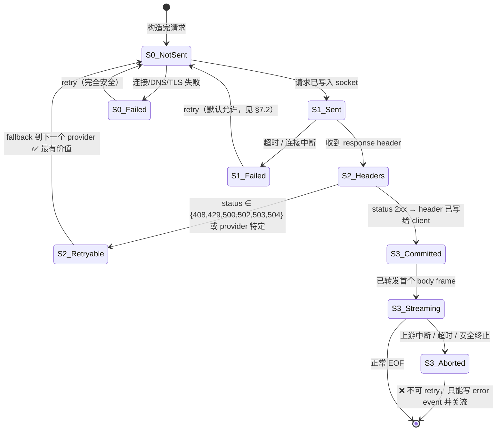

# 02 · Data Plane

> 状态：Draft v1 · 最后更新 2026-08-19
> 前置：`01-architecture.md`。本文只讲代理主链路；SSE 解析细节见 `05-streaming.md`。

---

## 1. Problem

Data Plane 要在**每一个请求**上做完这些事，且总额外开销控制在毫秒以内：

识别协议 → 认证授权 → 配额限流 → 请求安全检查 → 选路 → header 变换 → 发起上游请求 → 处理上游失败与 fallback → 双向转发字节 → 旁路复制给观测 → 传播取消 → 收尾。

难点不在单项，而在于：**这些步骤中任何一个都不能引入对外部系统（DB / Redis / 观测）的同步等待**，否则 TTFT 直接被外部系统的 p99 绑架。

---

## 2. Goals

- G-D1 主链路上唯一允许的外部 `.await` 是「对 provider 的网络 IO」和「PreflightGuard（带硬超时）」。
- G-D2 请求体在内存中最多存在一份，可被 retry 重放而不重新分配。
- G-D3 响应体从 provider 到 client 的转发路径上 **零 memcpy**。
- G-D4 client 断开必须在一个 RTT 内传播为上游连接的取消。
- G-D5 任何一步失败都产出结构化错误，且**错误格式符合调用方所用协议**（OpenAI 客户端要拿到 OpenAI 形状的 error，Anthropic 客户端要拿到 Anthropic 形状的 error）。

## 3. Non-goals

- 不做请求体的流式转发（第一阶段全量 buffer，理由见 §6.2）。
- 不做响应体的缓冲重组（响应必须真流式）。
- 不在 Data Plane 内做任何写数据库操作。

---

## 4. 主链路阶段划分

主链路被显式建模为一个阶段机，每个阶段有明确的「此刻能否 retry」「此刻能否 block」语义。

```text
P0  Accept        接受连接 / 解复用 HTTP2 stream
P1  Identify      URL path → Protocol；method 校验
P2  Authenticate  API Key → PrincipalCtx        [可 block, fail-close]
P3  Authorize     模型/provider 白名单、RBAC     [可 block, fail-close]
P4  Admit         配额、限流、load shedding      [可 block, fail-open on backend 故障]
P5  Ingest        读 body 到 Bytes（≤ 上限）
P6  Preflight     PreflightGuard 内容检查        [可 block, 硬超时]
P7  Route         RouteDecision
P8  Dispatch      header 变换 + 发起上游请求
P9  Headers       收到上游 response header      ← retry/fallback 的最后机会
P10 Relay         body 双向转发 + Tee            ← 此后禁止 retry
P11 Settle        收尾：trailer / 关闭 / 通知 Observer
```

`P9` 是整条链路的关键分水岭，详见 §7 与 `07-provider-routing.md` §6。

### 4.1 阶段与失败语义速查

| 阶段 | 失败时对 client 的表现 | 是否已污染 | 可否换 provider |
|------|---------------------|-----------|---------------|
| P1 | 404 / 405 | 否 | — |
| P2 | 401 | 否 | — |
| P3 | 403 | 否 | — |
| P4 | 429（带 `Retry-After`） / 503 | 否 | — |
| P5 | 413 / 400 | 否 | — |
| P6 | 403（带 policy 信息） | 否 | — |
| P7 | 404（model not found）/ 503（无健康 provider） | 否 | — |
| P8 | 502 | 否 | ✅ 可 |
| P9 | 视上游 status | 否 | ✅ 可（最有价值） |
| P10 | **无法改状态码**，只能中断流并写入错误 event | **是** | ❌ 禁止 |

---

## 5. Tee：request/response 的字节分流

### 5.1 核心实现

Tee 是一个 `http_body::Body` 的包装器。它在 `poll_frame` 里做一次 `Bytes::clone`（refcount++，**不复制内存**）和一次 `try_send`。

```rust
// argus-proxy/src/tee.rs
pin_project! {
    pub struct TeeBody<B> {
        #[pin] inner: B,
        sink: Option<TeeHandle>,
        stats: TeeStats,
    }
}

impl<B> Body for TeeBody<B>
where
    B: Body<Data = Bytes>,
{
    type Data  = Bytes;
    type Error = B::Error;

    fn poll_frame(
        self: Pin<&mut Self>,
        cx: &mut Context<'_>,
    ) -> Poll<Option<Result<Frame<Bytes>, Self::Error>>> {
        let this = self.project();
        let polled = ready!(this.inner.poll_frame(cx));

        match &polled {
            Some(Ok(frame)) => {
                if let Some(data) = frame.data_ref() {
                    this.stats.bytes_forwarded += data.len() as u64;
                    if let Some(sink) = this.sink.as_mut() {
                        // 唯一的跨界动作：非阻塞、可失败、失败即丢
                        sink.offer(data.clone(), this.stats);
                    }
                }
            }
            Some(Err(_)) => this.sink.take().map(|s| s.close(TeeEnd::UpstreamError)),
            None          => this.sink.take().map(|s| s.close(TeeEnd::Eof)),
        };
        Poll::Ready(polled)
    }

    #[inline] fn is_end_stream(&self) -> bool { self.inner.is_end_stream() }
    #[inline] fn size_hint(&self) -> SizeHint { self.inner.size_hint() }
}
```

`offer` 的实现体现了两级保护（数量 + 字节）：

```rust
impl TeeHandle {
    fn offer(&mut self, data: Bytes, stats: &mut TeeStats) {
        let len = data.len() as u64;

        // 保护 1：在途字节预算。防止少量超大 chunk 撑爆内存。
        if self.in_flight.load(Relaxed) + len > self.byte_budget {
            self.pending_gap += len;
            stats.bytes_dropped += len;
            return;
        }

        let chunk = TeeChunk { data, gap_before: self.pending_gap };

        // 保护 2：队列长度。try_send 永不阻塞。
        match self.tx.try_send(chunk) {
            Ok(()) => {
                self.in_flight.fetch_add(len, Relaxed);
                self.pending_gap = 0;
            }
            Err(TrySendError::Full(c)) => {
                self.pending_gap += c.data.len() as u64;
                stats.bytes_dropped += c.data.len() as u64;
                stats.drop_events += 1;
            }
            Err(TrySendError::Closed(_)) => {
                // Observer 已经结束（panic / 提前收尾），彻底摘掉 tee
                self.closed = true;
            }
        }
    }
}
```

Observer 侧每消费一个 chunk 就 `in_flight.fetch_sub(len)`，形成字节维度的信用回收。

### 5.2 为什么 `gap_before` 是必须的

如果只是静默丢弃字节，ProtocolParser 会看到一段"看起来连续但实际断裂"的字节流，可能把两个 SSE event 的碎片拼成一个语法上合法但语义错误的 event（例如把 `data: {"a":1}` 的尾巴接到下一个 event 的头上）。**错误的观测数据比没有观测数据更危险**。

`gap_before > 0` 让 parser 立刻进入 `Resync` 状态：丢弃当前缓冲，扫描到下一个 `\n\n` 边界再恢复。同时该 interaction 被永久标记为 `Degraded { dropped_bytes, gap_count }`。

### 5.3 Request 侧的 Tee

请求体在 P5 已全量读入 `Bytes`，因此**请求侧不需要 TeeBody**，直接把同一个 `Bytes` 的 clone 交给 Observer 即可：

```rust
let body: Bytes = ingest(req, limits).await?;
observer.set_request_body(body.clone());     // refcount++，零拷贝
let upstream_req = Request::from_parts(parts, Full::new(body));
```

这也是 §6.2 选择「全量 buffer 请求体」的收益之一。

---

## 6. 请求处理细节

### 6.1 协议识别（P1）

路由表是静态的，不查配置：

| Method + Path | `Protocol` | 备注 |
|---|---|---|
| `POST /v1/chat/completions` | `OpenAiChat` | |
| `POST /v1/responses` | `OpenAiResponses` | |
| `POST /v1/messages` | `AnthropicMessages` | |
| `POST /v1/messages/count_tokens` | `AnthropicMessages` | 非流式，走简化链路 |
| `GET  /v1/models` | — | Control Plane 投影，见 `04-protocols.md` §6 |
| `GET  /v1/models/{id}` | — | 同上 |
| `GET  /healthz` `/readyz` `/metrics` | — | 运维端点，不经 Gatekeeper |

**不做**基于 body 内容的协议嗅探。path 是唯一依据——嗅探会带来歧义与安全问题。

### 6.2 请求体读取（P5）

```toml
[limits]
max_request_bytes = "8MiB"       # 超过直接 413
ingest_timeout    = "30s"        # 读 body 的整体超时
```

**为什么全量 buffer 而不是流式转发请求体？**

| 需求 | 流式转发是否满足 |
|------|----------------|
| PreflightGuard 需要看完整 prompt | ❌ 必须等完整 body |
| P8/P9 阶段 retry 需要重放 body | ❌ 流已消费，无法重放 |
| Observer 需要记录完整 raw request | ❌ 需要额外缓冲 |
| 计算 body hash 用于去重/缓存键 | ❌ |

而代价极小：AI 请求体通常 1KB–200KB；即使 8MB 上限被打满，也只在该请求存活期间占用。多模态大图片（base64）是最坏情况，因此上限可按 workspace 配置。

> 若将来需要支持超大文件上传（如 Files API 代理），为该 endpoint 单独开一条**纯透传、不观测、不 preflight** 的流式通道，而不是改变主链路语义。

### 6.3 Header 变换（P8）

三类处理，规则表见 `04-protocols.md` §4。核心原则：

1. **必须剥离**：所有 hop-by-hop header（`Connection`、`Keep-Alive`、`Transfer-Encoding`、`Upgrade`、`Proxy-*`、`TE`、`Trailer`）；client 的 `Authorization` / `x-api-key`（**绝不透传到 provider**）；`Host`。
2. **必须注入**：provider credential（形式取决于 `ProviderKind`）；`Host`（上游的）；`x-argus-request-id`。
3. **默认透传**：`Content-Type`、`Accept`、`anthropic-version`、`anthropic-beta`、`OpenAI-Beta`、`User-Agent`（可配置改写）、以及**所有未知 header**（前向兼容：新的 beta header 必须能透传）。

未知 header 默认透传是刻意的：Anthropic/OpenAI 经常用新 header 开启新能力，白名单模式会让 Argus 成为能力瓶颈。风险（client 借 header 注入）由 §6.4 的黑名单兜住。

### 6.4 Header 黑名单

```rust
const STRIP_FROM_CLIENT: &[&str] = &[
    "authorization", "x-api-key", "api-key",           // 凭据：一律替换
    "host", "connection", "keep-alive", "te", "trailer",
    "transfer-encoding", "upgrade", "proxy-authorization",
    "x-argus-internal",                                 // 保留前缀，防伪造
];
```

任何 `x-argus-*` 前缀的 client header 一律剥离，防止客户端伪造内部标记。

---

## 7. 上游响应处理（P9 → P10）

这是最需要小心的部分。

### 7.1 状态机



### 7.2 各阶段的 retry 规则

| 状态 | provider 是否可能已产生副作用 | 默认 retry | 可配置 |
|------|--------------------------|-----------|--------|
| S0（连接前失败） | 否 | ✅ 是 | — |
| S1（已发出，无 header） | **可能**（provider 可能已开始生成并计费） | ✅ 是 | `retry.on_no_response = false` 可关 |
| S2（有 header，非 2xx） | 否（明确失败） | ✅ 是 | 按 status 码配置 |
| S2（有 header，2xx） | — | 不适用 | — |
| S3（已向 client 写出） | — | ❌ **永不** | 无法配置为 true |

S1 的默认 `true` 是一个权衡：AI 请求昂贵，重复可能造成双倍计费。但「连接已建立但 provider 长时间无响应」在实践中绝大多数是网络/网关问题而非模型已开始生成。我们把它做成可配置，并**在 audit 中显式记录 `retry_after_send=true`**，让重复计费可被事后核查。

### 7.3 为什么 S2 是黄金 fallback 点

在 S2，我们已经知道 provider 返回了 429/503，而**一个字节都还没写给 client**。此时切换到备用 provider，客户端完全无感知——它只会觉得这次请求稍微慢了一点。

实现要点：**必须在收到 header 后、写 client header 前插入判定**。用 hyper 的 `client.request()` 返回 `Response<Incoming>`，此时 body 尚未被 poll：

```rust
let resp = upstream.send(req.clone()).await?;      // S1 → S2
if should_failover(resp.status(), &route) {
    // body 还没 poll 过一次，直接 drop 即可放弃这条上游连接
    drop(resp);
    continue;                                       // 下一个候选 provider
}
// 提交点：一旦执行下一行，就进入 S3
let (parts, body) = resp.into_parts();
```

### 7.4 「2xx 但首个 event 是 error」

某些 provider（尤其是 OpenAI-compatible 的自建服务）会返回 `200 OK` 然后在第一个 SSE event 里写 `{"error": ...}`。此时 header 已提交，无法 fallback。

**可选缓解**：`upstream.first_event_gate = true`（默认 **false**）。开启时，Argus 会在写出 client header 前先 poll 出上游的第一个 body frame：

- 若第一个 frame 解析出 error → 仍处于 S2，可 fallback。
- 若正常 → 写 header，然后把已 poll 出的 frame 立刻发出。

**代价**：TTFT 增加「首 token 生成时间」（可能数百毫秒），因为要等第一个 event。这与 G3 直接冲突，所以默认关闭，仅建议对已知有此行为的 provider 单独开启：

```toml
[[providers]]
name = "some-selfhosted"
first_event_gate = true      # 明知该 provider 会 200+error
```

---

## 8. 取消传播

### 8.1 Client 断开

Axum/hyper 在 client 断开时会 drop request task 的 future。我们依赖 Rust 的 drop 语义：

```text
client 断开
  → hyper server 感知 → drop request future
  → TeeBody drop → 内部 upstream ResponseBody drop
  → hyper client 感知该 stream 不再被读 → 关闭 HTTP/2 stream（或整条 HTTP/1 连接）
  → provider 侧收到 RST_STREAM / FIN，停止计费
```

**但这不是自动正确的**——如果 observer task 持有了 upstream body 的所有权（而不是只持有 channel receiver），上游连接就不会被关闭。因此：

> 硬性规则：**Observer 只持有 `mpsc::Receiver<TeeChunk>`，绝不持有任何 hyper 类型。**

TeeHandle 被 drop 时会 `close(TeeEnd::ClientAborted)`，Observer 收到 channel 关闭信号即知道流被中断，走 §8.3 的收尾流程。

### 8.2 显式的 CancellationToken

除了 drop 语义，还需要显式取消用于：优雅停机、请求超时、安全终止。

```rust
pub struct RequestCtx {
    pub trace: TraceContext,
    pub cancel: CancellationToken,   // tokio_util
    pub deadline: Instant,
}
```

三个取消源：
1. `shutdown_token.child_token()` —— 进程停机（见 `12-reliability.md` §3）。
2. 请求级 deadline（`route.timeout.total`）。
3. StreamGuard 的 `Block` 判定（`gate_tools` / `delay_window` 模式）。

主链路的转发循环由 hyper 驱动，无法直接 `select!`。因此取消通过一个中间 Body 包装器实现：

```rust
// 与 TeeBody 组合：Cancellable<TeeBody<Incoming>>
fn poll_frame(...) -> Poll<...> {
    if self.cancel.is_cancelled() {
        return Poll::Ready(Some(Err(ProxyError::Cancelled(self.reason))));
    }
    // 同时注册 waker，保证取消能立刻唤醒而不是等下一个 frame
    ...
}
```

### 8.3 中断时的观测收尾

Observer 在收到以下任一信号时收尾：

| 信号 | `ObservedInteraction.outcome` |
|------|------------------------------|
| channel 正常关闭 + 上游 EOF | `Completed` |
| channel 关闭 + `TeeEnd::ClientAborted` | `ClientAborted { at_seq, bytes_forwarded }` |
| channel 关闭 + `TeeEnd::UpstreamError(e)` | `UpstreamError { kind }` |
| channel 关闭 + `TeeEnd::Cancelled(reason)` | `Cancelled { reason }` |
| observer 自身超时（`observer.idle_timeout`，默认 5min） | `ObserverTimeout` |

**所有情况都会落库**——一个被中途取消的流的 partial 结果，对审计和计费同样重要（provider 通常已经计了已生成的 token）。Accumulator 的 partial 语义见 `06-observation-model.md` §7。

---

## 9. 错误响应

错误必须以**调用方协议的形状**返回，否则客户端 SDK 会解析失败并抛出难以诊断的异常。

```rust
pub trait ErrorRenderer {
    fn render(&self, err: &ProxyError, protocol: Protocol) -> Response;
}
```

| Protocol | 错误形状 |
|---|---|
| `OpenAiChat` / `OpenAiResponses` | `{"error":{"message","type","param","code"}}` |
| `AnthropicMessages` | `{"type":"error","error":{"type","message"}}` |

流式场景（已进入 S3）的错误：不能改 HTTP status，只能在流内发出：

- OpenAI：发一个 `data: {"error":{...}}\n\n`，然后**不发** `data: [DONE]`，直接关闭。不发 `[DONE]` 是刻意的信号——正常结束必然有 `[DONE]`，缺失即异常。
- Anthropic：发 `event: error\ndata: {"type":"error","error":{...}}\n\n`，然后关闭。这是 Anthropic 协议原生支持的。

所有错误响应都带 `x-argus-request-id`，便于对账。**错误 body 中不得包含 provider 的原始凭据信息或内部栈信息**（由 `ErrorRenderer` 统一脱敏，见 `08-security.md` §10）。

---

## 10. Data Model

```rust
// argus-core
pub struct TraceContext {
    /// 单个 HTTP 请求的唯一标识。每次 attempt 共用同一个（attempt 用 AttemptRecord.seq 区分）。
    pub request_id: Uuid,           // UUIDv7，自带时间序
    /// 一次端到端操作。来自客户端的 `traceparent`，或由 Argus 生成。
    /// 关联「同一次调用的多次上游尝试」与「客户端侧的上下游 span」。
    pub trace_id: Uuid,
    /// 一次多轮对话。可能为 None（单轮）。
    pub conversation_id: Option<Uuid>,
    /// conversation_id 的来源，决定它能否被安全策略信任（见 06 §9）
    pub conversation_link: ConversationLink,
}

pub enum ConversationLink {
    /// 客户端显式提供 x-argus-conversation-id
    Explicit,
    /// 由 previous_response_id 或消息前缀指纹推断 —— 安全策略不信任
    Inferred,
    None,
}

pub struct PrincipalCtx {
    pub workspace_id: WorkspaceId,
    pub api_key_id:   ApiKeyId,
    pub user_id:      Option<UserId>,
    pub scopes:       ScopeSet,
    pub limits:       Arc<EffectiveLimits>,   // 已合并 workspace + key 层级
}

pub struct RequestCtx {
    pub trace:     TraceContext,
    pub protocol:  Protocol,
    pub principal: PrincipalCtx,
    pub snapshot:  Arc<ConfigSnapshot>,        // 请求期间固定
    pub cancel:    CancellationToken,
    pub deadline:  Instant,
    pub started:   Instant,                    // 单调时钟
}

pub struct RouteDecision {
    pub attempt:        u8,
    pub provider_id:    ProviderId,
    pub provider_kind:  ProviderKind,
    pub endpoint_url:   Url,
    pub credential:     Arc<ResolvedCredential>,
    pub provider_model: CompactString,          // 上游真实模型名
    pub logical_model:  CompactString,
    pub protocol:       Protocol,               // 必须与 request.protocol 相同
    pub timeouts:       Timeouts,
    pub retry:          Arc<RetryPolicy>,
    pub observe:        ObserveMode,            // Full / Lite / Off（采样结果）
}

pub struct Timeouts {
    pub connect:      Duration,   // 默认 3s
    pub headers:      Duration,   // 默认 60s（推理模型首 token 可能很慢）
    pub idle_frame:   Duration,   // 两个 body frame 之间的最大间隔，默认 120s
    pub total:        Duration,   // 默认 900s
}
```

注意 `Timeouts` 分成四个而不是一个：AI 流式请求的特点是**首 token 慢、token 之间快、总时长可能很长**。用单一超时会误杀推理模型。

---

## 11. Failure Modes

| 场景 | 检测 | 处理 |
|------|------|------|
| body 超过 `max_request_bytes` | Ingest 层计数 | 413，不读完剩余（直接关闭连接） |
| PreflightGuard 超时 | `tokio::time::timeout` 50ms | fail-open：放行并记 `preflight_timeout` 指标 |
| 上游 connect 超时 | `Timeouts.connect` | S0 → retry 下一个候选 |
| 上游 header 超时 | `Timeouts.headers` | S1 → 按 `retry.on_no_response` 决定 |
| 上游 frame 间隔超时 | `Timeouts.idle_frame` | S3 → 终止流，写 error event |
| 客户端只发 header 不发 body | `ingest_timeout` | 408，关闭连接 |
| 上游返回巨大的非流式 body | `max_response_bytes`（默认 64MB） | 截断并标记；client 收到截断的流（无法改 status） |
| Tee channel 已关闭 | `TrySendError::Closed` | 摘掉 tee，主链路继续，interaction 标记 `ObserverGone` |
| 同一请求 retry 次数耗尽 | `attempt > retry.max_attempts` | 502 + `x-argus-attempts` header |

---

## 12. Trade-offs

| 选择 | 收益 | 代价 |
|------|------|------|
| 全量 buffer 请求体 | 可 retry、可 preflight、零额外拷贝给 observer | 每请求最多 8MB 内存；不支持流式上传 |
| `first_event_gate` 默认关 | TTFT 最优 | 「200 + error event」的 provider 无法 fallback |
| 未知 header 默认透传 | provider 新能力立刻可用 | 需要显式黑名单防注入 |
| S1 默认允许 retry | 提高成功率 | 极端情况下可能双倍计费（已记录到 audit） |
| 四段式超时 | 不误杀推理模型 | 配置项更多，需要文档解释 |
| 错误按协议形状渲染 | SDK 兼容 | 每新增协议要写一个 renderer |

---

## 13. Alternatives Considered

**A. 用 `reqwest` 作为上游客户端。**
`reqwest` 封装了重定向、cookie、自动解压、retry 等，这些对透明代理都是**负面**的（自动解压会改变字节；重定向会跳到未授权的 host）。且它把 body 包成自己的类型，取消语义不透明。**否决**，直接用 `hyper-util` 的 `Client<HttpsConnector, Full<Bytes>>`。

**B. 在 P9 之前不建立上游连接，先做完所有本地检查。**
现状已经是这样（P2–P7 全在本地）。但曾考虑「预热连接」——在 P5 读 body 的同时并行建立上游连接以省 TLS 握手时间。**推迟**：需要先知道路由结果才知道连哪里，除非做投机性预连接。放到 `16-mvp-roadmap.md` 的 Phase 3 优化项。

**C. 用 `tower::retry::Retry` layer 实现重试。**
该 layer 要求 `Request` 可 `Clone`，我们的 body 是 `Bytes` 所以可行。但它无法表达 §7.1 的状态机（尤其是「基于 response header 判定」和「S3 后禁止」）。**否决**，手写重试循环。

**D. 让 Observer 直接持有上游 `Incoming` body，自己 poll。**
这样就不需要 Tee 了，但 Observer 会成为唯一的读者，主链路要从 Observer 拿数据——完全反了，Observer 的故障会直接阻塞代理。**强烈否决**。

---

## 14. Decision

1. 主链路建模为 P0–P11 阶段机，P9 是 retry 的最后边界。
2. Tee 实现为 `http_body::Body` 包装器，`Bytes::clone` + `try_send`，双重预算（条数 + 字节）。
3. 丢弃字节时上报 `gap_before`，parser 据此 resync 并标记 `Degraded`。
4. 请求体全量 buffer（默认 8MB 上限），响应体真流式。
5. Observer 只持有 channel receiver，不持有任何 hyper 类型，以保证取消传播。
6. 四段式超时（connect / headers / idle_frame / total）。
7. 错误按调用方协议形状渲染；S3 后的错误走流内 error event。
8. `first_event_gate` 默认关闭，per-provider 可开。

---

## 15. Open Questions

| # | 问题 | 何时决定 |
|---|------|---------|
| OQ-1 | S1 retry 是否应改为默认关闭？需要真实的重复计费数据 | 灰度一个月后 |
| OQ-2 | 是否为 `/v1/messages/count_tokens` 这类轻量端点建立独立的简化链路（跳过 observer）？ | 实现时评估 |
| OQ-3 | 多模态大 body（base64 图片）是否值得单独的内存池以减少大块 alloc？ | 有 profile 数据后 |
| OQ-4 | HTTP/1.1 client + HTTP/2 upstream 的混合场景，client 断开检测延迟是否可接受？ | 压测阶段 |
