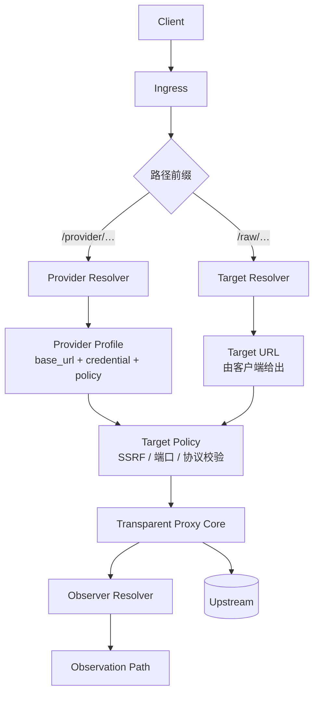
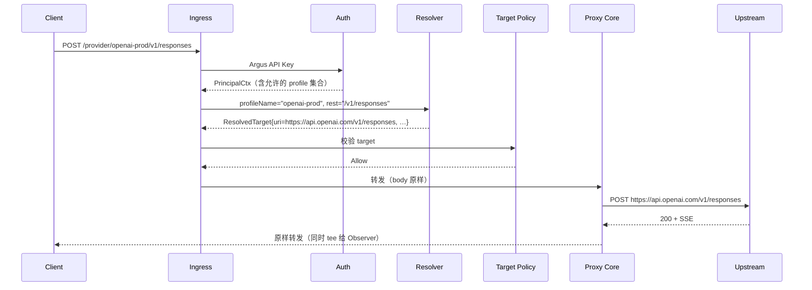

# 02 · 路由模型

> 状态：Draft v2 · 最后更新 2026-08-20
> 前置：`00-overview.md`
> 后续：`03-managed-provider-mode.md`、`04-raw-proxy-mode.md`

---

## 1. Problem

一个请求进来，Argus 必须回答一个问题：**这些字节应该发到哪里去。**

看起来有两条路可选：

```text
A. 从 body 里的 model 字段推断 provider
B. 从 URL 里显式读出 provider
```

A 看起来更"聪明"——客户端只要说 `model: gpt-5`，网关自己找地方。很多聚合网关就是这么做的。本文档论证 **A 是错的**，并且是那种一旦选了就很难回头的错。

---

## 2. Goals

- G-R1 provider 的选择是**显式的、可预测的**：同一个 URL 永远打到同一个上游。
- G-R2 `model` 字段对 Data Plane 是**不透明数据**，原样转发。
- G-R3 provider 新增/下线模型，Argus **不需要改任何配置或代码**。
- G-R4 Managed 与 Raw 两种模式共用同一套代理核心，不写两遍。
- G-R5 未纳管的、甚至未来才出现的 AI API，今天就能被代理。

## 3. Non-goals

- 不做 model → provider 的自动选择。
- 不做按价格/能力/负载的自动路由。
- 不维护模型目录（`models` / `provider_models` / `model_capabilities` 表）。
- 不做跨 provider 的自动 fallback（见 §7）。

---

## 4. 核心决策：provider 由 URL 决定

```text
POST /provider/{providerName}/{upstreamPath}
POST /raw/{targetUrl}
```

`providerName` 是**Provider Profile 的名字**，不是协议命名空间，也不必等于公司名。

### 4.1 为什么不能从 model 推断

同一个模型名在不同 provider 上不是同一个东西：

| 维度 | 后果 |
|---|---|
| 价格不同 | 自动选路等于替用户做花钱的决定 |
| 量化/二次封装不同 | 同名模型输出质量可能差很远 |
| 参数支持不同 | 有的支持 `logprobs`，有的直接 400 |
| 上下文长度不同 | 同名模型一个 128k 一个 32k |
| 版本不同 | `-latest` 指向的快照不同 |
| 工具能力不同 | 并行 tool call 支持程度不同 |
| 名字本身含 `/` | `kimi/kimi-k3` 无法安全地当成路由键 |

最后一条尤其致命。DashScope 上是：

```json
{ "model": "kimi/kimi-k3" }
```

Kimi 官方是：

```json
{ "model": "kimi-k3" }
```

如果 Argus 试图把两者归一成 `kimi-k3` 再反查 provider，就必须维护一张
"归一化名 → (provider, 真实名)" 的映射表。这张表：

- 每个 provider 每次上新模型都要更新
- 更新不及时 = 用户用不了新模型
- 归一化规则本身会和某个 provider 的命名习惯冲突
- 而且它解决的问题**是 Argus 自己创造出来的**

### 4.2 「model 是不透明数据」到底意味着什么

意味着 Data Plane 对 `model` 的处理只有一种：**不处理**。

```text
客户端 body                     上游收到的 body
{"model":"kimi/kimi-k3"}  ───→  {"model":"kimi/kimi-k3"}
```

不改写、不校验、不查表、不补全前缀、不去掉前缀。Argus 甚至不需要知道
`model` 这个字段存在——它在 body 里，body 是字节。

> Observation 侧可以（也应该）把 `model` 解析出来用于审计和指标。
> 那是**旁路**行为，与主链路的转发无关。见 `11-observation-model.md`。

### 4.3 Provider 新增模型时会发生什么

```text
供应商上线 gpt-6
        ↓
用户把 body 里的 model 改成 "gpt-6"
        ↓
Argus 原样转发
        ↓
能用
```

Argus 侧的改动：**零**。没有配置更新，没有版本发布，没有模型目录同步任务。

这是 §35 那条要求的直接后果，也是 G-R3。任何让这条路径不成立的设计
（比如"校验 model 是否在该 provider 的允许列表里"）都要重新论证。

### 4.4 OpenRouter 为什么在 Argus 里仍然只是一个 Provider

OpenRouter 自己做的就是"按 model 自动选路"。有人会问：Argus 是不是该做同样的事？

不。OpenRouter 是一个**上游**，Argus 是一个**入口**。用户配一个
`openrouter-personal` 的 Provider Profile，把请求打进去，OpenRouter 自己去选路。
Argus 既不需要理解它的模型目录，也不需要复制它的能力。

反过来，如果 Argus 也做自动选路，就会出现两层自动选路互相打架，而用户
无法解释"为什么这次请求跑到了那个模型上"。

**Argus 的价值是把多个入口收敛成一个，不是替用户做选择。**

---

## 5. 两种模式，一个核心



两条解析路径的**唯一区别**是「上游 URL 从哪来」：

| | Managed | Raw |
|---|---|---|
| 上游 URL | Provider Profile 的 `base_url` + 剩余 path | 客户端在 URL 里直接给出 |
| 凭据 | Argus 注入（Managed Credential） | 通常由客户端透传 |
| Target Policy | 仍然执行，但通常已由配置约束 | **核心安全边界** |
| Observer | Profile 默认值 + 按 path 细化 | 按 target host/path 猜 |
| 定位 | 普通客户端与 SDK 的主要用法 | Escape hatch / 高级模式 |

解析完成后，两者产出**同一个结构**，之后的代码路径完全一致：

```rust
pub struct ResolvedTarget {
    pub uri: Uri,                       // 完整上游 URL
    pub origin: TargetOrigin,           // Managed(ProfileId) | Raw
    pub credential: CredentialMode,     // Injected(..) | Passthrough | None
    pub observer: ObserverSelection,
    pub timeouts: Timeouts,
    pub policy: Arc<ProxyPolicy>,
}
```

> 不写两套代理实现，是因为两套实现必然在透明性上出现细微分歧，
> 而这类分歧只会在生产里以「Raw 模式下某个 header 丢了」的形式暴露。

---

## 6. Provider Profile 不是 Provider Type

这是新手最容易混淆的一对概念。

```text
provider_type  =  "这是哪一类供应商"   →  只用于 UI 模板和默认值
Provider Profile = "这是哪一个接入点"  →  Data Plane 真正依赖的东西
```

因此可以同时存在：

```text
openai-prod      base_url=https://api.openai.com   credential=prod-key
openai-dev       base_url=https://api.openai.com   credential=dev-key    quota 更小
azure-openai-eu  base_url=https://xx.openai.azure.com/...
dashscope-cn     base_url=https://dashscope.aliyuncs.com
dashscope-team   同上，但不同 credential + 不同 workspace
ollama-nas       base_url=http://192.168.1.20:11434
```

前两个 `provider_type` 都是 `openai`，`base_url` 也相同，但它们是两个不同的
Profile —— 因为**凭据、配额、安全策略、审计归属都不同**。

反过来，Data Plane **不允许**出现这样的代码：

```rust
// ❌ 禁止：按 provider_type 分支执行业务逻辑
match profile.provider_type {
    ProviderType::Anthropic => { /* 特殊处理 */ }
    _ => {}
}
```

需要差异化的东西（认证 header 形式、必需的额外 header）应该是 Profile 上的
**数据**，不是代码里的 `match`。见 `08-provider-profiles.md` §5。

---

## 7. 为什么第一阶段没有跨 Provider Fallback

旧设计里有一套"逻辑模型 → 多个 provider 候选 → 加权 + 熔断 + fallback"的机制。
在新的路由模型下它**消失了**，这是有意的。

理由：客户端已经在 URL 里明确说了要用哪个 provider。此时把请求悄悄发到另一个
provider，等于：

- 用不同的价格计费，用户不知情
- 用可能不同的模型行为返回结果，用户不知情
- 让"这次调用到底打到了哪里"变得不可预测

**重试仍然保留**，但重试的是**同一个 Profile**（`08-provider-profiles.md` §7）。
熔断也保留，粒度是 Profile。

> 如果将来确实需要 fallback，正确的形状是一个**显式的** Profile 组
> （`profile_group`），客户端明确选择这个组，而不是让单 Profile 悄悄漂移。
> 这属于 Phase 2，见 `22-mvp-roadmap.md`。

---

## 8. Data Flow



注意 `model` 在整张图里一次都没有出现。

---

## 9. Data Model

```rust
/// 上游 URL 是怎么定下来的。审计要能区分这两者。
#[derive(Clone, Debug)]
pub enum TargetOrigin {
    /// Managed 模式：由 Provider Profile 决定
    Managed { profile: ProviderProfileId, profile_name: CompactString },
    /// Raw 模式：由客户端在 URL 里给出
    Raw,
}

/// 凭据怎么来的。
#[derive(Clone, Debug)]
pub enum CredentialMode {
    /// Argus 注入自己保管的 provider 凭据
    Injected(Arc<ResolvedCredential>),
    /// 客户端自带上游凭据，Argus 原样透传
    Passthrough,
    /// 上游不需要认证（本地模型常见）
    None,
}
```

`ResolvedTarget` 的完整定义见 `06-data-plane.md` §10。

---

## 10. Failure Modes

| 情况 | 行为 | 依据 |
|---|---|---|
| `providerName` 不存在 | 404 `provider_not_found`，不泄漏已有 profile 列表 | §11 |
| Profile 存在但被禁用 | 503 `provider_disabled` | |
| API Key 无权访问该 Profile | 403 `provider_not_allowed` | `14-auth-and-credentials.md` §7 |
| Raw 模式但 Key 未开 `allow_raw_proxy` | 403 `raw_proxy_not_allowed` | 同上 |
| 剩余 path 为空 | 400 `empty_upstream_path` —— 不默认补 `/`，那会掩盖客户端配置错误 | §12 |
| Target 被 Target Policy 拒绝 | 403 `target_denied`，**不回显解析到的 IP** | `13-ssrf-protection.md` §8 |

---

## 11. Security Considerations

- **不要用错误信息做 profile 枚举**：`provider_not_found` 与
  `provider_not_allowed` 对无权调用者应返回**同一个** 404，否则攻击者可以
  用 API Key 探测出租户里配了哪些 provider。见 `14-auth-and-credentials.md` §7.3。
- **Raw 模式是权限，不是默认能力**：`allow_raw_proxy` 默认 `false`。
- **`model` 不参与路由，也就不构成注入面**。这是 §4 决策的一个附带好处：
  攻击者无法通过构造 model 名把请求引到别的地方。

---

## 12. Trade-offs

| 选择 | 得到 | 失去 |
|---|---|---|
| provider 显式在 URL 里 | 可预测、零模型目录、零维护 | 客户端要配 N 个 base_url（或一个 base_url + 换 path） |
| model 完全不透明 | provider 上新模型即刻可用 | Argus 无法在请求前拦截"这个 provider 不支持这个模型" |
| 无跨 provider fallback | 计费与行为可预测 | 单 provider 故障时客户端要自己换 |
| 两模式共用核心 | 透明性只需保证一次 | 解析层要处理两种输入形状 |

第二行值得展开：Argus **无法**在请求前告诉用户"你这个 model 名字写错了"。
它只能把上游返回的 404/400 原样转回去。这是「不维护模型目录」的必然代价，
也是正确的代价——猜错的校验比没有校验更糟。

---

## 13. Alternatives Considered

**A. model → provider 自动选路（OpenRouter 式）**
否决。理由见 §4.1 与 §4.4。它把 Argus 变成一个需要持续运营的模型目录服务，
而这不是产品定位。

**B. 用 header 指定 provider（`X-Argus-Provider: openai-prod`）**
可行但更差：URL 是 HTTP 里唯一天然可路由、可缓存、可在日志里一眼看懂的东西。
Header 形式还会让 SDK 配置更麻烦（很多 SDK 配 `base_url` 比配自定义 header 容易）。
**保留为兼容手段**：当客户端确实无法改 base_url 时可以启用，但不是主路径。

**C. 子域名（`openai-prod.argus.local`）**
需要泛域名证书和 DNS 配置，抬高了自建部署门槛（本产品要能跑在 NAS 上）。
否决，但不排斥将来作为可选形式。

**D. 一个 Profile 绑定一个"逻辑模型集合"**
就是旧设计。它把模型目录的维护成本重新引了回来。否决。

---

## 14. Decision

1. **Provider 由 URL 路径显式选择**，`/provider/{name}/{path}` 与 `/raw/{url}`。
2. **`model` 对 Data Plane 完全不透明**，原样转发，不校验、不改写、不查表。
3. **不维护模型目录**，provider 上新模型不需要 Argus 改动。
4. **Provider Profile 是路由单位**，`provider_type` 只用于 UI 与默认模板。
5. **两种模式共用一个 Proxy Core**，解析层产出统一的 `ResolvedTarget`。
6. **第一阶段无跨 Provider fallback**，重试与熔断的粒度是 Profile。

---

## 15. Open Questions

| # | 问题 | 何时决定 |
|---|------|---------|
| OQ-R1 | Profile 名的字符集与长度限制？（要能安全地出现在 URL path 段里） | 实现 `03` 时定，倾向 `[a-z0-9][a-z0-9-]{0,62}` |
| OQ-R2 | 是否提供 `X-Argus-Provider` header 作为备选入口？ | 有真实客户端无法改 base_url 时再加 |
| OQ-R3 | Profile 组（显式 fallback）要不要提前到 Phase 1？ | 有用户明确需求时 |
