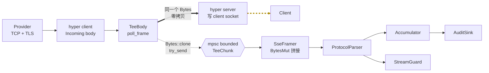

# 05 · 流式架构

> 状态：Draft v1 · 最后更新 2026-08-19
> 本文是 Argus 最核心的设计文档。前置：`02-data-plane.md` §5（Tee）。

---

## 1. Problem

必须同时成立的四件事：

1. **真流式**：provider 产出第一个 token 时，客户端立刻看到，不等整个响应收完。
2. **边转发边解析**：同一份字节要在转发的同时进入观测链路。
3. **不增加可感知延迟**：解析、安全检测、落库都不能出现在关键路径上。
4. **内存有界**：10k 条并发 SSE 连接下，无论客户端多慢、观测多慢、响应多长，内存都不能无界增长。

第 3 条和第 2 条天然矛盾：解析必然消耗 CPU，而 CPU 是共享的。第 4 条与第 1 条矛盾：真流式意味着不能缓冲，但不缓冲就没法处理速度不匹配。

本文给出的解法是：**一份字节，两条路径，非对称保障**——主链路保证送达，旁路保证不阻塞（但允许有损）。

---

## 2. Goals

- G-S1 从 provider 收到 `Bytes` 到写入 client socket，路径上 **零 memcpy**。
- G-S2 每个转发的 SSE frame 引入的额外延迟 p99 ≤ 1 ms。
- G-S3 每条 SSE 流的稳态额外内存（观测开启）≤ 64 KB（不含 accumulator 中的正文，正文单独有 cap）。
- G-S4 观测链路任何形式的阻塞（CPU 打满、channel 满、下游卡死）都不影响主链路的转发速率。
- G-S5 解析器对任意字节切分方式产生完全相同的事件序列。

## 3. Non-goals

- 不保证观测数据 100% 完整（明确允许在压力下有损，但**必须可检测**）。
- 不做客户端侧的重传/断点续传。
- 不做 SSE 的 `id:` / `retry:` 字段的语义处理（透传即可，AI provider 不用）。

---

## 4. 整体数据流



**粗线是主链路，虚线是旁路。** 两者共享同一块底层内存（`Bytes` 的 refcount），但生命周期独立。

---

## 5. 零拷贝的具体含义

### 5.1 一次 frame 的内存旅程

```text
① rustls 解密到内部 buffer
② hyper 从 rustls 读出，产出 Bytes（一次 alloc，hyper 内部的读缓冲切片）
③ TeeBody::poll_frame 拿到 Frame<Bytes>
④ data.clone()          → refcount 1→2，无 memcpy
⑤ try_send(TeeChunk)    → 移动指针，无 memcpy
⑥ 原 Frame 返回给 hyper server
⑦ hyper server 写入 rustls → 一次 memcpy 到 TLS 输出缓冲（不可避免）
⑧ Observer 消费 TeeChunk → SseFramer
```

真正不可避免的拷贝只有 ⑦（TLS 加密必须写到新缓冲）。**从 provider 到 client，我们自己没有引入任何一次额外的 memcpy。**

对比：如果先 `String::from_utf8(bytes)` 再 `serde_json::from_str` 再 `serde_json::to_vec` 再发出，同一份数据会被拷贝 3 次并产生 O(字段数) 次堆分配。这就是**不用官方 SDK 的核心原因之一**（见 `ADR/ADR-002`）。

### 5.2 SseFramer 的 fast path

SSE frame 与 TCP frame 不对齐。一个 `Bytes` 可能包含 0.5 个 event，也可能包含 3 个。朴素实现是把所有字节 append 到一个 `BytesMut`，然后扫描——这会产生一次 memcpy。

优化：**先看能不能直接切**。

```rust
impl SseFramer {
    pub fn push(&mut self, chunk: &TeeChunk, out: &mut FrameSink<'_>) -> Result<(), FramerError> {
        if chunk.gap_before > 0 {
            self.enter_resync(chunk.gap_before);   // 见 §6.4
        }

        // Fast path：缓冲区为空，且本 chunk 自带完整边界
        if self.buf.is_empty() {
            let mut rest = chunk.data.clone();     // refcount++
            while let Some(end) = find_frame_end(&rest) {
                let frame = rest.split_to(end);    // Bytes::split_to：零拷贝切片
                out.emit(FrameRef::Borrowed(&frame))?;
            }
            if !rest.is_empty() {
                self.buf.extend_from_slice(&rest); // 只有残余部分才拷贝
            }
            return Ok(());
        }

        // Slow path：有残留，必须拼接
        self.buf.extend_from_slice(&chunk.data);
        while let Some(end) = find_frame_end(&self.buf) {
            let frame = self.buf.split_to(end).freeze();
            out.emit(FrameRef::Owned(frame))?;
        }
        self.guard_buffer_size()?;                 // 见 §8.2
        Ok(())
    }
}
```

实践中 AI provider 的 SSE frame 通常小于一个 TCP segment，且 provider 倾向于按 event 边界 flush，因此 **fast path 命中率很高**（预期 > 80%，需实测验证）。

### 5.3 边界扫描

SSE 的 event 分隔符是空行。规范允许 `\n\n`、`\r\n\r\n`、`\r\r`。真实的 AI provider 都用 `\n\n`，但解析器必须容忍全部三种。

```rust
#[inline]
fn find_frame_end(buf: &[u8]) -> Option<usize> {
    // memchr::memmem 用 SIMD，比手写循环快数倍
    memchr::memmem::find(buf, b"\n\n").map(|i| i + 2)
        .or_else(|| memchr::memmem::find(buf, b"\r\n\r\n").map(|i| i + 4))
        .or_else(|| memchr::memmem::find(buf, b"\r\r").map(|i| i + 2))
}
```

> 注意上面这个实现有一个 bug 需要在实现时修正：三次独立 find 会返回「最早出现的 `\n\n`」而不是「最早出现的任意分隔符」。正确做法是一次扫描同时匹配三种模式，取最小位置。这里保留是为了标记这个易错点——`15-testing-strategy.md` §4 有对应的 golden case。

### 5.4 字段解析不做 UTF-8 校验

`data:` 后面的内容按 `&[u8]` 处理，只在真正需要文本时才做 `from_utf8`（且用 `from_utf8_lossy` 的容错变体或直接保留 bytes）。理由：
- 一个 UTF-8 字符可能跨 SSE frame？**不会**——SSE frame 边界是 `\n\n`，而 provider 保证每个 event 内是完整 JSON。
- 但 `data:` 内容跨 TCP frame 是常见的，这由 §5.2 的缓冲处理。
- 避免对每个 frame 做一次 O(n) 的 UTF-8 校验（虽然很快，但 10k 流 × 每秒数十 frame 累积起来可观）。

---

## 6. 背压与降级

### 6.1 三种"慢"

| 谁慢 | 后果 | 处理 |
|------|------|------|
| **Provider 慢** | 正常情况（模型在思考） | `Timeouts.headers` / `idle_frame` 兜底 |
| **Client 慢** | 主链路 poll 变慢 | §6.2：让背压自然传播到 provider |
| **Observer 慢** | 旁路 channel 积压 | §6.3：丢弃 + 标记，主链路不受影响 |

### 6.2 Slow client

**默认策略：不缓冲，让背压传播。**

```text
client 不读 → TCP 接收窗口关闭 → hyper server 的写入 pending
  → TeeBody::poll_frame 不被调用 → hyper client 不从 provider 读
  → provider 侧 TCP 窗口关闭 → provider 停止发送（HTTP/2 下是 stream 级流控）
```

这是**正确的**行为：没有任何一处出现无界缓冲。慢客户端只是让自己的流变慢，不消耗 Argus 的额外内存。

配套保护：

```toml
[limits.stream]
# 两次成功写出 client 之间的最大间隔。超过则断开该流。
client_write_idle_timeout = "60s"
# 单条流的总时长上限
max_stream_duration = "900s"
```

**明确拒绝的方案**：为慢客户端加一个"发送缓冲区"。这会把慢客户端的问题转化成 Argus 的内存问题——一个恶意客户端只要建立连接后不读，就能让 Argus 缓冲整个响应。10k 个这样的连接就是 OOM。

> HTTP/2 的一个额外好处：stream 级流控让单个慢 stream 不会阻塞同一连接上的其他 stream。HTTP/1.1 下一个连接一个流，慢客户端只影响自己。两种情况都安全。

### 6.3 Slow observer：请求粒度降级优先

这是本文最重要的设计。

**朴素方案**（逐字节丢弃）的问题：丢掉一条流中间 30% 的字节，得到的是一个**残缺且不可信**的 interaction——文本有洞、tool arguments 是坏 JSON、usage 可能丢失。它占用了存储，却几乎没有分析价值。

**更好的方案：在请求开始时就决定观测与否，让被观测的流保持完整。**

```rust
pub enum ObserveMode {
    /// 完整观测：raw request + 全部 event + 完整 accumulate
    Full,
    /// 轻量观测：只累积结构性信息（usage / tool call 元数据 / finish），
    /// 不保留正文与 raw event
    Lite,
    /// 完全不观测：Tee 不挂载，只记录请求级元数据（模型、耗时、状态码）
    Off,
}
```

准入决策在 P7（Route）阶段做一次：

```rust
fn decide_observe_mode(ctx: &RequestCtx, load: &ObserverLoad) -> ObserveMode {
    // 1. 策略强制：安全策略要求必须观测的（如高风险 workspace）
    if ctx.policy.force_full_observation { return ObserveMode::Full; }

    // 2. 全局压力：按当前 observer 负载分级降级
    match load.pressure() {
        Pressure::Normal   => ObserveMode::Full,                       // < 60%
        Pressure::Elevated => sample(ctx, load.full_sample_rate),      // 60–85%：抽样 Full，其余 Lite
        Pressure::High     => ObserveMode::Lite,                       // 85–95%：全部 Lite
        Pressure::Critical => ObserveMode::Off,                        // > 95%：只留元数据
    }
}
```

`ObserverLoad::pressure()` 由三个信号合成：活跃 observer 数 / 上限、AuditSink 队列深度 / 容量、近 1 分钟的 tee drop rate。

**抽样是确定性的**（`hash(trace_id) % 10000 < rate`），不是随机的，这样：
- 同一个 conversation 的多轮请求要么都被观测要么都不被，便于会话级分析。
- 可复现。

逐字节丢弃仍然保留，作为**最后防线**（见 §6.4），但正常运行时不应触发。指标 `argus_tee_dropped_bytes_total` 持续非零意味着容量规划有问题，应该告警。

### 6.4 逐字节丢弃与 resync

当 channel 仍然满（说明单条流的瞬时速率超过了 observer 处理能力，或 observer 卡住了）：

```text
try_send 失败
  → pending_gap += len，主链路继续（0 额外开销）
  → 下一次 try_send 成功时，TeeChunk.gap_before = 累积的 pending_gap
  → SseFramer 看到 gap_before > 0：
      · 丢弃当前 buf（它的尾部已经不连续了）
      · 进入 Resync 状态：扫描到下一个 \n\n 才恢复正常解析
      · 向 EventSink 发出 ObservedEventKind::Gap { bytes }
  → Accumulator 收到 Gap：
      · 把当前所有 open block 标记为 incomplete
      · interaction.integrity = Degraded { dropped_bytes, gap_count }
```

**`integrity` 字段是必须落库的**。任何下游分析（安全、计费、统计）都必须能区分「这个 interaction 是完整的」和「这个 interaction 缺了一段」。没有这个字段，有损观测就变成了静默的数据污染。

### 6.5 三层保护小结

```text
第 1 层（请求粒度）  ObserveMode 准入降级      ← 正常情况下唯一生效的
第 2 层（字节预算）  in_flight > byte_budget   ← 防单条流的超大 chunk
第 3 层（队列长度）  try_send 失败             ← 防 observer 卡死
```

---

## 7. 解析开销的控制

### 7.1 不构造 `serde_json::Value`

`Value` 会为每个字段分配 `String` 与 `HashMap`。一个 SSE chunk 解析成 `Value` 大约产生 10–20 次堆分配。10k 流 × 20 frame/s × 15 alloc = **300 万次 alloc/秒**，这会主导 CPU 开销。

改用**借用式部分反序列化**：

```rust
#[derive(Deserialize)]
struct AnthropicDelta<'a> {
    #[serde(borrow)] r#type: &'a str,
    #[serde(borrow)] text: Option<&'a str>,           // 借用，零分配
    #[serde(borrow)] partial_json: Option<&'a str>,   // 借用
    #[serde(borrow)] thinking: Option<&'a str>,
}
```

`serde(borrow)` 在字符串**不含转义序列**时直接借用原 buffer。含转义时（`\n`、`\"`、`\uXXXX`）serde 必须分配 —— 这是无法避免的，但 AI 输出的 delta 中转义字符占比不高。

> 注意：`&'a str` 的生命周期绑定到 `TeeChunk` 的 `Bytes`。因为 `ObservedEvent` 要跨 await 点存活，我们不能直接存 `&'a str`。做法是：Accumulator 立刻把借用的内容 `push_str` 到自己的 `String` 缓冲（一次 memcpy，amortized 分配），而不是每个 delta 分配一个新 `String`。见 §7.2。

### 7.2 Accumulator 的 amortized append

```rust
pub struct TextBlockState {
    /// 预分配 4KB，按需 2x 增长。整条流通常只发生 3–5 次 realloc。
    text: String,
    byte_cap: usize,
    truncated: bool,
}

impl TextBlockState {
    #[inline]
    fn push(&mut self, delta: &str) {
        if self.text.len() + delta.len() > self.byte_cap {
            self.truncated = true;
            return;                      // 静默停止累积，但仍继续消费事件
        }
        self.text.push_str(delta);       // amortized O(1)
    }
}
```

**每个 token 的分配次数：0（摊销）。** 这直接回答了「如何避免每个 token 产生一次 allocation」。

关键设计：超过 cap 时**不报错、不中断**，只是停止累积并置 `truncated = true`。一个 10MB 的响应不应该让观测崩溃。

### 7.3 事件对象本身

`ObservedEvent` 用 `SmallVec` / `CompactString` 避免小字符串的堆分配：

```rust
// CompactString：24 字节以内 inline，无堆分配
// 覆盖了绝大多数 tool name / block type / event name
pub struct ObservedEvent {
    pub seq: u32,
    pub at_micros: u32,          // 相对 start，u32 覆盖 71 分钟，够用
    pub kind: ObservedEventKind, // enum，大小控制在 64 字节内
}
```

事件不逐个发往 channel，而是**批量交给 Accumulator**（同一个 task 内直接调用，无跨 task 开销）。Observer 内部是同步的函数调用链：

```text
Framer::push → &mut FrameSink → Parser::on_frame → &mut EventSink → Accumulator::apply
```

整条链没有 `await`、没有 channel、没有 `Box<dyn>`（用泛型或 enum dispatch）。

### 7.4 CPU 预算估算

单个 SSE frame 的处理：
- `memchr` 找边界：~50 ns（几百字节）
- 部分反序列化：~500 ns–2 µs（取决于 JSON 大小）
- Accumulator apply：~50 ns
- **合计 ~1–3 µs/frame**

10,000 并发流 × 20 frame/s = 200k frame/s × 2 µs = **0.4 核**。

在 4 核机器上，观测消耗约 10% CPU。可接受，但这也解释了为什么 `Pressure::Critical` 时要降级到 `Off`——如果 frame 速率翻 5 倍，观测就会吃掉 2 核。

> 这是估算，不是实测。`15-testing-strategy.md` §7 定义了验证方法。

---

## 8. 内存模型

### 8.1 单条流的内存构成

| 组成 | 典型 | 上限 | 说明 |
|------|------|------|------|
| hyper server 连接缓冲 | ~16 KB | 可调 | 读写各 8KB |
| hyper client 连接缓冲 | ~16 KB | 可调 | HTTP/2 下多流共享，**摊薄后接近 0** |
| rustls 会话 | ~8 KB | | HTTP/2 下同样共享 |
| Tee channel 在途 | ~8 KB | `byte_budget` 256 KB | 稳态很低（observer 消费快） |
| SseFramer buf | ~4 KB | `max_frame_bytes` 1 MB | 只存跨 chunk 残留 |
| Parser 状态 | ~1 KB | 固定 | block 索引表等 |
| Accumulator 正文 | **变化大** | `max_accumulated_bytes` 1 MB | 见下 |
| Task/Future | ~2 KB | | |

**Accumulator 正文**是唯一会随响应长度增长的部分：
- 短回复（500 token）：~2 KB
- 长回复（8k token）：~32 KB
- 带 reasoning 的长回复：~64 KB
- 硬上限：1 MB（超过则 truncate）

### 8.2 缓冲上限

```toml
[limits.stream]
max_frame_bytes        = "1MiB"    # 单个 SSE event 的上限，超过则终止该流的观测
max_accumulated_bytes  = "1MiB"    # Accumulator 正文上限，超过则 truncate 但继续
tee_channel_capacity   = 64        # 条数
tee_byte_budget        = "256KiB"  # 在途字节
```

`max_frame_bytes` 是防御性的：一个恶意或异常的 provider 若发送一个永不结束的 `data:` 行，SseFramer 的 buf 会无界增长。超限时的行为是**停止该流的观测**（标记 `FramerOverflow`），**继续透传**。

### 8.3 并发规模的内存估算

假设：观测开启（`Full`），HTTP/2 上游连接复用（每个 provider 连接承载 100 个 stream）。

| 并发流 | 主链路（34 KB/流） | 观测（20 KB/流） | 逻辑占用合计 | 对应 RSS（×1.3 碎片） |
|-------|------------------|-----------------|-------------|---------------------|
| 100 | ~3.4 MB | ~2 MB | **~5.4 MB** | ~7 MB |
| 1,000 | ~34 MB | ~20 MB | **~54 MB** | ~70 MB |
| 10,000 | ~340 MB | ~200 MB | **~540 MB** | ~700 MB |
| 50,000 | ~1.7 GB | ~1 GB | **~2.7 GB** | ~3.5 GB |

推导（每流 typical，逐项核算见 `12-reliability.md` §4.1，该表为权威版本）：

| 路径 | 组成 | 小计 |
|------|------|------|
| 主链路 | hyper server 读 8 + 写 8 + rustls server 8 + client/TLS 摊薄 0.4 + request body 副本 8 + task 1.5 | **~34 KB** |
| 观测 | tee channel 4 + framer 4 + parser 1 + accumulator 正文 8 + accumulator 结构 2 + task 1 | **~20 KB** |
| 合计 | | **~54 KB** |

> 上表的"合计"列是**逻辑占用**。`12-reliability.md` §4.2 的 RSS 估算在此基础上乘 1.3× 的分配器碎片系数，因此那里的数字（10k 流 ~700 MB）高于本表直接相乘的结果（~540 MB）。**以 `12` 的数字为准做容量规划。**

**结论**：
- 4C8G 上 10,000 并发流是舒适的（~0.6 GB 稳态，峰值 1.2 GB，留出大量余量给 PG 连接池与 sink 批缓冲）。
- 50,000 需要 8 GB 以上，且要求：`ObserveMode` 降到 `Lite`、`max_accumulated_bytes` 调低、上游必须 HTTP/2。
- 详细的容量规划表见 `12-reliability.md` §8。

> 这些是**基于组件已知开销的估算**，不是压测结果。压测方法见 `15-testing-strategy.md` §7，实测数据回填到 `11-observability.md` §6。

### 8.4 HTTP/2 上游复用的重要性

如果上游用 HTTP/1.1，10,000 并发流需要 10,000 条到 provider 的 TCP+TLS 连接：
- 内存：10,000 × 24 KB = 240 MB（仅连接）
- 端口：接近单 IP 的 ephemeral port 上限（~28k）
- TLS 握手：连接池冷启动时的 CPU 尖峰

HTTP/2 下同样的 10,000 流只需 ~100 条连接。**因此上游客户端必须优先协商 HTTP/2**：

```rust
let connector = HttpsConnectorBuilder::new()
    .with_native_roots()?
    .https_only()
    .enable_http2()          // ALPN 优先 h2
    .enable_http1()          // 回退
    .build();
```

OpenAI 与 Anthropic 的 API 都支持 HTTP/2。对不支持的自建 provider，配置里标记 `http1_only = true` 并相应降低该 provider 的并发上限。

---

## 9. 关键问题的直接回答

| 问题 | 回答 |
|------|------|
| **如何边转发边解析而不增加 TTFT？** | 解析发生在**旁路 task**，主链路只做一次 `Bytes::clone` + 一次 `try_send`（合计 < 100 ns）。TTFT 由「上游 header 到达 → 写 client header」决定，观测完全不参与。 |
| **slow client 怎么办？** | 不缓冲，让 TCP 背压自然传播到 provider。加 `client_write_idle_timeout` 兜底。绝不为慢客户端分配发送缓冲。 |
| **slow observer 怎么办？** | 三层保护：请求粒度降级（主）→ 字节预算 → try_send 丢弃（末）。主链路速率完全不受影响。 |
| **bounded channel 满了怎么办？** | 丢弃该 chunk，累加 `pending_gap`，下次成功发送时通过 `gap_before` 告知 parser。parser resync，interaction 标记 `Degraded`。 |
| **parser 崩溃是否影响请求？** | 不。parser 在独立 task + `catch_unwind` + `panic=unwind`。崩溃后停止观测、继续透传，interaction 标记 `ParserFailed`。 |
| **未知 SSE event 怎么处理？** | 产出 `ObservedEventKind::Unknown { event_name, raw }`，计数 `argus_unknown_event_total`，**字节原样透传**。绝不因未知 event 中断代理。 |
| **stream 被中途取消怎么记录？** | Tee 关闭时带 `TeeEnd` 原因，Accumulator 走 partial finish，落库 `outcome = ClientAborted/Cancelled/UpstreamError` + 已累积的部分内容 + 已知 usage。 |
| **如何避免每个 token 一次 allocation？** | 借用式反序列化（`serde(borrow)`）+ Accumulator 的 amortized `push_str` + `CompactString`/`SmallVec`。稳态下每 token 0 次分配。 |
| **如何避免日志/DB 写入拖慢 TTFT？** | 主链路上没有任何日志写入与 DB 调用。tracing 用非阻塞 appender；AuditSink 是独立 task + 批量提交，且提交是 `try_send`。 |

---

## 10. Failure Modes

| 场景 | 检测 | 行为 | 可观测信号 |
|------|------|------|-----------|
| Observer task panic | `JoinError::Panic` / `catch_unwind` | 摘掉 tee，继续透传 | `argus_observer_panic_total` |
| channel 满 | `TrySendError::Full` | 丢弃 + gap | `argus_tee_dropped_bytes_total` |
| 单 frame 超过 1MB | framer buf 检查 | 停止该流观测 | `argus_framer_overflow_total` |
| 累积正文超 1MB | accumulator cap | truncate，继续 | `interaction.truncated = true` |
| 上游发送非法 UTF-8 | 解析时 | lossy 转换 + 标记 | `argus_invalid_utf8_total` |
| 上游 frame 间隔超时 | `idle_frame` timer | 终止流，写 error event | `argus_upstream_idle_timeout_total` |
| client 写超时 | `client_write_idle_timeout` | 断开，取消上游 | `argus_client_write_timeout_total` |
| Observer 数超过上限 | `active_observers` | 新请求降级为 `Off` | `argus_observe_mode_total{mode="off"}` |
| gap 后 resync 找不到边界 | 扫描超过 `max_frame_bytes` | 放弃该流观测 | `argus_resync_failed_total` |

---

## 11. Trade-offs

| 选择 | 收益 | 代价 |
|------|------|------|
| 不为慢客户端缓冲 | 内存有界，无 DoS 面 | 慢客户端拖慢自己的流（可接受） |
| 请求粒度降级优先 | 被观测的数据是完整可信的 | 高压下部分请求完全没有内容观测 |
| `gap_before` 显式上报 | 有损可检测，不产生污染数据 | Tee 逻辑多一个字段与状态 |
| 借用式反序列化 | 分配减少一个数量级 | 生命周期处理复杂，含转义时仍分配 |
| 上游强制 HTTP/2 优先 | 连接数 ↓100×，内存与端口都省 | 不支持 h2 的自建 provider 需单独限流 |
| Accumulator 硬 cap | 内存有界 | 超长响应的正文被截断（有标记） |
| 同 task 内同步解析链 | 无跨 task 开销 | 单条流的解析不能并行（但也不需要） |

---

## 12. Alternatives Considered

**A. 用 `futures::Stream` + `StreamExt::inspect` 做 tee。**
`inspect` 是同步闭包，无法把数据送到另一个 task（除非闭包里 `try_send`——那就等于我们的方案，只是包了一层）。且 `Incoming` 转 `Stream` 会丢失 trailer 支持。**否决**，直接实现 `Body`。

**B. 用 `broadcast::channel` 支持多个观测消费者。**
每条消息 `Clone`（对 `Bytes` 是廉价的），但滞后检测按消息数而非字节数，且 MVP 只有一个消费者。**推迟**，等真的需要多消费者时再改。

**C. 观测走 `spawn_blocking`。**
解析是纯 CPU 且很短（µs 级），扔进 blocking 池反而增加调度开销。blocking 池适合 ms 级以上的阻塞操作。**否决**（但 LLM detector 与压缩确实应该走 blocking 池）。

**D. 主链路先解析再转发（inline parsing）。**
最简单，但违背 G4：parser 变慢直接拖慢转发，parser panic 直接杀请求。**强烈否决**。

**E. 缓冲整个响应再一次性转发（非流式化）。**
TTFT 变成完整响应时间（可能 60 秒），且内存无界。**强烈否决**——这是很多简易网关的做法，完全不可接受。

**F. 用 `bytes::Buf` 的 `chain` 避免 slow path 的拷贝。**
理论上可以用 `Chain<Bytes, Bytes>` 表示跨 chunk 的 frame 而不拷贝，但 `serde_json` 需要连续切片。除非用流式 JSON 解析器（复杂度高得多）。**否决**，残留部分的拷贝量很小（通常 < 1KB）。

---

## 13. Decision

1. 主链路零 memcpy：`Bytes::clone` + `try_send`，唯一不可避免的拷贝在 TLS 加密。
2. Slow client 用 TCP 背压自然处理，**不加发送缓冲**，靠 `client_write_idle_timeout` 兜底。
3. Slow observer 的降级顺序：**请求粒度 `ObserveMode`（主）→ 字节预算 → try_send 丢弃（末）**。
4. 丢弃必须通过 `gap_before` 显式上报，parser resync，interaction 标记 `Degraded`。`integrity` 字段强制落库。
5. 解析用借用式部分反序列化，Accumulator 用 amortized `push_str`，稳态每 token 零分配。
6. SseFramer 有 fast path（无残留时直接 `split_to`），只有跨 chunk 残留才拷贝。
7. 所有缓冲有硬上限；超限时**降级而非报错**。
8. 上游客户端优先协商 HTTP/2，这是 10k+ 并发的前提。
9. Observer 内部是同步调用链，无 await、无 channel、无动态分发。

---

## 14. Open Questions

| # | 问题 | 现状 | 何时决定 |
|---|------|------|---------|
| OQ-1 | SseFramer fast path 的实际命中率？ | 假设 > 80% | 压测阶段实测 |
| OQ-2 | `tee_channel_capacity = 64` 是否合适？ | 拍的值 | 压测时按 drop rate 调优 |
| OQ-3 | `Pressure` 的阈值（60/85/95%）是否合理？ | 拍的值 | 需要真实负载曲线 |
| OQ-4 | 是否需要 per-workspace 的观测配额（防单租户吃满 observer）？ | 未做 | 出现多租户争抢时 |
| OQ-5 | `serde(borrow)` 在含大量 Unicode 转义的中文输出下的实际收益？ | 未验证 | 用中文 fixture 做 bench |
| OQ-6 | 是否值得为 Accumulator 引入 arena/slab 分配器？ | 未评估 | profile 显示 alloc 是瓶颈时 |
