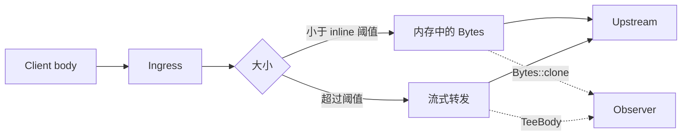
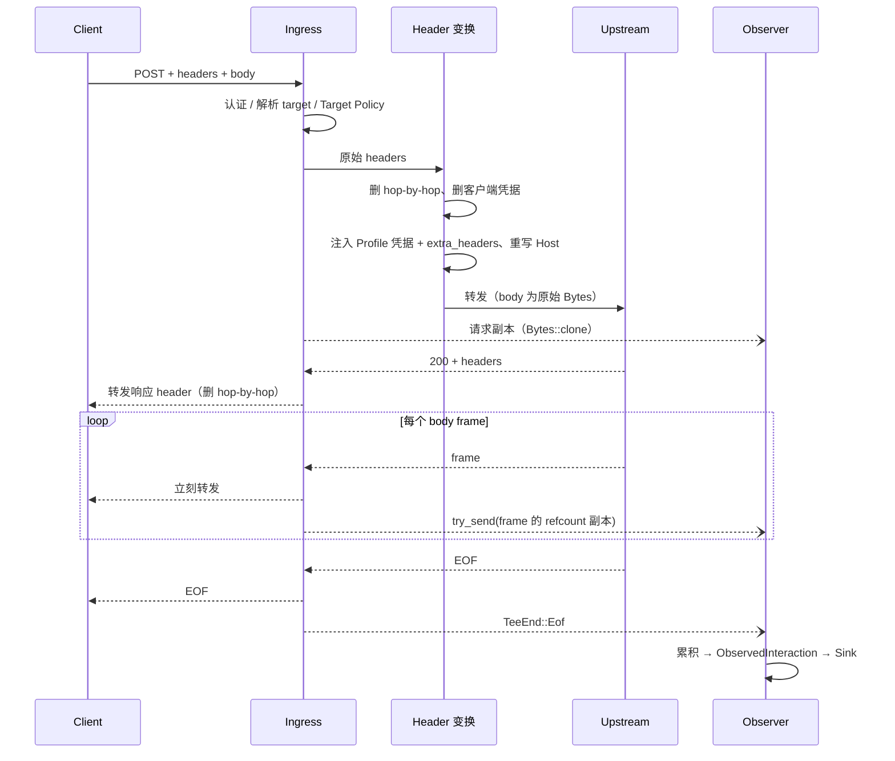

# 05 · 透明代理

> 状态：Draft v2 · 最后更新 2026-08-20
> 前置：`02-routing-model.md`
> 后续：`06-data-plane.md`（阶段机）、`10-streaming.md`（流式细节）

---

## 1. Problem

Argus 坐在客户端和供应商之间。它必须**看得见**流量（否则无法审计和做安全），
又必须**不改变**流量（否则就成了兼容性问题的来源）。

这两件事天然冲突。绝大多数"AI 网关"选择了看得见：把请求反序列化成自己的模型，
处理完再序列化发出去。代价是：

```text
供应商今天新增一个参数
        ↓
网关不认识，反序列化时丢弃
        ↓
用户："我加了 reasoning_effort，但没生效"
        ↓
等网关发版
```

Argus 选择另一条路：**字节原样转发，副本旁路观测**。

---

## 2. Goals

- G-T1 未启用改写功能时，上游收到的 body 与客户端发出的 body **逐字节相同**。
- G-T2 未知字段、未知参数、未来才出现的字段，**不可能**因为 Argus 不认识而丢失。
- G-T3 观测不引入额外的 body 拷贝（`Bytes` 引用计数）。
- G-T4 header 变换是**显式的白/黑名单**，不是"看着办"。

## 3. Non-goals

- 不做协议转换（OpenAI ↔ Anthropic）。
- 不做请求参数的规范化、补全、校验。
- 不解压/重压缩 body。
- 不缓存响应。

---

## 4. 透明性契约（§46）

> **未显式启用 Credential Rewrite / Header Rewrite 时，上游收到的请求 body
> 必须与客户端发送的 body 逐字节相同。**

body 上不允许有任何例外。header 上的差异必须能被 §5 的规则完全解释。

### 4.1 实现方式：不反序列化

```text
❌ 禁止
Client body ──deserialize──> ArgusRequest ──serialize──> Upstream

✅ 要求
Client body ──Bytes────────────────────────────────────> Upstream
                  └──Bytes::clone (refcount)──> Observer
```

`Bytes::clone` 只增加引用计数，不拷贝内容。因此"同时转发和观测"的额外成本
是一个原子加法，不是一次 memcpy。

### 4.2 Observer 可以反序列化，主链路不行

Observer 拿到的是同一块内存的只读视图。它爱怎么解析怎么解析
（`serde_json::Value`、部分反序列化、流式解析），因为它的产物**不会回到主链路**。

这条分工是整个架构的支点：

```text
主链路   只认 Bytes            → 永远不会因为不认识某个字段而出错
观测链路 尽力理解              → 理解失败也只是这次观测降级
```

### 4.3 压缩

`Accept-Encoding` 原样透传，上游返回的压缩 body **原样转发**，不解压。

Observer 需要看内容时自己解压副本。若解压失败（不支持的编码、损坏），
观测降级为「只有元数据」，**主链路不受影响**。

> 这也是不用 `reqwest` 的原因之一：它默认会自动解压，破坏透明性。
> 见 ADR-012。

---

## 5. Header 策略（Q15、Q16、Q27）

Header 是唯一允许被改动的地方，改动必须**逐条可解释**。

### 5.1 三类 header

```text
① hop-by-hop      —— 必须删除，它们描述的是"这一跳"的连接
② 客户端凭据      —— 必须删除，不能泄漏给上游
③ end-to-end      —— 原样转发
```

#### ① hop-by-hop（RFC 9110 §7.6.1）

```text
Connection            Keep-Alive          Proxy-Authenticate
Proxy-Authorization   TE                  Trailer
Transfer-Encoding     Upgrade
```

外加 `Connection` 头里**列出的**每一个 header 名（这一点常被漏掉）：

```http
Connection: close, X-Custom-Hop
```
→ `X-Custom-Hop` 也必须删。

`Content-Length` 不是 hop-by-hop，但由 HTTP 栈根据实际 body 重新生成，
不从客户端复制。

#### ② 客户端凭据（硬规则，不可配置）

Managed 模式下客户端带的是 **Argus 的** key。转发前必须删除：

```text
authorization        x-api-key           api-key
x-goog-api-key       proxy-authorization
```

例外只有一个：Profile 显式配置 `credential.mode = passthrough`。

#### ③ 其余原样转发

包括所有 `x-` 开头的自定义 header、`anthropic-beta`、`openai-organization`、
`user-agent` 等。**不做白名单**——白名单意味着供应商新增 header 时会被吞掉，
与 G-T2 冲突。

### 5.2 Argus 生成/改写的 header

| header | 行为 | 理由 |
|---|---|---|
| `Host` | 重写为 target 的 authority | 不重写上游会拒绝或路由错 |
| `X-Forwarded-For` | 追加客户端 IP | 可配置关闭（隐私） |
| `X-Forwarded-Proto` | 设为客户端侧的 scheme | |
| `Via` | 追加 `1.1 argus` | RFC 要求，也便于诊断链路 |
| `Forwarded` | 若客户端已有则追加，否则不生成 | 与 XFF 二选一，默认用 XFF |
| 凭据 header | 按 Profile 注入 | `03` §8 |
| `extra_headers` | 按 Profile 注入 | `03` §8 |

响应方向同样删除 hop-by-hop，其余原样返回（含 `Set-Cookie`、
`x-ratelimit-*`、供应商自定义 header）。

### 5.3 审计脱敏

审计里记录的 header **必须脱敏**：凭据类 header 只记录
`{header_name}: <redacted len=N>`。见 `12-security.md` §9。

---

## 6. Request Body（Q19）



小请求（绝大多数 AI 请求，几十 KB）整体读进内存再发——这让 S0/S1 阶段的重试
成为可能（`06-data-plane.md` §7）。超过阈值的（多模态大附件）走流式，
此时**不可重试**，因为 body 已经流走了。

阈值默认 1 MiB，可配置。这是「可重试性」与「内存占用」的权衡点。

---

## 7. Response Stream（Q20、Q21）

```text
Upstream ──frame──> Argus ──立刻转发──> Client
                      │
                      └─ Bytes::clone + try_send ──> Observer
```

三条硬规则：

1. **不缓冲**。收到一帧就转发一帧，不等 body 结束。
2. **旁路只用 `try_send`，永不 `.await`**。旁路慢或满，就丢观测，
   累计到 `gap_before`，主链路一步不停。
3. **丢失必须可见**。丢了多少字节要能在审计里查到，否则有损观测就变成了
   静默的数据污染。

完整设计见 `10-streaming.md`。TTFT 的构成与预算见 `21-performance.md`。

---

## 8. Data Flow：一次完整请求



注意 Observer 的三条箭头全是虚线（异步、不阻塞），且都在主链路之后发生。

---

## 9. Failure Modes

| 情况 | 主链路 | 观测 |
|---|---|---|
| Observer parse 出错 | 不受影响 | 该 interaction 标 `Integrity::Degraded` |
| Observer 队列满 | 不受影响 | 丢字节，累计 `gap_before` |
| Observer task panic | 不受影响（`catch_unwind`） | 该流观测丢失 + 指标 |
| PostgreSQL 挂 | 不受影响 | 落本地 Spool，恢复后重放 |
| OTLP 挂 | 不受影响 | 丢 span + 指标 |
| 客户端断开 | 取消上游请求 | 提交 partial observation |
| 上游断流 | 按阶段处理（`06` §7） | 提交 partial observation |
| 上游返回未知 header | 原样转发 | —— |
| 上游返回未知 SSE 事件 | 原样转发 | 记 raw + `unknown` 计数 |

**统一原则：观测侧的任何故障都不得改变主链路的行为。**
唯一的例外是安全策略显式要求阻断（`12-security.md` §10）。

---

## 10. Security Considerations

- **客户端凭据不可泄漏给上游**：§5.1 的删除是硬规则。这一条要有专门的
  golden test（`20-testing-strategy.md`）。
- **上游凭据不可泄漏给客户端**：响应方向不注入任何 Argus 侧凭据信息，
  错误体不含内部栈信息。
- **`Connection` 列出的 header 必须删**：漏掉这一条会让攻击者通过
  `Connection: X-Real-IP` 之类的写法影响下游组件的判断（request smuggling 的
  一个变体）。
- **Host 重写后不得残留客户端的 Host**：某些上游会读 `X-Forwarded-Host`，
  Argus 不自动生成它。

---

## 11. Trade-offs

| 选择 | 得到 | 失去 |
|---|---|---|
| body 不反序列化 | 完美的 forward compatibility | 无法在网关侧做请求参数级策略 |
| header 黑名单而非白名单 | 供应商新 header 不被吞 | 需要精确维护黑名单（尤其 `Connection` 列表） |
| 不解压 | 零 CPU 开销、完全透明 | Observer 要自己解压才能看内容 |
| 小 body 先读进内存 | S0/S1 可重试 | 大请求要走另一条（不可重试的）路径 |

---

## 12. Alternatives Considered

**A. 用官方 SDK 做代理**
否决。SDK 是 API Client 不是代理：它会反序列化、校验、丢未知字段、
规范化数据、重建请求与响应。这些行为每一条都直接违反 G-T1/G-T2。
SDK 的正确位置是测试 oracle，见 `20-testing-strategy.md` §9 与 ADR-012。

**B. 用 `reqwest` 做上游客户端**
否决。默认自动解压和自动跟随 redirect，两者都破坏透明性；body 类型也不透明。
用 `hyper` 直接控制。

**C. 反序列化后做"最小改动"再序列化**
否决。`serde_json` 的 round-trip 会改变 key 顺序、数字表示（`1.0` vs `1`）、
以及 Unicode 转义形式。"最小改动"在字节层面并不最小。

---

## 13. Decision

1. 主链路只处理 `Bytes`，**绝不反序列化再序列化**。
2. 观测通过 `Bytes::clone`（引用计数）获得副本，**永不阻塞主链路**。
3. header 用黑名单：删 hop-by-hop（含 `Connection` 列出的）、删客户端凭据；
   其余原样转发。
4. 不解压、不重压缩、不缓存、不跟随 redirect（Raw 模式见 `04` §8）。
5. 上游客户端用 `hyper`，不用 `reqwest`，不用任何 provider SDK。
6. 小 body 先读进内存以保留重试能力，超阈值走流式且不可重试。

---

## 14. Open Questions

| # | 问题 | 何时决定 |
|---|------|---------|
| OQ-T1 | `X-Forwarded-For` 默认开还是关？（隐私 vs 上游风控） | 倾向默认关，M1 定 |
| OQ-T2 | inline body 阈值 1 MiB 是否合适？多模态请求可能更大 | F07 实测后调 |
| OQ-T3 | 是否需要"响应 header 白名单"模式给强合规场景？ | 有需求再加 |
