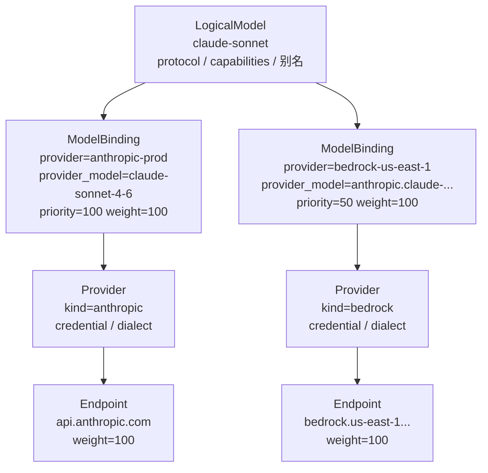
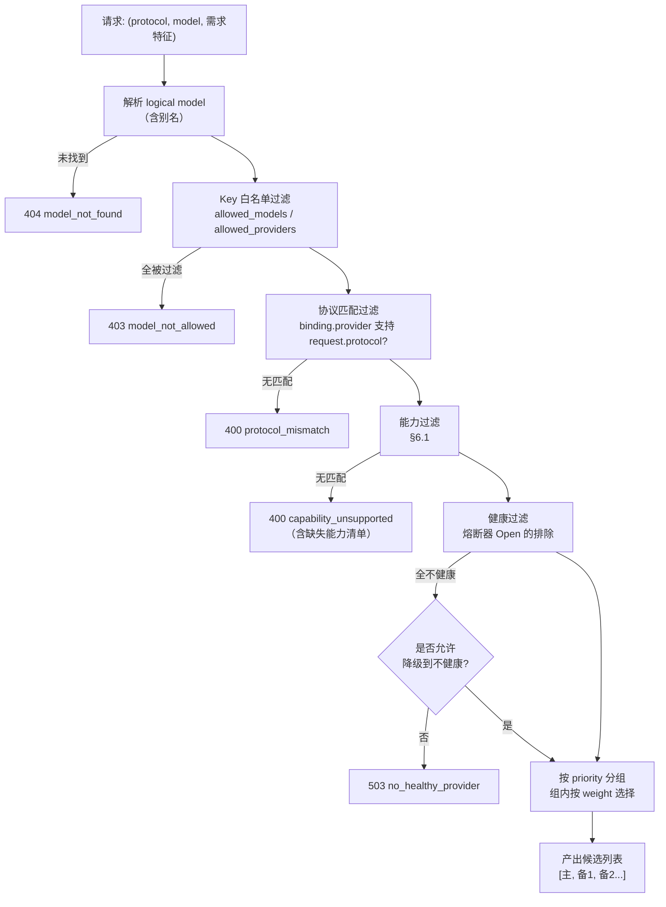
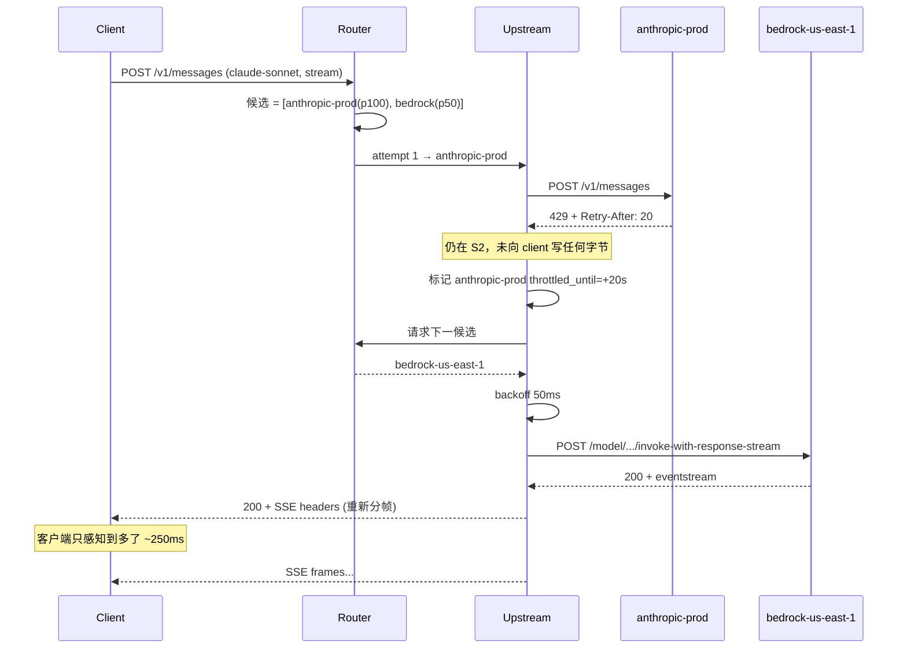

# 07 · Provider 路由与模型管理

> 状态：Draft v1 · 最后更新 2026-08-19
> 前置：`04-protocols.md`（Protocol/ProviderKind 正交）、`02-data-plane.md` §7（retry 状态机）
> 本文合并了原计划的「模型管理」章节（第十节），因为路由与模型映射是同一个问题的两面。

---

## 1. Problem

一个逻辑模型可能有多个来源：

```text
claude-sonnet
  ├─ anthropic-prod    / claude-sonnet-4-6              priority=100
  ├─ bedrock-us-east-1 / anthropic.claude-sonnet-4-6-v1:0  priority=50
  └─ vertex-us-central / claude-sonnet-4-6@20260101     priority=50
```

需要决定：正常时走哪个、失败时怎么切、如何避免打爆一个已经不健康的 provider、什么时候可以重试。

同时必须避免一个危险的错觉：**"同一个逻辑模型的不同绑定是等价的"**。它们的模型 ID 不同、能力子集不同、上下文窗口可能不同、定价不同、甚至 tokenizer 行为可能有细微差异。把它们当作可任意替换的会产生难以察觉的错误。

AI streaming 还带来一个特殊约束：**重试不是免费的，且大部分时候根本不允许**。

---

## 2. Goals

- G-R1 选路是纯内存计算，O(候选数)，无 IO。
- G-R2 单个 provider 故障时，流量在秒级内自动转移，且客户端无感知（前提：在 S2 之前）。
- G-R3 不健康的 provider 不会被持续打击（熔断）。
- G-R4 绝不在已向客户端输出内容后重试。
- G-R5 能力不匹配（如请求带图但目标 provider 不支持 vision）必须在**选路阶段**被发现，而非上游报错。

## 3. Non-goals

- 不做基于成本的自动最优选路（Phase 3；MVP 只提供手动 priority/weight）。
- 不做跨 region 的智能就近路由。
- 不做请求级别的模型自动升降级（如"简单问题用小模型"）。
- 不做 provider 侧的容量预测。

---

## 4. 数据模型

### 4.1 三层结构



三层的职责：
- **LogicalModel**：客户端看到的名字。声明 `protocol` 与**保证的最小能力集**。
- **ModelBinding**：逻辑模型 → 某个 provider 上的具体模型。承载 priority / weight / 能力覆盖 / 定价。
- **Provider + Endpoint**：如何连接。一个 provider 可以有多个 endpoint（多 region / 多部署）。

### 4.2 类型定义

```rust
pub struct LogicalModel {
    pub name: CompactString,             // "claude-sonnet"
    pub aliases: SmallVec<[CompactString; 2]>,
    pub protocol: Protocol,              // 决定可以从哪个 endpoint 调用
    /// 声明的能力。选路时用于 §6.1 的能力校验。
    pub capabilities: Capabilities,
    pub bindings: Vec<Arc<ModelBinding>>,
    pub routing: RoutingPolicy,
    pub deprecated: Option<DeprecationInfo>,
}

pub struct ModelBinding {
    pub id: BindingId,
    pub provider_id: ProviderId,
    pub provider_model: CompactString,   // 上游真实模型 ID
    pub deployment_name: Option<CompactString>,  // Azure 专用
    pub priority: u8,                    // 大者优先
    pub weight: u16,                     // 同 priority 内的权重
    /// 覆盖逻辑模型的能力声明（该 provider 上此模型的真实能力）
    pub capability_overrides: CapabilityOverrides,
    pub pricing: Option<Pricing>,
    pub enabled: bool,
}

pub struct Capabilities {
    pub streaming: bool,
    pub tools: bool,
    pub parallel_tools: bool,
    pub vision: bool,
    pub audio_input: bool,
    pub reasoning: bool,
    pub structured_output: bool,
    pub prompt_caching: bool,
    pub context_length: u32,
    pub max_output_tokens: u32,
}
```

### 4.3 能力是绑定级的，不是模型级的

**这是本文最重要的数据建模决定。**

`LogicalModel.capabilities` 是"客户端可以依赖的最小保证"，`ModelBinding.capability_overrides` 是"这个 provider 上的真实能力"。

真实例子：
- `claude-sonnet` 在 Anthropic 原生 API 上支持 prompt caching；在某些 Bedrock region 上不支持或语义不同。
- 同一个模型在 Vertex 上的 `max_output_tokens` 可能低于原生。
- 某个 OpenAI-compatible 的自建 vLLM 服务声称支持 `tools`，但实际不支持 `parallel_tool_calls`。

选路时使用的是**绑定级的有效能力**：

```rust
impl ModelBinding {
    fn effective_capabilities(&self, base: &Capabilities) -> Capabilities {
        let mut c = base.clone();
        self.capability_overrides.apply(&mut c);   // 只能收窄，不能放宽
        c
    }
}
```

`capability_overrides` **只允许收窄**（`true → false`，数值只减不增）。放宽会让 `LogicalModel` 的保证失效，Control Plane 在保存时拒绝放宽的配置。

---

## 5. 选路算法

### 5.1 流程



**产出的是一个有序候选列表**，不是单个决定。retry 循环按序尝试（见 §7）。

### 5.2 组内选择策略

```rust
pub enum RoutingStrategy {
    /// 默认。同 priority 内按 weight 加权随机。
    WeightedRandom,
    /// 同 priority 内轮询。适合权重相同且要求严格均衡的场景。
    RoundRobin,
    /// 选择近期 p95 TTFT 最低的。需要健康统计。
    LeastLatency { window: Duration },
    /// 选择在途请求数最少的。适合各 provider 容量差异大的场景。
    LeastPending,
}
```

MVP 实现 `WeightedRandom` 与 `RoundRobin`。`LeastLatency` 的问题是容易产生羊群效应（所有请求瞬间涌向最快的那个，然后它变慢），需要配合 EWMA 平滑与抖动，排在 Phase 2。

`WeightedRandom` 的实现必须避免每请求分配：预计算累积权重数组存在 `RouteTable` 里，选择时一次二分查找。

### 5.3 粘性（stickiness）

对多轮对话，切换 provider 有隐性代价：**prompt cache 失效**。Anthropic 与 OpenAI 的 prompt caching 都是 provider 侧的，切到另一家等于缓存全丢，成本可能翻数倍。

因此提供可选的会话粘性：

```toml
[routing]
sticky = "conversation"    # none | conversation | api_key
sticky_ttl = "30m"
```

`sticky = "conversation"` 时，用 `hash(conversation_id)` 做 rendezvous hashing 选择 binding，只要该 binding 健康就一直用它。健康检查失败时正常 fallback（粘性不能凌驾于可用性之上）。

> 注意：粘性依赖 `conversation_id`，而 `conversation_id` 可能是 `Inferred` 的（见 `06-observation-model.md` §9）。推断错误时粘性失效，只是性能损失不是正确性问题。可接受。

---

## 6. 能力校验

### 6.1 请求特征提取

选路前从请求中提取"需求特征"。这需要一次轻量的探测（比 `04-protocols.md` §8 的最小探测多一点）：

```rust
pub struct RequestDemand {
    pub streaming: bool,
    pub has_tools: bool,
    pub has_images: bool,
    pub has_audio: bool,
    pub wants_reasoning: bool,          // Anthropic thinking / OpenAI reasoning
    pub wants_structured_output: bool,   // response_format / json_schema
    pub uses_prompt_caching: bool,       // cache_control 出现
    pub max_tokens_requested: Option<u32>,
}
```

提取是**尽力而为**的：解析失败时所有字段为保守值（`false` / `None`），意味着不会因为提取失败而拒绝请求。

### 6.2 校验规则

```rust
fn capability_gap(demand: &RequestDemand, caps: &Capabilities) -> CapabilityGap {
    let mut gap = CapabilityGap::default();
    if demand.streaming      && !caps.streaming { gap.push("streaming"); }
    if demand.has_tools      && !caps.tools     { gap.push("tools"); }
    if demand.has_images     && !caps.vision    { gap.push("vision"); }
    if demand.wants_reasoning && !caps.reasoning { gap.push("reasoning"); }
    if let Some(m) = demand.max_tokens_requested {
        if m > caps.max_output_tokens { gap.push_value("max_output_tokens", m, caps.max_output_tokens); }
    }
    gap
}
```

**能力不足时的行为分两种**：

| 情况 | 行为 |
|------|------|
| 所有候选都缺该能力 | 400 + 明确的缺失清单（不浪费一次上游 RTT） |
| 部分候选缺该能力 | 缺的那些被过滤掉，只在剩余候选中选路 |

第二种情况很关键：如果请求带图片，`claude-sonnet` 的 Bedrock 绑定不支持 vision 而 Anthropic 绑定支持，那么这个请求就只能走 Anthropic——**能力过滤是选路的一部分，不是事后检查**。

错误信息要具体：

```json
{"type":"error","error":{
  "type":"invalid_request_error",
  "message":"model 'claude-sonnet' cannot serve this request: no binding supports [vision]. Available bindings: anthropic-prod(vision:false due to override), bedrock-us-east-1(vision:false)."
}}
```

### 6.3 `prompt_caching` 的特殊处理

`uses_prompt_caching = true` 时**不**作为硬性过滤条件（缺少缓存只是贵，不是错）。但会：
- 优先选择支持的 binding（作为软权重加成）
- 若最终选了不支持的 binding，在响应头加 `x-argus-warning: prompt-caching-unsupported-on-selected-provider`
- 记录到 audit

这体现了「能力有硬性和软性之分」。

---

## 7. Retry 与 Fallback

### 7.1 与主链路状态机的对应

回顾 `02-data-plane.md` §7.1 的状态机。retry 决策表：

| 状态 | 触发条件 | 默认动作 | 说明 |
|------|---------|---------|------|
| **S0** connect/DNS/TLS 失败 | `ConnectError` | ✅ 立即 fallback 到下一候选 | provider 完全没收到请求，绝对安全 |
| **S0** 熔断器 Open | 选路时 | ✅ 直接跳过该候选 | 不产生网络请求 |
| **S1** 请求已发出，header 超时 | `Timeouts.headers` | ✅ fallback（可配置关闭） | 可能重复计费，见 §7.3 |
| **S1** 连接在等 header 时断开 | `IncompleteMessage` | ✅ fallback | 同上 |
| **S2** 429 | status | ✅ fallback + 熔断计数 | 最典型的场景 |
| **S2** 500/502/503/504 | status | ✅ fallback + 熔断计数 | |
| **S2** 408 | status | ✅ fallback | |
| **S2** 401/403 | status | ❌ **不 fallback** | 凭据问题，换 provider 无用且掩盖配置错误。直接透传 + 告警 |
| **S2** 400/404/422 | status | ❌ 不 fallback | 客户端错误，换 provider 结果一样 |
| **S2** 413 | status | ❌ 不 fallback | 请求太大 |
| **S3** 流中断/超时 | 任意 | ❌ **永不 retry** | 已向客户端输出 |

**401/403 不 fallback** 是一个刻意的选择：如果主 provider 的 key 过期了，静默切到备用 provider 会掩盖问题，直到备用也出问题时才爆发。宁可让请求失败并立刻告警。

### 7.2 重试预算

```toml
[routing.retry]
max_attempts = 3           # 含首次，即最多 2 次重试
# 同一个 provider 最多试几次（防止在同一个坏 provider 上耗尽预算）
max_attempts_per_provider = 1
# 总的 fallback 时间预算。超过则直接返回错误，不再尝试。
budget = "10s"
# S1（已发出请求但无响应）是否重试
on_no_response = true
# 退避
backoff = { initial = "50ms", max = "1s", multiplier = 2.0, jitter = 0.3 }
```

`max_attempts_per_provider = 1` 很重要：默认情况下每次重试都换一个 provider。在同一个刚失败的 provider 上重试通常只是浪费时间。

`budget` 是硬性的：AI 请求本身就慢，如果 fallback 耗掉 10 秒，用户体验已经很差了，不如快速失败让客户端自己决定。

**全局重试预算**（防重试风暴）：

```rust
// 令牌桶：全局重试次数不超过总请求数的 10%
if !retry_budget.try_acquire() {
    metrics::counter!("argus_retry_budget_exhausted_total").increment(1);
    return Err(last_error);      // 不重试，直接返回
}
```

没有这个全局预算，provider 大面积故障时重试会把请求量放大 3 倍，进一步压垮 provider 和自己。这是级联故障的经典成因。

### 7.3 S1 重试的计费风险

S1 = "请求已写入 socket，但还没收到 response header"。此时 provider 可能：
- (a) 根本没收到（网络丢包）→ 重试安全
- (b) 收到了但还在排队 → 重试会产生两次排队，但只有一次计费（另一次的响应被我们丢弃……**但 provider 仍会计费**）
- (c) 收到了且已开始生成 → 重试确定双倍计费

无法从客户端区分这三种情况。默认 `on_no_response = true` 的理由是 (a) 在实践中最常见（尤其是跨境网络）。

**风险缓解**：
1. 每次 S1 重试都在 audit 中记录 `retry_after_send = true` + 被放弃的 attempt 的 `provider_request_id`（若有）。
2. 提供 `GET /admin/v1/stats/potential_double_billing` 查询，列出所有 S1 重试，供财务核对。
3. `headers` 超时默认设得较长（60s），减少误判。推理模型首 token 可能需要 30 秒以上，超时设短会大量误触发 S1 重试。

### 7.4 Fallback 的可观测性

每次 fallback 必须在响应头暴露，否则客户端无法诊断"为什么这次特别慢"：

```http
x-argus-provider: bedrock-us-east-1
x-argus-attempts: 2
x-argus-fallback-from: anthropic-prod
x-argus-request-id: req_01J...
```

以及在 audit 里记录完整的 attempt 链：

```rust
pub struct AttemptRecord {
    pub seq: u8,
    pub provider_id: ProviderId,
    pub endpoint_id: EndpointId,
    pub outcome: AttemptOutcome,     // Success / HttpError(u16) / Timeout(stage) / ConnectError
    pub stage_reached: UpstreamStage,// S0/S1/S2/S3
    pub duration_micros: u32,
}
```

---

## 8. 健康检查与熔断

### 8.1 被动健康检查（主）

不做主动探测作为主要机制。理由：主动探测会消耗配额、可能被 provider 视为异常流量、且探测成功不代表真实请求会成功（模型不同、token 数不同）。

**用真实流量的结果驱动熔断**：

```rust
pub struct CircuitBreaker {
    state: AtomicU8,              // Closed / Open / HalfOpen
    window: SlidingWindow,        // 近 N 秒的成功/失败计数
    opened_at: AtomicU64,
}
```

```toml
[routing.circuit_breaker]
window = "30s"
# 触发条件（同时满足）
min_requests = 20            # 样本太少不判断
failure_rate = 0.5           # 失败率阈值
# 打开后
open_duration = "15s"
half_open_probes = 3         # 半开时放行几个请求试探
```

**什么算失败**（进入熔断计数）：
- 连接错误、TLS 错误、DNS 失败
- 5xx
- 408 / 429（429 单独计数，见 §8.2）
- headers 超时

**什么不算失败**：
- 4xx（除 408/429）—— 客户端错误，不是 provider 不健康
- S3 阶段的流中断 —— 可能是客户端断开
- 请求被 PreflightGuard 拒绝

### 8.2 429 的特殊处理

429 意味着"provider 还活着，只是我们超配额了"。熔断它 15 秒可能过于激进（配额可能是每分钟窗口）。

单独处理：

```rust
// 429 不进主熔断器，而是进一个"限流退避"状态
if status == 429 {
    let retry_after = parse_retry_after(&headers)
        .unwrap_or_else(|| backoff.next_for(provider_id));
    provider_state.throttled_until = Instant::now() + retry_after;
    // 选路时跳过 throttled 的 provider，但不算熔断
}
```

尊重 provider 的 `Retry-After` header 是关键——它比我们的猜测准确得多。

### 8.3 可选的主动探测

对于**冷备**（priority 很低、长期无流量的 binding），被动检查永远没有样本。此时可选启用轻量主动探测：

```toml
[[models.bindings]]
provider = "bedrock-us-east-1"
priority = 10
health_probe = { enabled = true, interval = "5m", type = "models_list" }
```

`type = "models_list"` 用 `GET /v1/models` 之类的免费端点，不消耗 token 配额。**不做 chat 探测**——那会真的花钱。

探测失败只影响该 binding 的 `probe_healthy` 标志，作为选路的软信号（降权），不直接熔断。

---

## 9. Data Flow：一次 fallback



---

## 10. Failure Modes

| 场景 | 行为 |
|------|------|
| 所有 binding 都熔断 | 503 `no_healthy_provider`，`Retry-After` = 最近一个熔断器的剩余时间 |
| 所有 binding 都 throttled（429） | 503 + `Retry-After` = 最小的 `throttled_until` |
| 唯一的 binding 返回 401 | 502 + 原始 provider 错误 + 立即告警（`argus_provider_auth_failure_total`） |
| 重试预算耗尽（全局） | 直接返回上一个错误，记 `argus_retry_budget_exhausted_total` |
| `budget` 时间耗尽 | 返回上一个错误 + `x-argus-attempts` |
| binding 配置指向不存在的 provider | 配置加载时校验失败 → 该 binding 被禁用 + 告警，不影响其他 binding |
| 能力过滤后无候选 | 400 + 缺失能力清单 |
| provider 返回的 model 与请求的不同 | 记录 `ResponseStart.model` != `provider_model`，产生 anomaly（provider 可能做了静默替换） |
| 熔断器状态在多实例间不共享 | 每实例独立熔断。可接受（每实例都会独立发现故障），但故障发现速度与实例数无关 |

最后一条值得展开：熔断器是**进程内**的。多实例部署时，10 个实例各自需要 20 个失败样本才熔断，总共浪费 200 个请求。可选用 Redis 共享熔断状态，但这会引入对 Redis 的依赖。**MVP 接受进程内熔断**，因为 `min_requests=20` 的样本代价是可接受的。

---

## 11. Trade-offs

| 选择 | 收益 | 代价 |
|------|------|------|
| 能力在 binding 级 | 不会因为"以为等价"而路由到不支持的 provider | 配置更繁琐，需要维护每个 binding 的能力 |
| 被动健康检查为主 | 不消耗配额，反映真实情况 | 冷备 binding 无样本（用可选主动探测补） |
| 401/403 不 fallback | 配置问题立刻暴露 | 单 provider 凭据失效时服务中断 |
| S1 默认重试 | 提高跨境网络下的成功率 | 潜在双倍计费（已记录可核查） |
| 全局重试预算 | 防级联故障 | 大面积故障时部分请求不重试就失败 |
| 进程内熔断 | 无外部依赖 | 多实例时发现速度不随实例数提升 |
| 会话粘性可选 | 保住 prompt cache | 依赖 conversation_id 的准确性 |
| 不做成本最优路由 | 行为可预测 | 用户需要手动配置 priority |

---

## 12. Alternatives Considered

**A. 用 `tower::balance` + `tower::load` 做负载均衡。**
Tower 的 balance 基于 `Discover` + `Load` 抽象，设计给同构后端。我们的候选是异构的（不同模型 ID、不同能力、不同定价），且需要在失败后按 §7.1 的规则决定是否换。**否决**，手写选路。

**B. 主动健康检查为主（每 10 秒 ping 每个 provider）。**
消耗配额、可能触发 provider 的异常检测、且 ping 成功不代表大请求会成功。**否决**为主要机制，保留为冷备的可选补充。

**C. 用 Redis 共享熔断器与限流状态。**
更快的故障发现与更准的全局限流，但引入强依赖。**否决**为默认，作为 `12-reliability.md` §6 的可选增强。

**D. 请求失败时自动降级到更小的模型。**
听起来很聪明，实际很危险：用户请求 `claude-opus` 却收到 `claude-haiku` 的输出质量，而客户端毫不知情。**否决**。如果要做，必须是显式配置的 `fallback_model` 且在响应头明确标注。

**E. 把 429 也算作熔断失败。**
会导致配额型限流被误判为 provider 故障，15 秒的熔断可能远长于实际需要的退避。**否决**，单独用 `throttled_until` 处理并尊重 `Retry-After`。

---

## 13. Decision

1. 三层模型：`LogicalModel` → `ModelBinding` → `Provider`/`Endpoint`。
2. **能力在 binding 级生效，`capability_overrides` 只允许收窄。**
3. 选路产出**有序候选列表**，经过白名单 → 协议 → 能力 → 健康四层过滤。
4. MVP 策略：`WeightedRandom`（默认）+ `RoundRobin`；`LeastLatency` 推迟。
5. retry 严格遵守 S0–S3 状态机；**S3 后永不 retry**；401/403/4xx 不 fallback。
6. 重试有三重预算：`max_attempts`、时间 `budget`、全局令牌桶。
7. S1 重试默认开启，但必须记录 `retry_after_send` 供计费核查。
8. 熔断为被动、进程内；429 走独立的 `throttled_until` 并尊重 `Retry-After`。
9. 每次 fallback 通过响应头与 audit 的 `AttemptRecord` 链完全可见。
10. 会话粘性可选，用于保护 provider 侧 prompt cache，但不凌驾于可用性。

---

## 14. Open Questions

| # | 问题 | 现状 | 何时决定 |
|---|------|------|---------|
| OQ-1 | 进程内熔断在 20+ 实例规模下是否仍可接受？ | 接受 | 部署规模超过 10 实例时 |
| OQ-2 | `LeastLatency` 的羊群效应如何缓解？（EWMA + 抖动 + power-of-two-choices） | 未实现 | Phase 2 |
| OQ-3 | 是否需要按 `RequestDemand` 动态调整超时？（带图/长上下文的请求应有更长 headers 超时） | 未做 | 出现误超时时 |
| OQ-4 | provider 静默替换模型（返回的 model != 请求的）时是否应该报错？ | 当前只记 anomaly | 观察真实发生率 |
| OQ-5 | 成本感知路由的最小可用形态是什么？ | 未设计 | Phase 3 |
