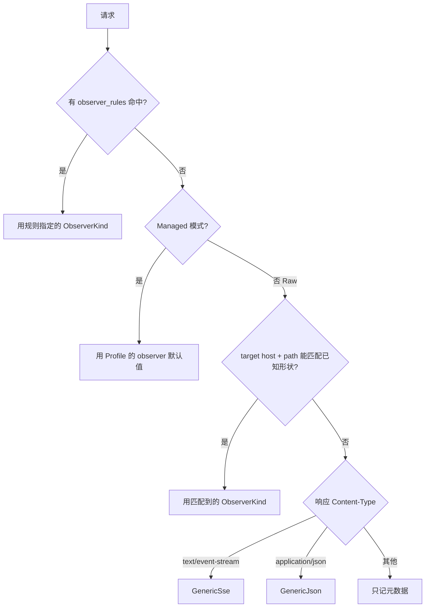

# 09 · Observer

> 状态：Draft v2 · 最后更新 2026-08-20
> 本文定义 Argus 认识的线上协议、endpoint 映射、header 变换规则，以及「Protocol 与 Provider 解耦」的具体含义。
> SSE 字节层处理见 `10-streaming.md`；事件语义映射见 `11-observation-model.md`。

---

## 1. Problem

「一个 Provider = 一套协议」是错误的模型。现实是：

- 同一个协议（OpenAI Chat Completions）被十几家供应商实现：OpenAI、Azure、DeepSeek、Qwen、Together、Groq、vLLM、Ollama……
- 同一个供应商提供多个协议：OpenAI 同时有 Chat Completions 和 Responses；Anthropic 的模型同时可通过 Anthropic 原生 API、Bedrock、Vertex 访问，而这三者的**线上格式并不相同**。
- 同一个模型在不同 provider 上有不同的模型 ID、不同的能力子集、不同的 header 要求。

如果把这三个维度耦合成一个枚举，配置模型会立刻崩塌。

---

## 2. Goals

- G-P1 `Protocol` 与 `ProviderKind` 是两个正交维度。
- G-P2 新增一个 OpenAI-compatible 供应商**不需要写代码**，只需配置。
- G-P3 provider 新增未知字段 / 未知 SSE event 时，Argus 原样透传且不报错。
- G-P4 header 变换规则是数据驱动的表，不是散落在代码里的 if-else。

## 3. Non-goals

- 不做跨协议转换（见 §7）。
- 不校验请求体的业务字段（不做 JSON Schema 校验，见 §8）。
- MVP 不实现 Gemini `generateContent` 与 Bedrock 原生 eventstream（见 §9）。

---

## 4. Observer 是怎么选出来的

**Observer 与路由无关。** 路由已经在 P1 由 URL 决定完了
（`02-routing-model.md`）；Observer 回答的是另一个问题：

> 这条流里的字节，该用哪套语义去理解？

### 4.1 `ObserverKind`

```rust
#[non_exhaustive]
pub enum ObserverKind {
    OpenAiChat,              // /v1/chat/completions 形状
    OpenAiResponses,         // /v1/responses 形状
    AnthropicMessages,       // /v1/messages 形状
    GeminiGenerateContent,   // 预留，MVP 不实现
    /// 认不出具体协议，但是 SSE：切帧、记 raw、统计事件数，不解语义
    GenericSse,
    /// 认不出协议，非流式 JSON：记 raw + 顶层字段名，不解语义
    GenericJson,
}
```

最后两个是新增的，也是关键的：**认不出来不等于不观测**。
`GenericSse` / `GenericJson` 保证 Raw 模式和未知供应商仍然有基础观测
（字节数、事件数、耗时、状态码、raw 留存），而不是一片空白。

### 4.2 三级判定



`observer_rules` 是 Control Plane 里的一张有序规则表：

```yaml
observer_rules:
  # Profile 默认是 openai-chat，但 /v1/responses 要用另一个 observer
  - match: { profile: "openai-prod", path_prefix: "/v1/responses" }
    observer: openai-responses
  # 任何 host 上的 /v1/messages 都按 Anthropic 理解
  - match: { path_prefix: "/v1/messages" }
    observer: anthropic-messages
  - match: { host_suffix: "api.anthropic.com" }
    observer: anthropic-messages
```

匹配维度：`profile` / `host_suffix` / `path_prefix` / `method` / `content_type`。
多个条件之间是 **AND**。**首个命中生效**，没有权重也没有打分——可预测比聪明重要。

`host_suffix` 匹配该域名自身与它的子域：`anthropic.com` 命中
`api.anthropic.com`，但不命中 `notanthropic.com` 或 `anthropic.com.evil.net`。

规则里的 `content_type` 指的是**请求**的，不是响应的。理由见 §4.2.1：前三级
必须在发出请求之前就能判完，那时响应头还不存在。

### 4.2.1 判定分两步

图上是四级，实现上是两步，因为**第四级要等响应 header**：

```text
请求时      provisional()       规则 → Profile 默认值 → Raw 按 path 猜
响应头到达  resolve_observer()  没定下来就按 Content-Type 兜底；
                                定下来了则**只准收窄**
```

「只准收窄」是硬约束：收到 header 之后可以把一个语义 Observer 降成 Generic，
但**不能换成另一个语义 Observer**——那会让已经解析出来的事件与后面的不一致。

几条实现上必须说清楚的：

- **图上第四级只挂在 Raw 分支下**，因为 Managed 总有 Profile 默认值兜着，
  第二级就返回了。但「收窄」对 Managed 同样适用：Profile 说这是
  `OpenAiChat`，而响应回来是 `text/html`，那就该降级而不是硬解。
- **Raw 的猜测只看 path 前缀，不看 host。** 形状是比 host 强得多的信号：
  `/v1/messages` 会出现在 `api.anthropic.com`、Bedrock、Vertex，以及任何
  anthropic-compatible 的自建服务上（§4.3）。
- **缺 `Content-Type` 时按「能承载」处理**，不降级。不少上游在流式响应上
  根本不发这个头，一律降级会把正常的流一起降掉。
- 「其他 Content-Type → 只记元数据」这一支由 `GenericJson` 实现：它在非
  JSON 输入上退化成 `Malformed`，留下的正好只有字节数与形状，没有 key、
  更没有 value。不需要再造一个 `MetadataOnly` 变体。

### 4.3 为什么 Observer 不能和 Provider 绑死

一个 Profile 可以同时提供多种形状的 endpoint：

```text
openai-prod  /v1/chat/completions  → OpenAiChat
openai-prod  /v1/responses         → OpenAiResponses
openai-prod  /v1/embeddings        → GenericJson
```

反过来，同一种形状横跨多个 Profile：`AnthropicMessages` 会出现在
`anthropic-prod`、`bedrock-*`、`vertex-*`、以及任何 anthropic-compatible 的自建服务上。

把 Observer 挂在 Profile 上（一个 Profile 只能一种）会立刻在第一个
多 endpoint 的供应商上崩掉。所以 Profile 上的 `observer` 只是**默认值**，
`observer_rules` 才是精确控制。

### 4.4 选错了会怎样

不会怎样。Observer 选错的后果是**观测数据降级**：解析不出事件，
`unknown` 计数上升，interaction 标 `Integrity::Degraded`。

**主链路一个字节都不受影响**——它根本不看 Observer 的输出。
这是 `05-transparent-proxy.md` §4.2 那条分工的直接好处。

---

## 5. 三种协议的线上要点

以下是 Argus 必须正确处理的协议细节。**这些不是完整 API 文档，只列出对代理与解析有影响的部分。**

### 5.1 OpenAI Chat Completions

**请求**：`POST /v1/chat/completions`，关键字段 `model`、`messages`、`stream`、`stream_options.include_usage`、`tools`、`tool_choice`。

**非流式响应**：`{"id","object":"chat.completion","choices":[{"index","message","finish_reason"}],"usage"}`

**流式响应**（SSE，**无 `event:` 行，只有 `data:`**）：

```text
data: {"id":"chatcmpl-x","object":"chat.completion.chunk","choices":[{"index":0,"delta":{"role":"assistant","content":""},"finish_reason":null}]}

data: {"id":"chatcmpl-x","choices":[{"index":0,"delta":{"content":"Hello"},"finish_reason":null}]}

data: {"id":"chatcmpl-x","choices":[{"index":0,"delta":{},"finish_reason":"stop"}]}

data: {"id":"chatcmpl-x","choices":[],"usage":{"prompt_tokens":10,"completion_tokens":5,"total_tokens":15}}

data: [DONE]
```

对解析器有影响的坑（每一条都有对应的 golden test，见 `20-testing-strategy.md`）：

| # | 坑 | 处理 |
|---|---|---|
| C1 | `data: [DONE]` 不是 JSON | framer 层特判，产出 `StreamDone` |
| C2 | tool_calls 是数组，用 `index` 标识，`id`/`name` 只在首个 chunk 出现 | 以 `index` 为 key，`id`/`name` 用 first-non-empty |
| C3 | 部分 provider 会**分片发送 `function.name`** | `name` 必须 append 而非覆盖 |
| C4 | usage 在 `choices:[]` 的最后一个 chunk（需 `include_usage`） | 独立处理 `choices` 为空的 chunk |
| C5 | `finish_reason` 可能与最后一个 content delta 在同一 chunk | 一个 chunk 可产出多个 `ObservedEvent` |
| C6 | DeepSeek 等用 `delta.reasoning_content` 承载推理 | 映射为 `BlockKind::Reasoning`（provider 方言，见 §6.3） |
| C7 | `n > 1` 时有多个 `choices`，各有独立 `index` | 每个 choice 是独立的 block 命名空间，见 `06` §5.1 |
| C8 | 某些 provider 在流末尾不发 `[DONE]` | 上游 EOF 也视为正常结束，不报错 |

### 5.2 OpenAI Responses

**请求**：`POST /v1/responses`，字段 `model`、`input`、`stream`、`tools`、`reasoning`、`previous_response_id`、`store`。

**流式响应**：SSE，**同时有 `event:` 和 `data:` 行**，事件名是层级化的：

```text
event: response.created
data: {"type":"response.created","response":{...}}

event: response.output_item.added
data: {"type":"response.output_item.added","output_index":0,"item":{"type":"message","id":"msg_x",...}}

event: response.content_part.added
data: {"type":"response.content_part.added","output_index":0,"content_index":0,"part":{"type":"output_text","text":""}}

event: response.output_text.delta
data: {"type":"response.output_text.delta","output_index":0,"content_index":0,"delta":"Hello"}

event: response.output_item.done
data: {"type":"response.output_item.done","output_index":0,"item":{...}}

event: response.completed
data: {"type":"response.completed","response":{...,"usage":{...}}}
```

要点：

| # | 要点 | 处理 |
|---|---|---|
| R1 | `type` 字段与 `event:` 行冗余但可能不一致 | **以 `data` 里的 `type` 为准**，`event:` 行只作 fallback |
| R2 | 坐标是二维：`output_index` + `content_index` | 映射为 `BlockIndex::TwoLevel`，见 `06` §5.2 |
| R3 | 函数调用参数走 `response.function_call_arguments.delta` | 与 text delta 分开处理 |
| R4 | 推理摘要走 `response.reasoning_summary_text.delta` | `BlockKind::Reasoning { summary: true }` |
| R5 | `response.completed` 里含**完整最终响应**（含 usage） | 作为 Accumulator 的权威校验源，见 `06` §7.4 |
| R6 | 事件类型是开放集合，OpenAI 持续新增 | 未知 `response.*` → `ObservedEventKind::Unknown`，原样透传 |
| R7 | 失败态是 `response.failed` / `response.incomplete` | 映射到 `FinishReason::Error` / `Incomplete` |

### 5.3 Anthropic Messages

**请求**：`POST /v1/messages`，字段 `model`、`messages`、`system`、`max_tokens`（**必填**）、`stream`、`tools`、`thinking`。

**必需 header**：`anthropic-version: 2023-06-01`（缺失会被 Anthropic 拒绝）。

**流式响应**：SSE，`event:` + `data:` 双行：

```text
event: message_start
data: {"type":"message_start","message":{"id":"msg_x","model":"...","usage":{"input_tokens":25,"output_tokens":1}}}

event: content_block_start
data: {"type":"content_block_start","index":0,"content_block":{"type":"text","text":""}}

event: content_block_delta
data: {"type":"content_block_delta","index":0,"delta":{"type":"text_delta","text":"Hello"}}

event: content_block_stop
data: {"type":"content_block_stop","index":0}

event: message_delta
data: {"type":"message_delta","delta":{"stop_reason":"end_turn","stop_sequence":null},"usage":{"output_tokens":15}}

event: message_stop
data: {"type":"message_stop"}
```

要点：

| # | 要点 | 处理 |
|---|---|---|
| A1 | `ping` 事件可随时出现 | 忽略（但计数），不影响状态机 |
| A2 | delta 有多种 type：`text_delta` / `input_json_delta` / `thinking_delta` / `signature_delta` / `citations_delta` | 分别映射，见 `06` §4.3 |
| A3 | `input_json_delta.partial_json` 是**字符串片段**，拼接后才是 JSON | 只 buffer，`content_block_stop` 才 parse。见 `06` §7.2 |
| A4 | 无参数工具的 `partial_json` 拼接结果可能是**空字符串** | 空字符串 → `{}`，不是 parse 错误 |
| A5 | usage 分两处：`message_start` 给 input，`message_delta` 给 output | 合并策略：last-non-null wins（见 `06` §6） |
| A6 | `cache_creation_input_tokens` / `cache_read_input_tokens` 也在 usage | 必须保留，影响成本计算 |
| A7 | `thinking` block 有 `signature`，不可篡改 | 原样保存，脱敏时特殊处理（见 `08` §9） |
| A8 | `error` 事件可在流中任意位置出现 | 映射为 `ObservedEventKind::ProviderError`，**不中止解析**，后续帧照常透传 |
| A9 | 未来会有新 event type | 未知 event → `Unknown`，透传 + 记录 |
| A10 | `stop_reason` 取值集合会扩展（如 `refusal`、`model_context_window_exceeded`） | 映射为 `FinishReason::Other`，原文进 `Finish.raw_reason`（`docs/11` §4.5）|

---

## 6. Endpoint 与 URL：不由本文档决定

v1 在这里有一张「`ProviderKind` × `Protocol` → URL 模板」的表。**它已删除。**

新模型下上游 URL 完全由 URL 里的 path 决定：客户端打
`/provider/openai-prod/v1/responses`，Argus 就转发到 `{base_url}/v1/responses`。
Azure 那种 `deployments/{name}?api-version=` 的形状也一样——客户端怎么写就怎么转。
拼接规则见 `03-managed-provider-mode.md` §5。

> 这张表消失本身就是新路由模型的收益：Argus 不再需要知道每家供应商的
> endpoint 长什么样，也就不会因为某家改了路径而滞后。

### 6.1 `/v1/models` 不再由 Argus 合成

v1 让 `/v1/models` 返回 Argus 自己的逻辑模型清单。**这个行为已删除**，
因为它依赖模型目录，而模型目录已经不存在了（`02-routing-model.md` §3）。

现在 `GET /provider/{name}/v1/models` 就是一次普通的透明转发，
客户端拿到的是**那个 provider 真实的模型列表**。

这反而更正确：客户端问的是"这个 provider 有什么模型"，Argus 没有资格替它回答，
而且任何合成的答案都会过期。

> 若将来需要"我这把 Key 能访问哪些 provider"，那是 Control Plane 的
> `GET /admin/v1/profiles` ，不是 `/v1/models`。两者是不同的问题。

### 6.2 Provider 方言（dialect）

某些 OpenAI-compatible provider 在**响应形状**上有小偏差。用声明式配置而非代码分支：

```toml
[[providers]]
name = "deepseek"
provider_type = "deepseek"
base_url = "https://api.deepseek.com"

[providers.dialect]
# 推理内容字段名（OpenAI 官方无此字段）
reasoning_field = "reasoning_content"
# 是否支持 stream_options.include_usage
supports_stream_usage = true
# 是否会发送 data: [DONE]
emits_done_sentinel = true
```

**方言只影响 Observer 的解析行为，绝不改写转发的字节。**
这条必须严格遵守——方言配置错了顶多是观测数据不准，不会破坏代理。

注意方言里**没有** `auth_header` / `auth_scheme` 了：那属于 Profile 的
`credential.header` / `credential.format`（`08-provider-profiles.md` §5），
是接入配置不是观测配置。两者混在一起会让"改错方言导致请求失败"成为可能。

---

## 7. 跨协议转换：明确不做

### 7.1 决定

若客户端用 `Protocol::AnthropicMessages` 调用一个只提供 `Protocol::OpenAiChat` 的 provider，Argus 返回 **400**，不做隐式转换：

```json
{"type":"error","error":{
  "type":"invalid_request_error",
  "message":"model 'gpt-4o' is bound to provider protocol 'openai_chat' and cannot be served over the Anthropic Messages API. Use /v1/chat/completions instead, or bind an anthropic_messages-capable provider."
}}
```

Control Plane 在配置时就会拒绝这种绑定（见 `07-control-plane.md` §5.2），所以运行时遇到它意味着配置漂移。

### 7.2 为什么不做

跨协议转换看起来只是字段搬运，实际上是有损的：

| 语义 | Anthropic | OpenAI Chat | 转换损失 |
|------|-----------|-------------|---------|
| system prompt | 顶层 `system` 字段，可以是 block 数组、可带 cache_control | `messages[0].role="system"` | cache_control 丢失 |
| thinking | 独立 content block + `signature` | 无对应物 | 完全丢失，且 signature 丢失后无法回传给 Anthropic 继续对话 |
| tool_result | `messages[].content[]` 中的 block | 独立的 `role: "tool"` 消息 | 顺序与并行关系需要重建，易错 |
| prompt caching | `cache_control` 断点 | `prompt_cache_key`（语义完全不同） | 无法映射，且会显著改变成本 |
| 图片 | `source.type: base64/url` | `image_url.url`（可为 data URI） | 可映射但细节多 |
| `max_tokens` | 必填 | 可选 | 需要臆造默认值 |
| stop_reason | `end_turn`/`tool_use`/`max_tokens`/`refusal`/… | `stop`/`tool_calls`/`length`/`content_filter` | 非双射 |

一次转换丢失 cache_control，用户的成本可能翻数倍且毫无提示。**这类静默损失正是 Argus 要避免的东西。**

### 7.3 将来如果要做

作为**独立的、显式开启的** compatibility layer：

```text
POST /compat/anthropic/v1/messages   →  显式的兼容端点，与 /v1/messages 不同 path
```

- 走独立 path，让用户明确知道自己在用转换层。
- 转换层产出 `ObservedInteraction` 时标注 `translated_from: Protocol`，审计里可见。
- 有独立的 golden test 套件覆盖损失矩阵。
- 不复用 `/v1/*` 的透明路径，两者代码不交叉。

---

## 8. 请求体校验：只做最小必要

Argus **不做** JSON Schema 校验。理由：provider 的 schema 每周都在变，Argus 的 schema 必然滞后，滞后的校验会**拒绝合法请求**——这是最糟糕的失败模式。

只做三项最小解析（用 `serde_json` 的部分反序列化，不构造完整 `Value`）：

```rust
#[derive(Deserialize)]
struct RequestProbe<'a> {
    #[serde(borrow)] model: Option<&'a str>,   // 必需：选路
    stream: Option<bool>,                       // 必需：决定转发模式
    // 其他字段一律忽略
}
```

- `model` 缺失 → 400（无法选路）。
- `stream` 缺失 → 按协议默认（三者都默认 false）。
- 其他一切交给 provider 判断。provider 返回的 400 原样透传给客户端，**包括 provider 的原始错误信息**——这比 Argus 自己编一个更有用。

> 例外：PreflightGuard 需要更深的解析（提取 system/user message、tool 定义）。它使用**独立的、容错的**提取器（见 `12-security.md` §5），提取失败时降级为「只检查 raw 文本」，绝不因此拒绝请求。

---

## 9. 预留协议

### 9.1 Gemini `generateContent`

- URL：`{base}/v1beta/models/{model}:streamGenerateContent?alt=sse`
- 请求形状与 OpenAI/Anthropic 差异大（`contents[].parts[]`、`systemInstruction`、`functionDeclarations`）。
- SSE 只有 `data:` 行，每个 chunk 是完整的 `GenerateContentResponse`（**不是增量 delta，是累积快照的分片**）。
- 结论：需要独立的 `GeminiParser`，语义映射不平凡。排在 MVP 之后。

### 9.2 Bedrock：流式不是 SSE

这是一个必须提前记录的架构风险。

Bedrock 的 `invoke-with-response-stream` 返回 `application/vnd.amazon.eventstream`——**AWS 私有的二进制帧格式**（prelude + headers + payload + CRC32），不是 SSE。

影响：
- `SseFramer` 不适用，需要一个 `EventStreamFramer`。
- 但**上层的 `ProtocolObserver` 可以复用**：解出的 payload 是标准的 Anthropic 事件 JSON。

因此 `argus-protocol` 的接口必须把「分帧」与「解析」分开：

```rust
pub trait Framer {
    /// 喂入字节，产出零个或多个逻辑帧
    fn push(&mut self, input: &TeeChunk, out: &mut FrameSink) -> Result<(), FramerError>;
}
pub struct SseFramer { .. }
pub struct EventStreamFramer { .. }   // Bedrock，Phase 3

pub trait ProtocolObserver {
    fn on_frame(&mut self, frame: Frame<'_>, out: &mut EventSink) -> Result<(), ParseError>;
}
```

这个分层从 MVP 第一天就要有，否则 Bedrock 支持会需要重构。**这是本文最重要的前瞻性约束。**

另外，Bedrock 的透明代理还有一个更麻烦的问题：客户端用 Anthropic SDK 发来的是 SSE 期望，而 Bedrock 返回二进制 eventstream。这意味着 `AnthropicMessages` over `Bedrock` **不可能是纯字节透传**，必须重新分帧。这属于「帧格式转换」而非「协议语义转换」，是可接受的（语义无损），但要在文档和实现中标记为**特殊路径**：

```text
Anthropic client → Argus → Bedrock
  字节层：SSE ← 重新分帧 ← eventstream      （有损：帧边界改变）
  语义层：完全无损（event JSON 逐字保留）
```

---

## 10. Data Model

```rust
pub struct ProviderConfig {
    pub id: ProviderId,
    pub name: CompactString,
    pub kind: ProviderKind,
    pub endpoints: Vec<Arc<ProviderEndpoint>>,
    pub credential: Arc<ResolvedCredential>,
    pub dialect: Arc<Dialect>,
    pub supported_protocols: EnumSet<Protocol>,
    pub health: Arc<HealthState>,
}

pub struct ProviderEndpoint {
    pub id: EndpointId,
    pub base_url: Url,
    pub region: Option<CompactString>,
    pub weight: u16,
    pub priority: u8,
    pub timeouts: Timeouts,
    pub extra_headers: Arc<HeaderMap>,   // 预构造，避免每请求分配
}

pub struct Dialect {
    pub reasoning_field: Option<CompactString>,
    pub supports_stream_usage: bool,
    pub emits_done_sentinel: bool,
    pub auth_header: HeaderName,
    pub auth_scheme: Option<CompactString>,
    pub required_headers: Arc<HeaderMap>,     // 如 anthropic-version
}
```

---

## 11. Failure Modes

| 场景 | 行为 |
|------|------|
| 未知 endpoint path | 404，OpenAI 形状错误（默认） |
| `model` 字段缺失 | 400，按调用协议形状 |
| 逻辑模型的绑定 protocol ≠ 调用 protocol | 400 + 明确指引（§7.1） |
| provider 返回未知 SSE event | 透传 + `ObservedEventKind::Unknown` + `argus_unknown_event_total{protocol,event}` 指标 |
| provider 返回未知 JSON 字段 | 透传（我们从不重新序列化），Accumulator 存入 `extensions` |
| 方言配置错误（如 `reasoning_field` 写错） | 观测数据缺失该字段，**代理不受影响** |
| Anthropic 缺 `anthropic-version` header | 由 `Dialect.required_headers` 强制注入，不依赖客户端 |
| Azure 缺 `api-version` | 配置校验期拒绝保存该 endpoint |

---

## 12. Trade-offs

| 选择 | 收益 | 代价 |
|------|------|------|
| Protocol / ProviderKind 正交 | 新 OpenAI-compatible provider 零代码 | 配置维度增加，需要 §5.2 的语义校验兜住错误组合 |
| 不做请求体校验 | 永不误拒合法请求；provider 新字段立刻可用 | 错误请求要多走一次上游 RTT 才报错 |
| 不做跨协议转换 | 零静默语义损失 | 用户不能用 Anthropic SDK 调 GPT |
| 方言用配置而非代码 | 新方言无需发版 | 方言表达能力有限，怪异 provider 仍需代码 |
| Framer / Parser 分层 | Bedrock 可复用 parser | 多一层间接，MVP 用不上 |
| `/v1/models` 合成 | 客户端只看到有权模型 | 与 provider 的真实模型列表可能不同步 |

---

## 13. Alternatives Considered

**A. 用一个大枚举 `Provider { OpenAI, Anthropic, ... }` 同时表达协议与供应商。**
无法表达「Anthropic 协议跑在 Bedrock 上」。**否决**——这正是本文要解决的问题。

**B. 对请求体做 JSON Schema 校验以提前拒绝错误请求。**
Schema 必然滞后于 provider，会拒绝合法请求。**否决**（见 §8）。

**C. `/v1/models` 转发到默认 provider。**
客户端会看到自己无权访问的模型，且多 provider 时选哪个是任意的。**否决。**

**D. 用 `event:` 行作为 Responses API 的事件类型权威来源。**
`data` 里的 `type` 更可靠（非流式响应也有它，便于统一处理），且 SSE 的 `event:` 行在某些代理下可能被处理。**采用 `data.type` 优先。**

**E. 把方言做成 trait + 动态分发。**
过度设计。95% 的方言差异是「字段名不同」「是否发某个 sentinel」，配置足够。**否决**，保留将来加 trait 的余地。

---

## 14. Decision

1. `Protocol` 与 `ProviderKind` 正交，组合合法性由 §4.3 矩阵与 Control Plane 校验保证。
2. MVP 实现 `OpenAiChat`、`OpenAiResponses`、`AnthropicMessages` 三个 Protocol。
3. 请求体只探测 `model` 与 `stream`，其余不校验、不重新序列化。
4. 未知 header / 未知字段 / 未知 SSE event 一律透传，未知 event 额外计数。
5. 不做跨协议转换；配置期拒绝，运行期 400。
6. `/v1/models` 由 Argus 合成，按 Key 权限过滤，扩展信息放 `x-argus` 命名空间。
7. Provider 方言用声明式配置，且**只影响观测，不影响转发字节**。
8. `Framer` 与 `ProtocolObserver` 从第一天起就是分离的 trait，为 Bedrock eventstream 预留。

---

## 15. Open Questions

| # | 问题 | 何时决定 |
|---|------|---------|
| OQ-1 | `AnthropicMessages` over `Bedrock` 的重新分帧是否应该在 MVP 就支持？ | 有真实 Bedrock 用户时 |
| OQ-2 | 是否要支持 `/v1/completions`（legacy）与 `/v1/embeddings`？ | 用户需求驱动；embeddings 很容易加（非流式） |
| OQ-3 | Responses API 的 `store=true` + `previous_response_id` 会让会话状态存在 OpenAI 侧，Argus 的 conversation trace 如何关联？ | 见 `11-observation-model.md` OQ-3 |
| OQ-4 | 是否为 `OpenAiCompatible` 提供自动方言探测（首次请求时嗅探能力）？ | Phase 3 评估 |
