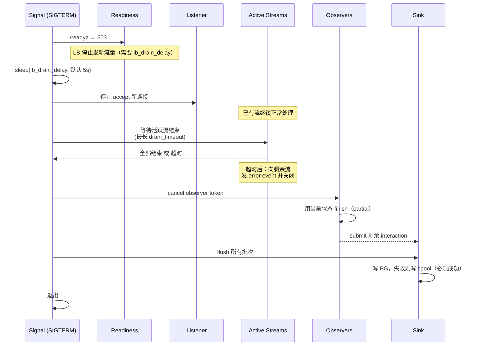

# 12 · 可靠性与资源模型

> 状态：Draft v1 · 最后更新 2026-08-19
> 前置：`05-streaming.md` §8（内存模型）、`10-storage.md` §8（Spool）

---

## 1. Problem

Argus 处于所有 AI 流量的关键路径上。它挂掉 = 所有 AI 功能挂掉。因此它的可靠性要求比它代理的任何一个 provider 都高。

具体威胁：

- **资源耗尽**：大量长连接、大 payload、失控的缓冲。Rust 没有 GC，但也没有自动的内存回收压力信号——OOM 是硬崩溃。
- **级联故障**：一个 provider 挂了 → 重试放大 → 打垮其他 provider / 自己。
- **慢速故障**：不是崩溃，而是变慢。连接池耗尽、队列积压、锁竞争。
- **部署中断**：滚动升级时正在进行的 SSE 流（可能长达 10 分钟）被粗暴切断。
- **单点**：PostgreSQL、master key、单实例。

---

## 2. Goals

- G-Rel1 内存占用在任何输入下都有明确上界。
- G-Rel2 优雅停机不中断已建立的流（在可配置的等待窗口内）。
- G-Rel3 任何单个组件的故障不导致进程级故障。
- G-Rel4 过载时优雅降级（拒绝新请求）而非崩溃。
- G-Rel5 给出可验证的资源模型，而非"Rust 性能好"。

## 3. Non-goals

- 不做多机高可用编排（交给 K8s / 负载均衡器）。
- 不做数据的跨机房复制。
- 不做自动扩缩容。

---

## 4. 资源模型（G-Rel5）

### 4.1 逐项核算

**每条活跃 SSE 流的内存**（observe = Full）：

| 组成 | 大小 | 依据 |
|------|------|------|
| hyper server 连接读缓冲 | 8 KB | `http1::Builder::max_buf_size` 默认 ~8KB |
| hyper server 连接写缓冲 | 8 KB | |
| rustls server 会话 | 8 KB | TLS 记录缓冲（可用 `max_fragment_size` 调小） |
| hyper client 连接（HTTP/2，100 流共享） | 32 KB / 100 = **0.3 KB** | 连接级缓冲摊薄 |
| rustls client 会话（摊薄） | 8 KB / 100 = **0.1 KB** | |
| request body 副本（`Bytes`，典型 8KB 对话） | 8 KB | 全量 buffer，见 `02` §6.2 |
| Tee channel 在途 | ~4 KB | 稳态很低，上限 256 KB |
| SseFramer `BytesMut` | 4 KB | 初始容量，上限 1 MB |
| ProtocolParser 状态 | 1 KB | block 索引表 |
| Accumulator 正文（典型 2k token 回复） | 8 KB | 上限 1 MB |
| Accumulator 结构（BTreeMap + 元数据） | 2 KB | |
| request task future | 1.5 KB | |
| observer task future | 1 KB | |
| **合计（典型）** | **~54 KB** | |

**上限（最坏情况，单流）**：8+8+8+0.3+0.1+8192(8MB body)+256+1024+1+1024+2+1.5+1 ≈ **8 MB 主要来自 body** + ~2.3 MB 缓冲 = **~10.3 MB**

最坏情况由 `max_request_bytes`（8MB）主导。这就是为什么 §5.2 要限制"大 body 请求"的并发数。

### 4.2 并发规模表

| 并发流 | 典型 RSS | p99 RSS | 上游连接数（h2） | 上游连接数（h1） | 推荐规格 |
|-------|---------|---------|----------------|----------------|---------|
| 100 | ~15 MB | ~40 MB | 2 | 100 | 任意 |
| 1,000 | ~90 MB | ~250 MB | 10 | 1,000 | 2C2G |
| 10,000 | ~700 MB | ~1.8 GB | 100 | 10,000 ⚠️ | **4C8G** |
| 50,000 | ~3.2 GB | ~8 GB ⚠️ | 500 | 不可行 | 8C16G + `Lite` |

（RSS 含 Rust 分配器碎片，按 1.3× 系数估算；不含 PG 连接池与 sink 批缓冲，那部分约 50–200 MB 固定开销。）

**50,000 流的必要条件**：
1. 上游必须 HTTP/2（否则端口耗尽）
2. `observe_mode` 降到 `Lite`（省掉 accumulator 正文与 raw）
3. `max_accumulated_bytes` 降到 256 KB
4. `max_request_bytes` 降到 1 MB
5. 文件描述符上限 ≥ 65536

### 4.3 CPU 模型

| 工作 | 单次成本 | 10k 流 @ 20 frame/s |
|------|---------|-------------------|
| TLS 解密（入） | ~0.5 µs/KB | 200k frame/s × 0.5KB × 0.5µs = 0.05 核 |
| TLS 加密（出） | ~0.5 µs/KB | 0.05 核 |
| hyper 帧处理 | ~2 µs/frame | 0.4 核 |
| Tee（clone + try_send） | ~0.1 µs/frame | 0.02 核 |
| SseFramer | ~0.3 µs/frame | 0.06 核 |
| ProtocolParser | ~1.5 µs/frame | 0.3 核 |
| Accumulator | ~0.1 µs/frame | 0.02 核 |
| **合计** | | **~0.9 核** |
| 加上请求级开销（auth/preflight/route，按 10 req/s 新建流） | | +0.1 核 |
| **总计** | | **~1.0 核** |

在 4 核机器上留有 3 核余量。**这是估算，压测时必须验证**（`11-observability.md` §6.4）。

### 4.4 文件描述符

```text
fd 需求 = 客户端连接数 + 上游连接数 + PG 连接数 + spool 文件 + 监听 socket + 余量
       = 10,000 + 100 + 20 + 2 + 3 + 1000
       ≈ 11,125
```

```toml
# 启动时自动尝试提升软限制到硬限制
[limits]
auto_raise_nofile = true
min_nofile = 65536       # 低于此值启动时警告
```

用 `rlimit` crate 在启动时 `setrlimit(RLIMIT_NOFILE)`。若无法达到 `min_nofile`，打印明确的告警与修复指引（`ulimit -n` / systemd `LimitNOFILE=`）。

---

## 5. 准入控制与过载保护

### 5.1 分层限制

```toml
[limits]
max_connections       = 20000    # TCP 连接数硬上限
max_concurrent_requests = 12000  # 正在处理的请求数
max_active_streams    = 10000    # 活跃 SSE 流
max_request_bytes     = "8MiB"
# 大请求的独立配额（防止 100 个 8MB 请求 = 800MB）
max_large_request_concurrency = 32   # body > 1MB 的请求
```

### 5.2 大 body 的隔板

8MB 的请求体上限意味着理论最坏情况是 `并发数 × 8MB`。10,000 × 8MB = 80 GB —— 显然不可行。

解法：**对大请求单独限流**（bulkhead）。

```rust
// 读 body 时，超过阈值就需要获取一个大请求许可
async fn ingest(req: Request, limits: &Limits) -> Result<Bytes> {
    let hint = req.body().size_hint().lower();
    let _permit = if hint > limits.large_threshold {
        // 只有 32 个许可。拿不到就 503（快速失败，不排队）
        Some(limits.large_sem.try_acquire()
            .map_err(|_| ProxyError::Overloaded("too many large requests"))?)
    } else { None };
    read_with_limit(req, limits.max_request_bytes).await
}
```

最坏情况内存 = `32 × 8MB + 10000 × 1MB` = 256MB + 10GB。仍然太多。

因此**分两档**：

```toml
large_threshold = "256KiB"
max_large_request_concurrency = 32     # 256KB–8MB
# 普通请求的隐含上限就是 256KB × 并发数
```

10,000 × 256KB = 2.5 GB —— 仍然是最坏情况。实际的 AI 请求体中位数在 5–50 KB，所以真实占用远低。但**最坏情况必须可计算**，且要在文档中给出：

> 若所有并发请求都是 256KB 的最大普通请求，10k 并发需要额外 2.5 GB。生产配置应根据实际请求体大小分布调整 `max_active_streams` 或 `large_threshold`。

### 5.3 Load shedding

过载时**快速拒绝**而非排队：

```rust
// Tower layer，在最外层
if active_requests.load(Relaxed) > limits.max_concurrent_requests {
    metrics::counter!("argus_load_shed_total").increment(1);
    return Response::builder()
        .status(503)
        .header("retry-after", "1")
        .body(render_error(protocol, "server_overloaded"))?;
}
```

**为什么不排队**：AI 请求本身耗时数秒到数分钟。排队会让客户端等待远超其超时时间，最终两边都白费资源。快速失败让客户端能立刻重试或降级。

### 5.4 内存压力的兜底

Rust 没有 GC 压力信号，但可以主动监控 RSS：

```rust
// 后台 task，每 5 秒
let rss = memory_stats::memory_stats().map(|s| s.physical_mem);
match rss {
    Some(r) if r > limits.memory_high_watermark => {
        // 1. 观测降级到 Off
        observer_load.force_pressure(Pressure::Critical);
        // 2. 拒绝新的大请求
        limits.large_sem.forbid();
        // 3. 收紧准入
        limits.effective_max_streams.store(current_streams * 9 / 10);
        metrics::gauge!("argus_memory_pressure").set(1.0);
    }
    Some(r) if r < limits.memory_low_watermark => { /* 恢复 */ }
    _ => {}
}
```

```toml
[limits.memory]
high_watermark = "70%"    # 相对 cgroup limit 或系统总内存
low_watermark  = "55%"
```

**cgroup 感知**：在容器中读 `/sys/fs/cgroup/memory.max`（v2）或 `memory.limit_in_bytes`（v1），而不是系统总内存。否则在 8G 限制的容器里跑在 64G 机器上会算错。

这不能完全防止 OOM（突发分配可能瞬间超限），但能显著降低概率。

---

## 6. 依赖故障处理

### 6.1 依赖矩阵

| 依赖 | 是否必需 | 不可用时的行为 | 恢复 |
|------|---------|--------------|------|
| **PostgreSQL** | 启动必需，运行不必需 | Data Plane 正常；审计走 Spool；auth 用 stale cache 15min；Control Plane 503 | 自动 |
| **Master Key** | 启动必需 | **无法启动**（拒绝以半可用状态运行） | 人工 |
| **Redis** | 完全可选 | 降级本地限流；配额同步改走 PG | 自动 |
| **Provider** | — | 熔断 + fallback | 自动 |
| **OTLP collector** | 完全可选 | trace 丢弃 | 自动 |
| **本地磁盘（spool）** | 可选 | 写失败则丢审计数据 + 告警 | 人工 |

### 6.2 启动时的依赖检查

```rust
async fn startup(cfg: &Config) -> Result<Runtime> {
    // 硬性：master key
    let master = load_master_key(cfg)?;               // 失败 → 退出
    // 硬性：数据库可达 + 迁移完成
    let pool = connect_with_retry(cfg, Duration::from_secs(60)).await?;
    run_migrations(&pool).await?;                     // 失败 → 退出
    // 硬性：至少加载一次配置快照
    let snapshot = ConfigSnapshot::load(&pool, &master).await?;
    // 软性：Redis
    let redis = try_connect_redis(cfg).await.ok();    // 失败 → 警告，继续
    // 软性：spool 目录可写
    check_spool_writable(cfg).unwrap_or_else(|e| warn!(?e, "spool disabled"));
    // ...
}
```

**启动时严格，运行时宽容**。这是关键的不对称：启动时可以安全地拒绝（还没有流量），运行时拒绝会造成事故。

### 6.3 「Redis 挂了是否继续工作」的直接回答

> **继续。** Redis 只用于跨实例的限流与配额同步。不可用时：
> - Rate limit → 降级为进程内 GCRA（每实例独立预算）
> - 配额同步 → 改走 PostgreSQL（10s 间隔）
> - 会话 taint 共享 → 退化为进程内
> - **不拒绝任何请求**
> 记 `argus_redis_degraded_total` 指标并告警。

---

## 7. 隔离与熔断

### 7.1 Bulkhead 清单

| 资源 | 隔板 | 上限 |
|------|------|------|
| 大请求内存 | Semaphore | 32 |
| Observer task 数 | 计数 + 准入降级 | `max_active_observers` = 12000 |
| AuditSink 队列 | bounded channel | 4096 |
| Tee channel（每流） | bounded channel + byte budget | 64 条 / 256 KB |
| LLM detector 并发 | Semaphore | 4 |
| PG 连接（data） | PgPool | 16 |
| PG 连接（admin） | 独立 PgPool | 4 |
| 每 provider 的上游连接 | 连接池上限 | 可配置，默认 256 |
| spawn_blocking 池 | tokio 配置 | 默认 512（用于压缩等） |

**每个隔板满时的行为都是"快速失败"，不是"排队"。**

### 7.2 可选的 Runtime 隔离

`01-architecture.md` §6.4 提到的 `runtime.split`：

```toml
[runtime]
split = false            # 默认关闭
worker_threads = 0       # 0 = CPU 核数
observer_threads = 2     # split=true 时生效
```

启用后创建第二个 Tokio Runtime 专跑 Observer 与 AuditSink。

**代价与风险**（诚实说明）：
- 跨 runtime 传递 `Bytes` 安全（`Send`），但传递 `sqlx::PgPool` 需要小心（pool 绑定到创建它的 runtime）。因此 AuditSink 的 PG 连接必须在 observer runtime 上创建。
- 两个 runtime 的线程会争抢 CPU，隔离效果不如想象中好（除非用 CPU 亲和性绑定）。
- 增加调试复杂度。

**默认关闭。** 只有在实测确认 observer 的 CPU 干扰显著（主链路 p99 因观测而恶化 > 20%）时才启用。

### 7.3 Panic 隔离

见 `01-architecture.md` §9。要点复述：

1. `panic = "unwind"` 强制（`panic = "abort"` 会杀死上千条连接）。
2. `argus-protocol` 用 clippy lint 禁止 `unwrap`/`panic`/索引越界。
3. Observer 内 `catch_unwind` 包裹 parser step。
4. 主链路用 `CatchPanicLayer`。
5. `argus_observer_panic_total` 必须告警——它意味着代码 bug。

---

## 8. 优雅停机

### 8.1 挑战

AI 的 SSE 流可能持续 10 分钟以上。粗暴停机会：
- 中断用户正在看的回复
- 上游已经计费但客户端没拿到完整结果
- 审计数据丢失

### 8.2 流程



```toml
[shutdown]
lb_drain_delay = "5s"       # readyz 503 到停止 accept 的间隔
drain_timeout  = "300s"     # 等待活跃流结束的最长时间
sink_flush_timeout = "30s"  # 最后的落库时间
force_kill_after = "360s"   # 总超时，超过强制退出
```

**`lb_drain_delay` 是最容易被忽略的一步**：K8s 的 endpoint 更新与 kube-proxy 规则同步有延迟（通常 1–5 秒）。如果 SIGTERM 后立刻停止 accept，这段时间内到达的连接会被 RST。5 秒的延迟让 LB 有时间把这个实例摘掉。

### 8.3 停机时的观测收尾

Observer 收到取消信号时：

```rust
tokio::select! {
    _ = observer.run() => { /* 正常完成 */ }
    _ = shutdown.cancelled() => {
        // 不丢弃！用当前累积的状态收尾
        let interaction = observer.accumulator.finish_partial(Outcome::Cancelled(Shutdown));
        sink.try_submit(Box::new(interaction)).ok();
    }
}
```

**部分数据 > 无数据**。一个记录了"这个请求进行到一半时进程停机了，已消耗 X token"的审计条目，对计费和排障都有价值。

### 8.4 K8s 配置配合

```yaml
spec:
  terminationGracePeriodSeconds: 400   # 必须 > force_kill_after
  containers:
  - name: argus
    lifecycle:
      preStop:
        exec:
          command: ["sleep", "5"]      # 额外的 LB 摘除窗口
    readinessProbe:
      httpGet: { path: /readyz, port: 8080 }
      periodSeconds: 2
      failureThreshold: 1              # 快速摘除
    livenessProbe:
      httpGet: { path: /healthz, port: 8080 }
      periodSeconds: 10
      failureThreshold: 3
```

`terminationGracePeriodSeconds` 必须大于 Argus 的 `force_kill_after`，否则 K8s 会先 SIGKILL。

---

## 9. 级联故障防护

| 机制 | 防什么 | 位置 |
|------|-------|------|
| 熔断器 | 持续打击已故障的 provider | `07` §8 |
| 全局重试预算（10%） | 重试风暴放大流量 | `07` §7.2 |
| 时间预算 `budget=10s` | fallback 链无限拉长 | `07` §7.2 |
| Load shedding | 过载时排队导致全面超时 | §5.3 |
| 快速失败（所有隔板） | 排队积压 | §7.1 |
| 抖动（jitter=0.3） | 重试同步化（惊群） | `07` §7.2 |
| `min_requests=20` 熔断门槛 | 低流量时误熔断 | `07` §8.1 |
| Preflight 硬超时 50ms | 安全模块拖慢一切 | `08` §6.1 |

**最重要的两条**：全局重试预算 + 快速失败。这两个缺一个，provider 大面积故障时 Argus 就会自己压垮自己。

---

## 10. Failure Modes（汇总）

| 故障 | 检测 | 自动处理 | 需人工 |
|------|------|---------|--------|
| 单 provider 挂 | 熔断器 | fallback | 否 |
| 全部 provider 挂 | 无健康候选 | 503 + Retry-After | 是（查 provider） |
| PG 挂 | 连接失败 | Spool + stale auth | 是（修 PG，2h 内） |
| PG 慢 | 池耗尽 | sink degrade | 是 |
| Redis 挂 | 连接失败 | 降级本地 | 否 |
| 磁盘满 | spool 写失败 | 丢审计 + 告警 | **是（紧急）** |
| 内存压力 | RSS watermark | 观测降级 + 收紧准入 | 是 |
| OOM Kill | 进程死 | K8s 重启 | 是（调容量） |
| Observer panic | catch_unwind | 单流降级 | **是（代码 bug）** |
| 主链路 panic | CatchPanicLayer | 单请求 500 | **是（代码 bug）** |
| 配置加载失败 | refresh 失败 | 保留旧快照 | 是 |
| Master key 丢失 | 启动检查 | 拒绝启动 | **是（灾难）** |
| 时钟跳变 | — | 单调时钟不受影响；分区路由用 SystemTime 需注意 | 否 |
| fd 耗尽 | accept 失败 | 拒绝新连接 | 是（调 ulimit） |

---

## 11. SPOF 分析

| 组件 | 是否 SPOF | 缓解 |
|------|----------|------|
| Argus 实例 | 单实例时是 | 多实例 + LB（无状态，天然可水平扩展） |
| PostgreSQL | **部分是** | Data Plane 可用；但配置变更与审计受影响。可用 PG 主从/托管 HA |
| Master Key | **是**（灾难级） | 必须离线备份；`13-deployment.md` §7 强调 |
| Provider | 否 | 多 provider fallback |
| Spool 磁盘 | 否（只影响审计） | |
| Redis | 否 | 可选 |

**最大的 SPOF 是 Master Key**：丢失后所有 credential 无法解密，等于所有 provider 配置作废。必须：
- 离线备份（不与数据库备份放同一处，否则失去加密的意义）
- 支持多 key（`master_key` + `master_key_previous`）以便轮换
- 启动时验证能解密至少一个 credential，否则拒绝启动（早发现）

---

## 12. Trade-offs

| 选择 | 收益 | 代价 |
|------|------|------|
| 快速失败而非排队 | 不放大故障；客户端可及时重试 | 过载时拒绝率高（但排队的结果是全部超时） |
| `drain_timeout = 300s` | 长流不被中断 | 部署时间变长 |
| 停机时提交 partial | 数据不丢 | 停机流程更复杂 |
| RSS watermark 监控 | 降低 OOM 概率 | 不能完全防止；增加一个后台 task |
| `runtime.split` 默认关 | 简单 | 观测的 CPU 干扰未隔离 |
| 大请求 semaphore | 内存上界可算 | 大请求可能被拒（503） |
| 启动严格/运行宽容 | 配置错误早发现 | 启动依赖 PG（首次部署顺序有要求） |
| 进程内熔断 | 无外部依赖 | 多实例发现速度不叠加 |

---

## 13. Alternatives Considered

**A. 用 `jemalloc` / `mimalloc` 替代系统分配器。**
`jemalloc` 在高并发多线程分配下通常更快且碎片更少。**推荐尝试**，但需要实测（`mimalloc` 在某些负载下 RSS 更高）。列为 Phase 2 的优化项，不是 MVP 决定。

**B. 用 `cgroup` 的 memory.high 做软限制，让内核帮我们施压。**
Linux cgroup v2 的 `memory.high` 会在超过时触发回收而不是 OOM Kill。但 Rust 的堆内存不能被"回收"（没有 GC），只会触发 swap。**收益有限**，仍需应用层控制。

**C. 请求排队而非拒绝（有界队列 + 超时）。**
对短请求有意义，对 AI 请求（秒到分钟级）无意义——排队时间会超过客户端超时。**否决**。

**D. 优雅停机时把活跃流"迁移"到其他实例。**
HTTP 流无法迁移（TCP 连接绑定实例）。理论上可以让新实例重新发起上游请求，但会重复计费且丢失已生成内容。**不可行**。

**E. 不做 Spool，PG 挂了就同步阻塞等待。**
会把 PG 故障直接变成 Data Plane 故障。**强烈否决**。

**F. 用 `arc-swap` 之外的方案做配置热更新（如 RwLock）。**
`RwLock` 的读也有原子操作与潜在的写者饥饿。`ArcSwap` 的读是纯 load。**已选 ArcSwap**。

---

## 14. Decision

1. 资源模型逐项核算（§4）：每流典型 ~54 KB，10k 流 ~700 MB 典型 / ~1.8 GB p99，4C8G 可承载。
2. **上游必须优先 HTTP/2**——这是 10k+ 并发的前提（连接数 100× 差异）。
3. 分层准入限制 + 大请求 Semaphore 隔板，使最坏内存可计算。
4. 过载时 **load shedding（快速 503）**，绝不排队。
5. RSS watermark 监控（cgroup 感知）驱动观测降级与准入收紧。
6. 启动时严格检查依赖（master key / PG / 迁移 / 配置），运行时全面宽容。
7. 优雅停机四阶段：`readyz 503` → `lb_drain_delay` → 停止 accept → 等流结束（300s）→ flush sink。**停机时提交 partial interaction。**
8. `panic = "unwind"` 强制；三层 panic 隔离。
9. 全局重试预算 + 时间预算 + 抖动，防级联故障。
10. `runtime.split` 默认关闭，仅在实测确认干扰后启用。
11. Master Key 是最大 SPOF，必须离线备份 + 支持轮换 + 启动时验证。

---

## 15. Open Questions

| # | 问题 | 现状 | 何时决定 |
|---|------|------|---------|
| OQ-1 | 每流 54 KB 的估算是否准确？（rustls 缓冲的真实占用需实测） | 估算 | 首次压测 |
| OQ-2 | 是否切换到 jemalloc？RSS 与延迟的实际影响？ | 系统分配器 | Phase 2 压测对比 |
| OQ-3 | `drain_timeout = 300s` 是否过长？（部署会变慢） | 拍的值 | 有真实部署经验后 |
| OQ-4 | RSS watermark 的 70% 阈值在小内存容器（1G）下是否太晚？ | 拍的值 | 小规格测试 |
| OQ-5 | 是否需要 per-workspace 的资源隔离（防单租户吃满）？ | 未做 | 多租户投诉时 |
| OQ-6 | `runtime.split` 的真实收益有多大？ | 未测 | Phase 2 |
