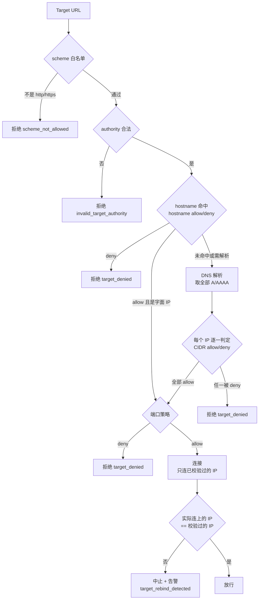

# 13 · Target Policy 与 SSRF 防护

> 状态：Draft v2 · 最后更新 2026-08-20
> 前置：`04-raw-proxy-mode.md`
> 相关：`12-security.md`、`14-auth-and-credentials.md`

---

## 1. Problem

Raw 模式让调用方指定完整的上游 URL。这句话换个说法就是：

> **Argus 是一台可以按调用方指令向任意地址发起请求的服务器。**

这正是 SSRF 的定义。而 Argus 的部署位置让后果特别严重——它通常跑在内网里，
手里还握着一堆供应商凭据。

同时有一个不能牺牲的需求：Argus **必须**能代理本地模型。

```text
http://192.168.1.20:11434   Ollama
http://10.0.0.20:8000       vLLM
http://nas.local:3000       自建服务
```

也就是说，**"私有地址一律拒绝"这个最简单的答案是错的**。

---

## 2. Goals

- G-S1 默认安全：不配置任何东西时，私有网段与元数据地址被拒绝。
- G-S2 显式可放行：管理员可以精确地允许特定网段/主机/端口。
- G-S3 校验发生在**真正要连的那个 IP** 上，而不是主机名上。
- G-S4 DNS rebinding 不可绕过。
- G-S5 拒绝不泄漏内网信息。

## 3. Non-goals

- 不做出站流量的内容审计（那是 `12-security.md`）。
- 不做网络层隔离（那应该由部署环境的防火墙/NetworkPolicy 做，Argus 只是第二道）。
- 不试图枚举"所有危险地址"——用 allow/deny 组合，不用启发式。

---

## 4. 判定链



关键点有两个，都在图的下半部分：

1. **判定的对象是 IP，不是主机名。** 主机名可以指向任何地方。
2. **连接时再确认一次。** 这是防 DNS rebinding 的唯一可靠办法（§6）。

---

## 5. 默认策略

```toml
[target_policy]
schemes = ["https", "http"]

# 默认拒绝的网段。管理员可以在 allow_cidrs 里逐条放行。
deny_cidrs = [
  "127.0.0.0/8", "::1/128",              # loopback
  "10.0.0.0/8", "172.16.0.0/12", "192.168.0.0/16",   # RFC1918
  "fc00::/7",                            # IPv6 ULA
  "169.254.0.0/16", "fe80::/10",         # link-local（含 169.254.169.254）
  "100.64.0.0/10",                       # CGNAT
  "0.0.0.0/8", "::/128",                 # unspecified
  "224.0.0.0/4", "ff00::/8",             # multicast
]

# 显式放行，优先级**高于** deny_cidrs
allow_cidrs = []

# 主机名级别的 allow/deny，在 DNS 解析之前判定
allow_hosts = []
deny_hosts  = []

# 端口
deny_ports = [22, 23, 25, 111, 135, 139, 445, 3306, 5432, 6379, 11211, 27017]

# 是否允许 target 是字面 IP（而非主机名）
allow_literal_ip = true
```

### 5.1 放行本地模型的正确写法

```toml
[target_policy]
allow_cidrs = ["192.168.1.20/32"]     # 精确到单机，不是整个 /16
deny_ports  = [22, 3306, 6379]        # 11434 不在里面
```

文档必须强调：**放行范围要精确到能用为止，不要图省事写 `192.168.0.0/16`。**
放行整个内网等于把 SSRF 防护关掉。

### 5.2 优先级

```text
deny_hosts  >  allow_hosts  >  deny_cidrs 与 allow_cidrs 的最长前缀匹配  >  默认拒绝
```

最长前缀匹配意味着 `allow_cidrs = ["192.168.1.20/32"]` 会赢过
`deny_cidrs = ["192.168.0.0/16"]`，符合直觉。

---

## 6. DNS Rebinding（Q12）

攻击形状：

```text
t=0  attacker.com 解析 → 1.2.3.4（公网，通过校验）
t=1  Argus 发起连接
t=1  attacker.com 再次解析 → 127.0.0.1
```

如果"校验"和"连接"各自做一次 DNS 解析，中间这个窗口就是漏洞。

**解决办法：只解析一次，然后连那个 IP。**

```rust
// 伪代码
let ips = resolve(host).await?;                 // 唯一一次 DNS 解析
let allowed: Vec<IpAddr> = ips.into_iter()
    .filter(|ip| policy.allows(*ip))            // 逐个判定
    .collect();
if allowed.len() != ips_len { return Err(TargetDenied); }   // 有任一不合规就整体拒绝

// 关键：连接时直接给 SocketAddr，不再给 hostname
let stream = connect_to(allowed[0], port).await?;
// TLS 的 SNI 与证书校验仍然用原始 hostname
let tls = connector.connect(ServerName::from(host), stream).await?;
```

三个细节：

1. **"有任一不合规就整体拒绝"**，而不是"挑一个合规的连"。后者会让攻击者
   通过返回 `[1.2.3.4, 127.0.0.1]` 这样的多值 A 记录来碰运气。
2. **连接必须指定 IP**。用 hyper 时要自定义 connector，不能把 hostname
   交给 `TcpStream::connect`（那会重新解析）。
3. **TLS 仍然用 hostname 做 SNI 和证书校验**，否则证书校验会失败——
   这一点常被漏掉，然后被"改成 danger_accept_invalid_certs"这种更糟的方式绕过。

### 6.1 DNS 缓存

自建 resolver 带**短 TTL 上限**的缓存（默认 30s，且不超过记录自身的 TTL）。
缓存的是「hostname → 已判定通过的 IP 集合」，不是原始 DNS 结果。

不缓存的代价是每个请求一次 DNS 往返（对本地模型可以忽略，对公网 provider
会加几毫秒 TTFT）。缓存的风险是攻击者可以让一个曾经合规的名字后来指向内网——
但因为我们连的是缓存里那个**已判定过的 IP**，这个风险不成立。

---

## 7. Redirect（Q13）

**Argus 不跟随 redirect**，见 `04-raw-proxy-mode.md` §8。3xx 连同 `Location`
原样透传给客户端，因此本文档的判定链**只需要跑一次**，不存在"第二跳"。

这是一条实实在在的攻击面削减：跟随一旦启用，就得同时保证「每跳完整重跑
§4 的整条判定链（含 DNS 重解析与连接时确认）」和「跨 origin 剥除全部凭据
header」。后者尤其要命 —— 漏掉它，redirect 就成了一条把凭据送到任意地址的
通道，比 SSRF 本身更严重。不做，就一条都不用守。

若将来重新支持（`04` §16 OQ-W5），上面两条是硬前提。

---

## 8. 错误信息（信息泄漏面）

拒绝类错误**统一**返回：

```json
{ "error": { "type": "target_denied", "message": "target is not allowed by policy" } }
```

**不允许**的做法：

```text
❌ "target 10.0.0.5 is in a denied CIDR"       泄漏解析结果
❌ 私有地址 403 / DNS 失败 502                  用状态码区分 = 存活探测
❌ 拒绝很快、超时很慢                            时间侧信道（OQ-W3）
```

前两条必须做到。第三条第一阶段不处理，作为 Open Question 记录——
处理它需要给拒绝路径加固定延迟，而那会占用连接。

审计里可以记录完整信息（谁、什么 target、被哪条规则拒绝），因为审计的
读取权限是受控的（`14-auth-and-credentials.md` §7）。

---

## 9. Raw + Injected Credential 的硬约束

这个组合是最危险的：

```text
调用方指定任意 target  +  Argus 注入自己保管的供应商凭据
        ↓
调用方可以把你的 OpenAI key 送到自己的服务器上
```

**硬约束**：`allow_raw_proxy = true` 且凭据模式为 `injected` 时，
**必须**同时配置一个非空的 target allowlist（`allow_hosts` 或 `allow_cidrs`）。
配置校验期就要拒绝这个组合，而不是运行期。

默认组合是安全的：Raw 模式默认 `passthrough` 凭据。

---

## 10. Managed 模式也走 Target Policy

虽然 Managed 模式的 target 来自管理员配置，Target Policy **仍然执行**。理由：

- 配置可能写错（把 base_url 写成了 `http://169.254.169.254`）
- Control Plane 可能被攻破，此时 Target Policy 是第二道防线
- 统一路径 = 只有一套逻辑要维护和测试

代价是每个 Managed 请求也要过一次 DNS 判定。用 §6.1 的缓存把它摊薄。

---

## 11. Failure Modes

| 情况 | 行为 |
|---|---|
| DNS 解析失败 | 502 `target_dns_failure`（与 `target_denied` **不同**，因为这不泄漏策略信息） |
| DNS 超时 | 同上，超时默认 2s |
| 解析出的 IP 全部被拒 | 403 `target_denied` |
| 解析出的 IP 部分被拒 | 403 `target_denied`（整体拒绝，§6） |
| 连接时 IP 不匹配 | 中止 + `argus_target_rebind_detected_total` + 告警 |
| 策略配置为空 | **不是 fail-open**：空 allowlist + 默认 deny_cidrs 生效 |
| 策略加载失败 | 启动失败（严格）；运行期热更新失败则保留旧策略 + 告警 |

> 最后两行遵循宪法「启动严格、运行宽松」：配置错在启动时必须炸，
> 运行期不能因为一次坏的热更新把已经在跑的流量搞死。

---

## 12. Security Considerations

- **这不是唯一一道防线。** 生产部署应同时用网络层隔离（K8s NetworkPolicy、
  安全组）限制 Argus 的出站范围。文档必须写明这一点，避免用户以为
  Target Policy 是充分的。
- **元数据地址要特别对待。** `169.254.169.254`（AWS/GCP/Azure）与
  `fd00:ec2::254` 已在默认 deny 里，且**不建议**允许被 allow 覆盖——
  可以考虑做成硬编码的、不可放行的黑名单。（OQ-S2）
- **端口 denylist 不是安全边界**，只是降低误伤。真正的边界是 IP 判定。

---

## 13. Trade-offs

| 选择 | 得到 | 失去 |
|---|---|---|
| 判定 IP 而非主机名 | rebinding 不可绕过 | 每请求一次 DNS（用缓存摊薄） |
| 多 IP 时整体拒绝 | 无碰运气空间 | 某些 CDN 的混合 A 记录会被误伤 |
| 不跟随 redirect | 无绕过面；判定链只跑一次 | 少数上游需要客户端配合 |
| Managed 也走策略 | 一套逻辑、配置错误也能兜住 | 每请求多一次判定 |
| 拒绝不区分原因 | 不成为内网探测器 | 用户排查配置时体感差（靠审计弥补） |

---

## 14. Alternatives Considered

**A. 只做主机名黑白名单**
否决。主机名可以解析到任何 IP，等于没做。

**B. 校验时解析一次，连接时再解析一次**
否决。这正是 rebinding 的窗口。

**C. 完全禁止私有地址**
否决。与"要能代理 NAS 上的本地模型"直接冲突，而那是本产品的一个核心场景。

**D. 交给部署环境的防火墙**
不够。防火墙是必要的补充（见 §12），但 Argus 自己不能没有边界——
它是唯一知道"这个请求是 Raw 模式发来的"的组件。

---

## 15. Decision

1. 判定链：scheme → hostname 规则 → **DNS 解析后逐 IP 判定** → 端口 → 连接时确认。
2. 默认拒绝 loopback / RFC1918 / link-local / ULA / CGNAT / multicast，
   管理员可用 `allow_cidrs` 精确放行（最长前缀匹配优先）。
3. **只解析一次 DNS，连接时直接指定 IP**；TLS 的 SNI 与证书校验仍用 hostname。
4. 多个 IP 中有任一不合规 → 整体拒绝。
5. 不跟随 redirect，3xx 原样透传（`04` §8）。判定链因此只跑一次。
6. 拒绝类错误统一 `target_denied`，不回显 IP、不按原因区分状态码。
7. `allow_raw_proxy` + `injected` 凭据必须配 target allowlist，配置期强制。
8. Managed 模式同样执行 Target Policy。

---

## 16. Open Questions

| # | 问题 | 何时决定 |
|---|------|---------|
| OQ-S1 | DNS 缓存 TTL 上限 30s 是否合适？ | M1 实测 |
| OQ-S2 | 云元数据地址是否做成不可放行的硬黑名单？ | M1，倾向是 |
| OQ-S3 | 拒绝路径的时间侧信道要不要处理？ | 第一阶段不做 |
| OQ-S4 | 是否支持出站走 HTTP proxy？（企业环境常见）那会绕过 IP 判定 | 有需求时，需重新设计判定点 |
