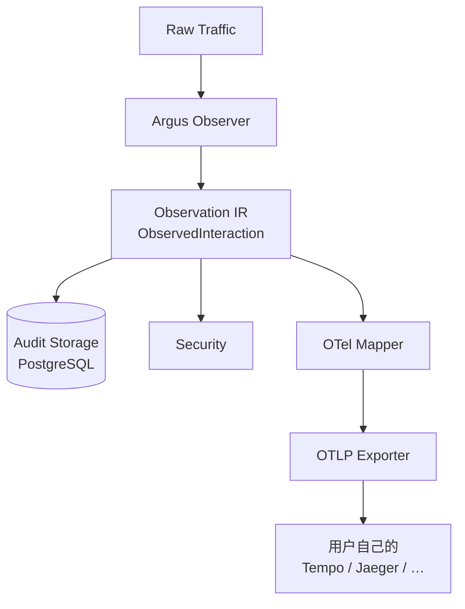

# 16 · OpenTelemetry

> 状态：Draft v2 · 最后更新 2026-08-20
> 指标定义、SLO 与基准方法已移到 `21-performance.md`。
> 注意区分：本文的「可观测性」指 **Argus 自身的运维可观测性**（metrics/log/trace），与 `11-observation-model.md` 的「AI 流量观测」是两回事。

---

## 1. Problem

需要回答三类问题：

1. **Argus 自己健康吗？** —— 延迟、错误率、资源、队列深度。
2. **上游 provider 健康吗？** —— 每个 provider 的成功率、TTFT、限流情况。
3. **观测链路本身健康吗？** —— 丢了多少字节、多少 interaction 被降级、解析出了多少 anomaly。

第 3 类是特有的：因为 Argus 的观测是**允许有损**的，就必须有指标精确表达"损了多少"。没有这个，有损观测会退化成不可信的数据。

同时有一个硬约束：**遥测本身不能拖慢主链路**。日志写入、指标记录都在每请求路径上。

---

## 2. Goals

- G-Ob1 主链路上的遥测开销 < 5 µs/请求。
- G-Ob2 OpenTelemetry 完全可选，未配置时零开销、零依赖。
- G-Ob3 能精确量化观测的完整性损失。
- G-Ob4 能把 proxy-added latency 与上游 latency 分离测量。
- G-Ob5 日志不包含 prompt 内容或凭据。

## 3. Non-goals

- 不内置 Grafana/Prometheus（提供 `/metrics` 端点即可）。
- 不做日志聚合与检索（交给外部）。
- 不做告警规则的内置引擎（提供推荐的 PromQL）。

---

## 4. Observation 与 Observability 是两件事（Q36）

这是本文档的核心区分。混淆它们会导致两个后果：要么把 prompt 塞进 trace
attribute（合规灾难），要么用 trace 去回答"模型到底说了什么"（数据不全）。

| | **Argus Observation** | **OpenTelemetry Observability** |
|---|---|---|
| 回答的问题 | **AI 内容和行为到底发生了什么** | **这次调用链发生了什么** |
| 典型内容 | prompt、响应正文、tool call 与其 arguments、reasoning、安全判定、partial stream | 耗时、TTFT、上游、状态码、token 数、错误、span 关系 |
| 数据量 | 大（KB–MB / 请求） | 小（几十个属性） |
| 保留期 | 按合规要求，通常较短且可脱敏 | 按监控需要，通常较长 |
| 去处 | PostgreSQL（`15-storage.md`） | OTLP → 用户自己的后端 |
| 谁能看 | 需要 `audit:read_content` 这个**单独的** scope | 运维普遍可见 |
| 缺了会怎样 | 无法做安全回溯与审计 | 无法做容量规划与故障定位 |

**Observation IR 不能被 OTLP 取代**，反过来也一样。

### 4.1 映射关系



OTel Mapper 是一个**单向、有损**的投影：它从 IR 里挑出元数据，
**丢掉全部内容**。这个"有损"是设计意图，不是缺陷。

### 4.2 什么绝对不进 trace attribute（Q39）

```text
❌ prompt / system prompt / 任何 message 内容
❌ 响应正文 / reasoning 内容
❌ tool call 的 arguments 与 tool result
❌ 任何凭据、API Key、fingerprint 以外的凭据信息
❌ 用户可控的长字符串（会撑爆后端并可能注入）
```

允许的是它们的**元数据**：

```text
✅ 长度、哈希、条数、token 数
✅ tool 名称（不含 arguments）
✅ finish_reason / stop_reason
✅ 安全规则命中的规则名与动作（不含命中的内容片段）
```

理由很实际：trace 后端的访问控制通常远宽松于审计库，而且很多团队把
trace 转发给第三方 SaaS。把 prompt 放进去等于把用户数据交出去。

> 这条与 `12-security.md` §9 的脱敏规则、`ci/check_log_fields.py` 的字段黑名单
> 是同一套要求在三个地方的体现。

### 4.3 语义约定

优先用 OpenTelemetry 的 **GenAI Semantic Conventions**：
`gen_ai.system`、`gen_ai.request.model`、`gen_ai.usage.input_tokens` 等。

标准表达不了的用 `argus.*` 自定义属性：

| 属性 | 说明 |
|---|---|
| `argus.target.origin` | `managed` / `raw` |
| `argus.profile.name` | Managed 模式的 Profile 名 |
| `argus.observer.kind` | 选出来的 ObserverKind |
| `argus.observation.integrity` | `complete` / `degraded` / `metadata_only` |
| `argus.observation.dropped_bytes` | 旁路丢了多少字节 |
| `argus.security.action` | `allow` / `flag` / `warn` / `block` / `require_review` |
| `argus.security.rules` | 命中的规则名列表（**不含内容**） |
| `argus.proxy.added_ttft_us` | 见 `21-performance.md` §5 |
| `argus.retry.after_send` | S1 重试标记（重复计费核查用） |

注意 `gen_ai.request.model` 填的是**观测到的** model 字段值，
它不参与路由（`02-routing-model.md` §4.2）——这一点要在字段说明里写清楚，
否则看 trace 的人会以为 Argus 按它选路。

---

## 5. 日志

### 7.1 分级与内容

```rust
// 每请求一条结构化 access log（INFO）
tracing::info!(
    request_id = %ctx.trace.request_id,
    trace_id   = %ctx.trace.trace_id,
    workspace  = %ctx.principal.workspace_id,
    protocol   = %ctx.protocol,
    model      = %route.logical_model,
    provider   = %route.provider_id,
    status     = resp.status,
    outcome    = ?outcome,
    stream     = ctx.stream,
    tokens_in  = usage.input,
    tokens_out = usage.output,
    ttft_us    = timings.ttft_us,
    total_us   = timings.total_us,
    overhead_us= timings.proxy_overhead_us,
    attempts   = attempts,
    integrity  = ?integrity,
    "request completed"
);
```

**绝不记录**（G-Ob5）：
- prompt 内容、响应内容、tool arguments
- API Key（完整或部分）
- provider credential
- 任何 `security_events` 的 `redacted_sample`

这些只进审计数据库（有访问控制），不进日志（日志通常聚合到低权限系统）。

CI 检查：grep 日志宏调用中是否出现 `body` / `content` / `secret` / `key` 等字段名（白名单例外）。

### 7.2 非阻塞写入

```rust
let (writer, _guard) = tracing_appender::non_blocking(std::io::stdout());
tracing_subscriber::fmt().json().with_writer(writer).init();
```

`non_blocking` 把日志写入放到独立线程 + 有界队列。**队列满时丢弃日志**（而不是阻塞请求）。这是 G-Ob1 的保证之一。

丢弃量由 `tracing_appender` 报告，应该导出为指标。

### 7.3 采样

高 QPS 下每请求一条 INFO 日志可能是主要的 IO 开销。

```toml
[logging]
access_log = "sampled"     # all | sampled | errors_only | off
sample_rate = 0.05         # 5%
# 但这些永远记录：
always_log_errors = true
always_log_security = true
always_log_degraded = true
```

**错误与安全事件永不采样**——它们的信息价值远高于成功请求。

---

## 6. 分布式追踪（OpenTelemetry，可选）

### 8.1 可选性的实现（G-Ob2）

```toml
[telemetry.otlp]
enabled = false            # 默认关闭
endpoint = "http://localhost:4317"
sample_rate = 0.01
```

**未启用时零开销**：不是"启用了但采样率 0"，而是 subscriber 层根本不注册 OTel layer。`tracing` 的 layer 在编译期是泛型组合，未注册的 layer 不产生任何运行时分支。

**依赖也是可选的**：

```toml
# argus-server/Cargo.toml
[features]
default = []
otel = ["dep:opentelemetry", "dep:opentelemetry-otlp", "dep:tracing-opentelemetry"]
```

不启用 feature 时，`opentelemetry` 相关的 crate 完全不编译进二进制（减小体积，减少依赖面）。

### 8.2 Span 结构

```text
argus.request                          (root, 或继承 client 的 traceparent)
├── argus.auth
├── argus.preflight
│   └── argus.security.rule_eval
├── argus.route
├── argus.upstream                     (每次 attempt 一个)
│   ├── argus.upstream.connect         (仅冷连接)
│   └── argus.upstream.headers
└── argus.relay
    └── (observer 的 span 是独立 trace，通过 link 关联)
```

**Observer 的 span 不是主链路 span 的 child**，因为它的生命周期可能超出主链路。用 span link 关联：

```rust
let observer_span = tracing::info_span!("argus.observe");
observer_span.follows_from(request_span.id());
```

### 8.3 traceparent 传播

- 入站：接受客户端的 `traceparent` header，作为 `trace_id`。
- 出站：**默认不向 provider 传播** `traceparent`（provider 不需要，且可能泄漏内部拓扑）。可配置开启。

---

## 7. 健康检查端点

| 端点 | 语义 | 用途 |
|------|------|------|
| `/healthz` | 进程存活。**永远返回 200**（除非进程死了） | K8s liveness |
| `/readyz` | 能否处理流量 | K8s readiness |
| `/metrics` | Prometheus | |

`/readyz` 的判定：

```rust
fn ready(&self) -> Ready {
    // 必须：有可用的配置快照
    if self.config.load().version == 0 { return NotReady("config not loaded"); }
    // 必须：不在停机中
    if self.shutdown.is_cancelled() { return NotReady("shutting down"); }
    // 必须：至少有一个健康的 provider
    if self.healthy_provider_count() == 0 { return NotReady("no healthy provider"); }
    // 不要求：PostgreSQL 可用！
    Ready
}
```

**`/readyz` 刻意不检查 PostgreSQL**。如果检查了，PG 故障会导致所有实例被摘除，Data Plane 完全不可用——而 Data Plane 明明还能正常工作（`15-storage.md` §8.5）。这是一个常见且严重的错误。

PG 状态通过 `/admin/diagnostics` 与指标暴露，用于告警，不用于流量摘除。

---

## 8. Failure Modes

| 场景 | 行为 |
|------|------|
| 日志队列满 | 丢弃日志，记录丢弃计数，**不阻塞请求** |
| `/metrics` 抓取超时（指标过多） | 限制标签基数；提供 `[metrics] per_workspace=false` |
| OTLP endpoint 不可达 | OTel 的 batch exporter 内部丢弃，不阻塞 |
| 标签基数爆炸（如 model 名被用户随意指定） | 只对**已知 logical model** 打标签，未知的归到 `model="_unknown"` |
| `quanta::Clock` 在某些虚拟化环境不可用 | 自动回退到 `Instant::now()` |
| `/readyz` 被误配置为检查 PG | 文档明确警告；提供 `/readyz?strict=true` 给确实需要的场景 |

---

## 9. Trade-offs

| 选择 | 收益 | 代价 |
|------|------|------|
| `/readyz` 不查 PG | PG 故障不导致全站摘除 | 需要单独的 PG 告警 |
| 日志采样 | 高 QPS 下 IO 可控 | 成功请求的日志不完整（但审计库有全量） |
| OTel 作为 feature | 零开销、二进制小 | 想用 OTel 要重新编译或用带 feature 的发行版 |
| 不带 workspace 标签 | 指标基数可控 | 租户维度分析要查审计库（慢） |
| 预 intern 的 `&'static str` 标签 | 零分配 | 配置重载会累积泄漏（见 OQ-3） |
| 对照法测 overhead | 数字可信 | 需要维护 Mock Provider 与压测环境 |

---

## 10. Alternatives Considered

**A. 用 OpenTelemetry metrics 替代 `metrics` crate。**
OTel metrics 的 Rust 实现较重（每次记录有更多间接层），且会让 OTel 成为必需依赖。**否决**——用 `metrics` + Prometheus exporter，OTel 只做 trace。

**B. 每请求都记 INFO 日志（不采样）。**
1000 QPS × 500 字节 = 500 KB/s 的日志，一天 43 GB。**否决为默认**，提供采样。

**C. 把 access log 写进 PostgreSQL 而不是 stdout。**
审计库已经有更完整的记录了。重复写是浪费。**否决**。

**D. `/readyz` 检查 PostgreSQL（"没有数据库就不算就绪"）。**
这是最危险的反模式：PG 抖动 → 所有 pod NotReady → LB 摘除全部 → 完全不可用，而实际上 Argus 还能转发。**强烈否决**。

**E. 直接用 `Instant::now()`，不引入 quanta。**
`Instant::now()` 在 Linux 上是 vDSO 调用，约 20–25 ns。8 次采样 = 200 ns/请求。相对 1ms 的 overhead 预算是 0.02%，其实可以接受。**quanta 是可选优化**，不是必须。降级为 OQ。

---

## 11. Decision

1. 指标用 `metrics` crate + Prometheus exporter；标签值必须是 `&'static str`，热路径零分配。
2. **观测链路健康指标（§4.3）是一等公民**，尤其是 `tee_dropped_bytes`、`interaction_integrity`、`unknown_event`。
3. `proxy_overhead` 分解为 `pre_upstream` + `header_relay`，上游等待单独计量；SLO 验收用**对照法**。
4. 性能 SLO 全部标注为「目标，未验证」，实测后回填并区分标注。
5. 日志绝不含内容/凭据（CI 检查）；非阻塞写入；成功请求可采样，错误与安全事件永不采样。
6. OpenTelemetry 是 **Cargo feature + 配置双重可选**，未启用时不编译进二进制。
7. **`/readyz` 不检查 PostgreSQL**，只检查配置快照、停机状态、健康 provider 数。
8. Observer 的 span 通过 `follows_from` link 关联，不作为主链路 span 的 child。

---

## 12. Open Questions

| # | 问题 | 现状 | 何时决定 |
|---|------|------|---------|
| OQ-1 | Preflight 是 overhead 主要来源的推断是否正确？ | 未验证 | 首次压测 |
| OQ-2 | SLO 中的 p99 ≤ 10ms 是否过于乐观？（GC 无，但有调度抖动） | 目标值 | 首次压测后修订 |
| OQ-3 | `Box::leak` 的标签在频繁配置重载下会累积泄漏，需要改用 `string_cache` 或 arena？ | 已知问题 | 实现时直接用 interning crate |
| OQ-4 | 是否值得引入 `quanta`？（vs `Instant::now()` 的 25ns） | 倾向不引入 | profile 后决定 |
| OQ-5 | 观测链路是否需要自己的 `/metrics` 子集以便独立监控？ | 未做 | 指标数量过多时 |
