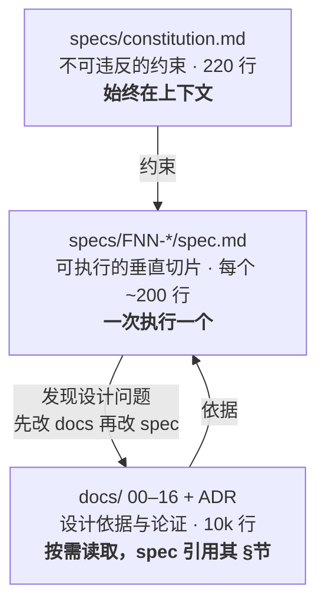
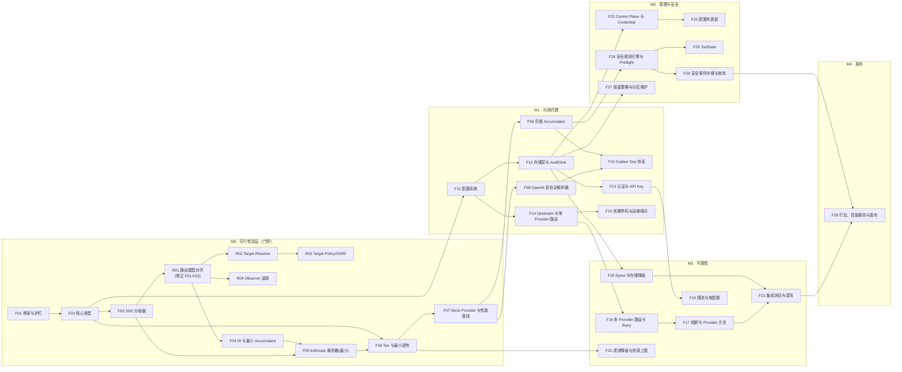

# Argus Specs · 索引与执行顺序

> 状态：v1 · 2026-08-19

---

> **关于 `R` 前缀**：`R01–R04` 是 2026-08-20 路由模型重设计引入的。
> R01 修正 F01–F03 已落地的部分，R02–R04 是 v2 新增的能力。
> **执行顺序：F01 → F02 → F03 → R01 → R02 → R04 → F04 → …**，
> R03 属于 M2。给它们单独的前缀而不是给 F04–F28 重新编号，
> 是因为重编号会打断 30 个 spec 的依赖字段与交叉引用，代价远大于收益。

## 1. 三层文档的关系

| 层 | 何时读 | 改动成本 |
|---|---|---|
| `constitution.md` | 每次执行都读 | 高（需要重新审视全局） |
| `docs/` | spec 指向哪节就读哪节 | 中（要同步受影响的 spec） |
| `specs/FNN/spec.md` | 执行该切片时读 | 低（切片内自洽） |

**纪律（宪法 C31）**：spec 不复制 docs 的设计内容，只引用。发现设计要改 → 先改 docs 再改 spec。

---

## 2. 为什么按垂直切片而非按关注点

`docs/` 按关注点组织（streaming / storage / security），但**实现是竖着走的**。
例如 F05「Anthropic 流式解析」会同时用到 `04`（协议格式）、`05`（分帧）、`06`（IR 映射）、`15`（golden test）。

每个 spec 是一次**可交付、可验收、可独立 review** 的实现单元：
- 有明确的输入（依赖的 spec 已完成）
- 有可执行的验收命令
- 完成后系统处于可编译、可测试的状态

---

## 3. 依赖图

---

## 4. Spec 清单

| ID | 名称 | 里程碑 | 主 crate | 依赖 | 主要设计依据 |
|----|------|--------|---------|------|-------------|
| [F01](F01-workspace-skeleton/spec.md) | 骨架与架构护栏 | M0 | — | — | `14` §5,§7,§9 |
| [R01](R01-routing-realign/spec.md) | **路由模型对齐**（修正 F01–F03） | M0 | F01–F03 | core/protocol/proxy | `02`、ADR-003/004/005/010 |
| [R02](R02-target-resolver/spec.md) | Target Resolver（URL → ResolvedTarget） | M0 | R01 | proxy::ingress | `03` §4–7、`04` §4–5 |
| [R03](R03-target-policy/spec.md) | Target Policy 与 SSRF 防护 | M2 | R02 | proxy::target | `13` 全篇、ADR-013 |
| [R04](R04-observer-resolution/spec.md) | Observer 选择 | M1 | R01,R02 | proxy/protocol | `09` §4、ADR-010 |
| [F02](F02-core-types/spec.md) | 核心类型与错误 | M0 | core | F01 | `02` §10, `04` §4 |
| [F03](F03-sse-framer/spec.md) | SSE 分帧器 | M0 | protocol | F02 | `05` §5–6 |
| [F04](F04-observation-ir/spec.md) | Observation IR 与最小 Accumulator | M0 | protocol | F02 | `06` §4,§7 |
| [F05](F05-anthropic-parser/spec.md) | Anthropic 解析器（最小） | M0 | protocol | F03,F04 | `04` §5.3, `06` §5.3 |
| [F06](F06-tee-passthrough/spec.md) | Tee 与最小透传服务 | M0 | proxy | F02,F05 | `02` §5, `05` §4 |
| [F07](F07-mock-provider-bench/spec.md) | Mock Provider 与性能基线 | M0 | tests | F06 | `11` §5–6, `15` §7 |
| [F08](F08-openai-parsers/spec.md) | OpenAI Chat / Responses 解析器 | M1 | protocol | F07 | `04` §5.1–5.2, `06` §5.1–5.2 |
| [F09](F09-accumulator-full/spec.md) | 完整 Accumulator 与非流式合成 | M1 | protocol | F08 | `06` §7, `04` §8 |
| [F10](F10-golden-tests/spec.md) | Golden Test 体系 | M1 | tests | F09 | `15` §5–6 |
| [F11](F11-config-system/spec.md) | 配置系统与 profile | M1 | core/server | F02 | `13` §5 |
| [F12](F12-storage-sink/spec.md) | 存储 Schema 与 AuditSink | M1 | storage | F11 | `10` §4–7 |
| [F13](F13-auth-apikey/spec.md) | 认证、API Key 与授权 | M1 | proxy/storage | F12 | `09` §5–7 |
| [F14](F14-upstream-routing/spec.md) | Upstream 与单 Provider 路由 | M1 | proxy | F11 | `02` §6–7, `07` §4–5 |
| [F15](F15-shutdown-ops/spec.md) | 优雅停机与运维端点 | M1 | server | F14 | `12` §8, `11` §4,§9 |
| [F16](F16-multi-provider-retry/spec.md) | 多 Provider 路由与 Retry 状态机 | M2 | proxy | F14 | `07` §5–7, `02` §7 |
| [F17](F17-circuit-dialect/spec.md) | 熔断、限流退避与 Provider 方言 | M2 | proxy | F16 | `07` §8, `04` §6.4 |
| [F18](F18-spool/spec.md) | Spool 与存储降级 | M2 | storage | F12 | `10` §7.3,§8 |
| [F19](F19-ratelimit-quota/spec.md) | 限流与软配额 | M2 | proxy | F13 | `09` §8 |
| [F20](F20-observe-degradation/spec.md) | 观测降级与资源上限 | M2 | proxy | F06 | `05` §6, `12` §4–5 |
| [F21](F21-integration-chaos/spec.md) | 集成测试与混沌验证 | M2 | tests | F17,F18 | `15` §10 |
| [F22](F22-control-plane/spec.md) | Control Plane API 与 Credential 加密 | M3 | server/storage | F12 | `03` §5–7 |
| [F23](F23-config-hot-reload/spec.md) | ConfigSnapshot 与热更新 | M3 | core/server | F22 | `01` §7, `03` §5 |
| [F24](F24-security-engine/spec.md) | 安全规则引擎与 PreflightGuard | M3 | proxy | F09 | `08` §5–7 |
| [F25](F25-tool-gate/spec.md) | ToolGate | M3 | proxy | F24 | `08` §6.2 |
| [F26](F26-security-events/spec.md) | 安全事件存储与审计查询 | M3 | storage/server | F24 | `08` §9, `03` §5.3 |
| [F27](F27-retention-partition/spec.md) | 分区维护与分级保留 | M3 | storage | F12 | `10` §9 |
| [F28](F28-release/spec.md) | 打包、性能报告与发布 | M4 | — | F21,F26 | `13` §4,§8, `11` §6 |

---

## 5. 关键门禁

| 门禁 | 位置 | 不通过时 |
|------|------|---------|
| **G-M0 架构可行性** | F07 结束 | **停止**，不得进入 M1。重新审视 `ADR-009` |
| G-M1 SDK 兼容 | F15 结束 | 修复后才进 M2 |
| G-M2 混沌通过 | F21 结束 | 修复后才进 M3 |
| G-M4 性能回填 | F28 | 实测数据必须写回 `docs/21` §6 |

**G-M0 的判定标准**（`F07` §7）：
- `proxy_added_ttft` p50 < 2 ms、p99 < 15 ms
- 10k 并发流 RSS < 1.5 GB
- 观测开 vs 关的 CPU 差 < 30%
- 逐字节切分与整块切分结果一致

---

## 6. Spec 文件格式

每个 `FNN-*/spec.md` 固定包含：

| 节 | 内容 |
|---|---|
| 元信息表 | ID / 里程碑 / 依赖 / crate / 设计依据 / 相关宪法条款 |
| 1. 目标 | 一句话 |
| 2. 范围 | In scope / Out of scope（Out 必须指向接手的 spec） |
| 3. 需求 | EARS 记法，编号 `R<n>`，可追溯 |
| 4. 接口契约 | Rust 签名 / SQL DDL / HTTP 契约，供并行开发对齐 |
| 5. 实现要点 | **只写本切片新增的决定**，其余引用 docs |
| 6. 任务 | 可勾选，每条 ≤ 半天，标注产出文件 |
| 7. 验收 | 可执行命令 + 断言，含宪法条款检查 |
| 8. 交给后续 | 明确列出本切片故意不做的事及承接方 |

**EARS 记法**：
- `WHEN <触发> THE SYSTEM SHALL <行为>` —— 事件驱动
- `WHILE <状态> THE SYSTEM SHALL <行为>` —— 状态驱动
- `IF <异常> THEN THE SYSTEM SHALL <行为>` —— 异常处理
- `WHERE <可选特性启用> THE SYSTEM SHALL <行为>` —— 可选特性
- `THE SYSTEM SHALL <行为>` —— 恒定要求
